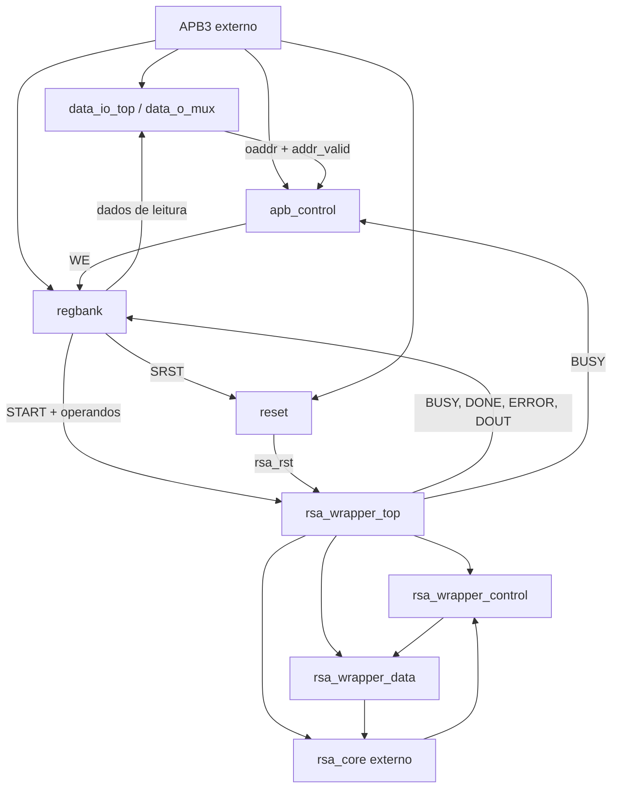

# RSA_APB — Índice de documentação dos módulos

**Linguagem:** SystemVerilog · **Protocolo:** AMBA 3 APB (APB3) · **Dados:** 32 bits  
**Estágio:** concepção RTL inicial; integração e verificação funcional ainda pendentes.

Este pacote foi elaborado a partir dos arquivos `.sv` fornecidos nesta conversa e segue o modelo de profundidade e organização de `README_rsa_wrapper.md`. Os arquivos RTL **não foram alterados**.

# Árvore de projeto:

Estrutura inicial de 
├───docs
├───images
├───scripts
├───src
├───testbenchs
└───waveforms

# Link editável do diagrama de topo da arquitetura:

https://app.diagrams.net/#G1pJmIWxV6VePdHCURcpEqT6SSo5kHxkri#%7B%22pageId%22%3A%22MEHrRE8WjDQsoYR0GH0S%22%7D

## 1. Organização

Cada pasta contém um `README.md` específico do módulo. Os arquivos recebem nomes idênticos aos dos módulos para facilitar sua movimentação ao repositório:

| Pasta / README | Módulo documentado | Principal responsabilidade |
|---|---|---|
| [`amba_3_apb_control/README.md`](amba_3_apb_control/README.md) | `amba_3_apb_control` | Decodificação APB, WE, `PSLVERR`, `PREADY`, IRQ. |
| [`amba_3_apb_data_io_top/README.md`](amba_3_apb_data_io_top/README.md) | `amba_3_apb_data_io_top` | Endereço reduzido, validação e seleção de leitura. |
| [`amba_3_apb_data_o_mux/README.md`](amba_3_apb_data_o_mux/README.md) | `amba_3_apb_data_o_mux` | Multiplexador combinacional de PRDATA. |
| [`amba_3_apb_regbank/README.md`](amba_3_apb_regbank/README.md) | `amba_3_apb_regbank` | Registradores, W1C, START/SRST e RESULT. |
| [`amba_3_apb_reset/README.md`](amba_3_apb_reset/README.md) | `amba_3_apb_reset` | Reset global com liberação sincronizada e SRST. |
| [`amba_3_apb_rsa_wrapper_control/README.md`](amba_3_apb_rsa_wrapper_control/README.md) | `amba_3_apb_rsa_wrapper_control` | FSM One-Hot e contador GAP. |
| [`amba_3_apb_rsa_wrapper_data/README.md`](amba_3_apb_rsa_wrapper_data/README.md) | `amba_3_apb_rsa_wrapper_data` | MUX de operandos, CORE_LOAD e BUSY. |
| [`amba_3_apb_rsa_wrapper_top/README.md`](amba_3_apb_rsa_wrapper_top/README.md) | `amba_3_apb_rsa_wrapper_top` | Instância do core e integração control/data. |
| [`rsa_apb_top/README.md`](rsa_apb_top/README.md) | `rsa_apb_top` (arquivo `amba_3_apb_top.sv`) | Topo geral APB, ainda incompleto. |
| [`README_rsa_wrapper.md`](README_rsa_wrapper.md) | Wrapper completo | README anterior, preservado como referência detalhada. |

## 2. Blocos existentes e arquitetura desejada

O diagrama mostra a **arquitetura-alvo**; `rsa_apb_top.sv` ainda não instancia todos esses blocos.

## 3. Decisões de projeto documentadas

- Escritura de registradores: um `PWDATA` compartilhado e write enables `we_*`; sem demux no caminho ativo.
- Leitura: sete fontes legíveis e CTRL lido como zero; `data_io_top` mascara endereços inválidos com zero.
- Reset: bloco dedicado, dois estágios por padrão, liberação sincronizada e `rsa_rst_o` que também incorpora SRST.
- Wrapper: `top` centraliza parâmetros e instanciações; `control` implementa sete estados One-Hot e GAP; `data` gera `core_din`, `core_load` e BUSY.
- RESULT e flags sticky permanecem no regbank, não no wrapper.
- Comentários e sinais internos alinhados à coluna 1; `logic`, `D_WID`, `'0` e `begin/end` explícitos conforme a convenção do projeto.

## 4. Pendências de maior prioridade encontradas nos arquivos

| Prioridade | Arquivo | Pendência |
|---|---|---|
| Bloqueante | `amba_3_apb_rsa_wrapper_control(1).sv` | O texto `begin (provisional implementation)` em WAIT_DONE é sintaticamente inválido. |
| Bloqueante | `amba_3_apb_top.sv` | A instância de `data_io_top` utiliza portas antigas que já não existem. |
| Alta | `amba_3_apb_top.sv` | `ADDR_WIDTH = 11` vs 12 na especificação e `data_io_top`. |
| Alta | `amba_3_apb_top.sv` | Ainda não instancia controle, regbank, reset e wrapper; saídas APB sem conexões funcionais. |
| Integração | `amba_3_apb_reset(1).sv` / wrapper | Decidir a política de aceitação de START durante a liberação sincronizada do reset. |
| Integração | `amba_3_apb_rsa_wrapper_top(1).sv` | A entrada `presetnsync_i` permanece sem uso. |
| Integração | `amba_3_apb_control(1).sv` | Sem clock/reset na interface; qualificação de WE durante reset requer análise sistêmica. |

As pendências são descritas **como observações do RTL atual**, sem alterar ou corrigir os arquivos originais nesta entrega.

## 5. Como utilizar os READMEs

Para consultar um componente isolado, abra seu `README.md` na pasta correspondente. Para compreender a integração geral do wrapper, use `README_rsa_wrapper.md` e os READMEs de control/data. Para iniciar a integração do projeto, use a documentação de `rsa_apb_top` e resolva as pendências marcadas.

**Não foram executados testes, compilação, lint ou síntese nesta tarefa.** As descrições refletem a inspeção do texto-fonte e as decisões documentadas no projeto.
