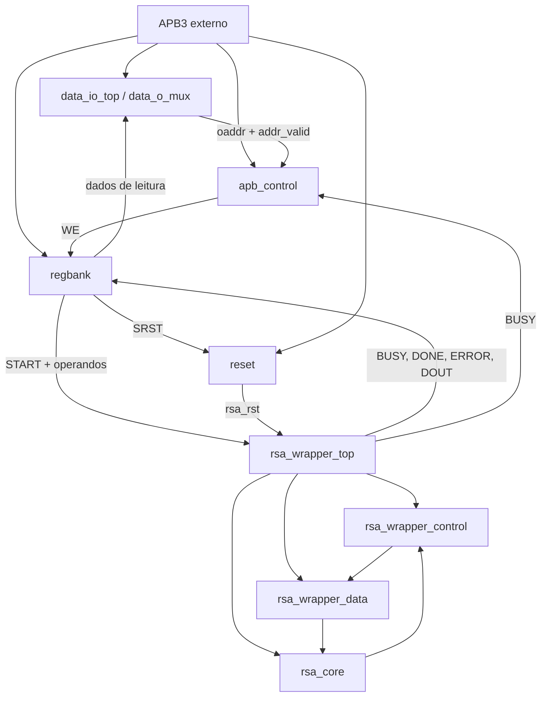

# RSA_APB

Periférico RSA com interface AMBA 3 APB (APB3), descrito em SystemVerilog.
O projeto contém RTL do periférico, um núcleo RSA, testbenches estruturais e
scripts auxiliares de síntese, LEC e simulação.

## Diagrama de topo da arquitetura

**[Abrir o diagrama interativo conectado ao Drive](https://mattgrossi12.github.io/RSA_APB_32-bit/#arquitetura)**

O visualizador da página consulta o XML original do Google Drive, com
atualização automática a cada minuto enquanto a aba está visível. As edições
salvas no diagrams.net aparecem sem exportar imagens ou reconstruir o site.

[Editar no diagrams.net](https://app.diagrams.net/#G1pJmIWxV6VePdHCURcpEqT6SSo5kHxkri#%7B%22pageId%22%3A%22MEHrRE8WjDQsoYR0GH0S%22%7D)
· [Arquivo original no Drive](https://drive.google.com/file/d/1pJmIWxV6VePdHCURcpEqT6SSo5kHxkri/view)


```drawio
<mxfile>
  <diagram id="46pf-PaCrOoO9aHZ-ShB" name="RSA_APB_DIAGRAM">
    <mxGraphModel dx="3759" dy="2081" grid="1" gridSize="10" guides="1" tooltips="0" connect="1" arrows="1" fold="1" page="1" pageScale="1" pageWidth="850" pageHeight="1100" math="0" shadow="0">
      <root>
        <mxCell id="0" />
        <mxCell id="1" parent="0" />
        <mxCell id="zPIV-1LiO8nZpduFTinF-263" connectable="0" parent="1" style="group;fillColor=#ffcd28;strokeColor=#d79b00;container=0;gradientColor=#ffa500;" value="" vertex="1">
          <mxGeometry height="285.83" width="680" x="1470" y="-735.83" as="geometry" />
        </mxCell>
        <mxCell id="zPIV-1LiO8nZpduFTinF-264" edge="1" parent="1" style="endArrow=classic;html=1;rounded=0;fontSize=22;startSize=8;endSize=8;curved=1;" value="">
          <mxGeometry height="50" relative="1" width="50" as="geometry">
            <mxPoint x="2005" y="-519.9999999999999" as="sourcePoint" />
            <mxPoint x="2245" y="-519.9999999999999" as="targetPoint" />
          </mxGeometry>
        </mxCell>
        <mxCell id="zPIV-1LiO8nZpduFTinF-265" edge="1" parent="1" style="endArrow=classic;html=1;rounded=0;fontSize=22;startSize=8;endSize=8;curved=1;" value="">
          <mxGeometry height="50" relative="1" width="50" as="geometry">
            <mxPoint x="2005" y="-551.67" as="sourcePoint" />
            <mxPoint x="2245" y="-551.67" as="targetPoint" />
          </mxGeometry>
        </mxCell>
        <mxCell id="zPIV-1LiO8nZpduFTinF-266" edge="1" parent="1" style="endArrow=classic;html=1;rounded=0;fontSize=22;startSize=8;endSize=8;curved=1;" value="">
          <mxGeometry height="50" relative="1" width="50" as="geometry">
            <mxPoint x="2005" y="-583.67" as="sourcePoint" />
            <mxPoint x="2245" y="-583.67" as="targetPoint" />
          </mxGeometry>
        </mxCell>
        <mxCell id="zPIV-1LiO8nZpduFTinF-267" edge="1" parent="1" style="endArrow=classic;html=1;rounded=0;fontSize=22;startSize=8;endSize=8;curved=1;" value="">
          <mxGeometry height="50" relative="1" width="50" as="geometry">
            <mxPoint x="2005" y="-615" as="sourcePoint" />
            <mxPoint x="2245" y="-615" as="targetPoint" />
          </mxGeometry>
        </mxCell>
        <mxCell id="zPIV-1LiO8nZpduFTinF-268" edge="1" parent="1" style="endArrow=classic;html=1;rounded=0;fontSize=22;startSize=8;endSize=8;curved=1;" value="">
          <mxGeometry height="50" relative="1" width="50" as="geometry">
            <mxPoint x="2005" y="-646.67" as="sourcePoint" />
            <mxPoint x="2245" y="-646.67" as="targetPoint" />
          </mxGeometry>
        </mxCell>
        <mxCell id="zPIV-1LiO8nZpduFTinF-269" edge="1" parent="1" style="endArrow=classic;html=1;rounded=0;fontSize=22;startSize=8;endSize=8;curved=1;" value="">
          <mxGeometry height="50" relative="1" width="50" as="geometry">
            <mxPoint x="2005" y="-679.3299999999999" as="sourcePoint" />
            <mxPoint x="2245" y="-679.3299999999999" as="targetPoint" />
          </mxGeometry>
        </mxCell>
        <mxCell id="zPIV-1LiO8nZpduFTinF-270" edge="1" parent="1" style="endArrow=classic;html=1;rounded=0;fontSize=22;startSize=8;endSize=8;curved=1;" value="">
          <mxGeometry height="50" relative="1" width="50" as="geometry">
            <mxPoint x="2005" y="-488.3299999999999" as="sourcePoint" />
            <mxPoint x="2245" y="-488.3299999999999" as="targetPoint" />
          </mxGeometry>
        </mxCell>
        <mxCell id="zPIV-1LiO8nZpduFTinF-271" edge="1" parent="1" style="endArrow=classic;html=1;rounded=0;fontSize=22;startSize=8;endSize=8;curved=1;" value="">
          <mxGeometry height="50" relative="1" width="50" as="geometry">
            <mxPoint x="2005" y="-710" as="sourcePoint" />
            <mxPoint x="2245" y="-710" as="targetPoint" />
          </mxGeometry>
        </mxCell>
        <mxCell id="zPIV-1LiO8nZpduFTinF-272" parent="1" style="text;html=1;whiteSpace=wrap;strokeColor=none;fillColor=none;align=left;verticalAlign=middle;rounded=0;fontSize=22;" value="we_ier" vertex="1">
          <mxGeometry height="30" width="220" x="970" y="-628.22" as="geometry" />
        </mxCell>
        <mxCell id="zPIV-1LiO8nZpduFTinF-273" parent="1" style="text;html=1;whiteSpace=wrap;strokeColor=none;fillColor=none;align=left;verticalAlign=middle;rounded=0;fontSize=22;" value="we_msg" vertex="1">
          <mxGeometry height="30" width="220" x="970" y="-588.22" as="geometry" />
        </mxCell>
        <mxCell id="zPIV-1LiO8nZpduFTinF-274" parent="1" style="text;html=1;whiteSpace=wrap;strokeColor=none;fillColor=none;align=left;verticalAlign=middle;rounded=0;fontSize=22;" value="we_exp" vertex="1">
          <mxGeometry height="30" width="220" x="970" y="-551.14" as="geometry" />
        </mxCell>
        <mxCell id="zPIV-1LiO8nZpduFTinF-275" parent="1" style="text;html=1;whiteSpace=wrap;strokeColor=none;fillColor=none;align=left;verticalAlign=middle;rounded=0;fontSize=22;" value="we_mod" vertex="1">
          <mxGeometry height="30" width="220" x="970" y="-508.22" as="geometry" />
        </mxCell>
        <mxCell id="zPIV-1LiO8nZpduFTinF-276" edge="1" parent="1" style="endArrow=classic;html=1;rounded=0;fontSize=22;startSize=8;endSize=8;curved=1;" value="">
          <mxGeometry height="50" relative="1" width="50" as="geometry">
            <mxPoint x="800" y="-593.87" as="sourcePoint" />
            <mxPoint x="1200" y="-594.42" as="targetPoint" />
          </mxGeometry>
        </mxCell>
        <mxCell id="zPIV-1LiO8nZpduFTinF-277" edge="1" parent="1" style="endArrow=classic;html=1;rounded=0;fontSize=22;startSize=8;endSize=8;curved=1;" value="">
          <mxGeometry height="50" relative="1" width="50" as="geometry">
            <mxPoint x="800" y="-553.87" as="sourcePoint" />
            <mxPoint x="1200" y="-554.42" as="targetPoint" />
          </mxGeometry>
        </mxCell>
        <mxCell id="zPIV-1LiO8nZpduFTinF-278" edge="1" parent="1" style="endArrow=classic;html=1;rounded=0;fontSize=22;startSize=8;endSize=8;curved=1;" value="">
          <mxGeometry height="50" relative="1" width="50" as="geometry">
            <mxPoint x="800" y="-513.87" as="sourcePoint" />
            <mxPoint x="1200" y="-514.42" as="targetPoint" />
          </mxGeometry>
        </mxCell>
        <mxCell id="zPIV-1LiO8nZpduFTinF-279" edge="1" parent="1" style="endArrow=classic;html=1;rounded=0;fontSize=22;startSize=8;endSize=8;curved=1;" value="">
          <mxGeometry height="50" relative="1" width="50" as="geometry">
            <mxPoint x="800" y="-473.87" as="sourcePoint" />
            <mxPoint x="1200" y="-474.41999999999996" as="targetPoint" />
          </mxGeometry>
        </mxCell>
        <mxCell id="zPIV-1LiO8nZpduFTinF-280" parent="1" style="text;html=1;whiteSpace=wrap;strokeColor=none;fillColor=none;align=left;verticalAlign=middle;rounded=0;fontSize=22;" value="we_status" vertex="1">
          <mxGeometry height="30" width="220" x="970" y="-670.22" as="geometry" />
        </mxCell>
        <mxCell id="zPIV-1LiO8nZpduFTinF-281" edge="1" parent="1" style="endArrow=classic;html=1;rounded=0;fontSize=22;startSize=8;endSize=8;curved=1;" value="">
          <mxGeometry height="50" relative="1" width="50" as="geometry">
            <mxPoint x="800" y="-633.87" as="sourcePoint" />
            <mxPoint x="1200" y="-634.42" as="targetPoint" />
          </mxGeometry>
        </mxCell>
        <mxCell id="zPIV-1LiO8nZpduFTinF-282" edge="1" parent="1" style="endArrow=classic;html=1;rounded=0;fontSize=22;startSize=8;endSize=8;curved=1;" value="">
          <mxGeometry height="50" relative="1" width="50" as="geometry">
            <mxPoint x="800" y="-673.87" as="sourcePoint" />
            <mxPoint x="1200" y="-674.42" as="targetPoint" />
          </mxGeometry>
        </mxCell>
        <mxCell id="zPIV-1LiO8nZpduFTinF-283" parent="1" style="text;html=1;whiteSpace=wrap;strokeColor=none;fillColor=none;align=left;verticalAlign=middle;rounded=0;fontSize=22;" value="we_ctrl" vertex="1">
          <mxGeometry height="30" width="220" x="970" y="-712.42" as="geometry" />
        </mxCell>
        <mxCell id="zPIV-1LiO8nZpduFTinF-284" edge="1" parent="1" source="zPIV-1LiO8nZpduFTinF-489" style="edgeStyle=none;curved=1;rounded=0;curveGeometry=1;orthogonalLoop=1;jettySize=auto;html=1;entryX=0.5;entryY=1;entryDx=0;entryDy=0;fontSize=12;startSize=8;endSize=8;endArrow=block;endFill=0;strokeWidth=6;dashed=1;" target="zPIV-1LiO8nZpduFTinF-450">
          <mxGeometry relative="1" x="0.0003" as="geometry">
            <Array as="points">
              <mxPoint x="30" y="310" />
            </Array>
          </mxGeometry>
        </mxCell>
        <mxCell id="zPIV-1LiO8nZpduFTinF-285" connectable="0" parent="1" style="group" value="" vertex="1">
          <mxGeometry height="1420" width="1360" x="50" y="-2890" as="geometry" />
        </mxCell>
        <mxCell id="zPIV-1LiO8nZpduFTinF-286" parent="zPIV-1LiO8nZpduFTinF-285" style="shape=process;whiteSpace=wrap;html=1;backgroundOutline=1;size=0.038461538461538464;strokeColor=light-dark(#0000FF,#EDEDED);dashed=1;" value="" vertex="1">
          <mxGeometry height="1420" width="1237" as="geometry" />
        </mxCell>
        <mxCell id="zPIV-1LiO8nZpduFTinF-287" parent="zPIV-1LiO8nZpduFTinF-285" style="rounded=0;whiteSpace=wrap;html=1;" value="" vertex="1">
          <mxGeometry height="980" width="123" x="729" y="335" as="geometry" />
        </mxCell>
        <mxCell id="zPIV-1LiO8nZpduFTinF-288" parent="zPIV-1LiO8nZpduFTinF-285" style="text;html=1;whiteSpace=wrap;strokeColor=none;fillColor=none;align=center;verticalAlign=middle;rounded=0;fontSize=52;fontStyle=3;fontFamily=Courier New;" value="&lt;font face=&quot;Helvetica&quot; style=&quot;font-style: normal; font-size: 40px;&quot;&gt;Detalhamento do We System&lt;/font&gt;" vertex="1">
          <mxGeometry height="150" width="751.5" x="242.75" y="5" as="geometry" />
        </mxCell>
        <mxCell id="zPIV-1LiO8nZpduFTinF-289" parent="zPIV-1LiO8nZpduFTinF-285" style="shape=trapezoid;perimeter=trapezoidPerimeter;whiteSpace=wrap;html=1;shapeInside=1;fixedSize=1;rotation=90;" value="" vertex="1">
          <mxGeometry height="30" width="70" x="773" y="375" as="geometry" />
        </mxCell>
        <mxCell id="zPIV-1LiO8nZpduFTinF-290" edge="1" parent="zPIV-1LiO8nZpduFTinF-285" style="endArrow=classic;html=1;rounded=0;fontSize=12;startSize=8;endSize=8;curved=1;" value="">
          <mxGeometry height="50" relative="1" width="50" as="geometry">
            <mxPoint x="763" y="405" as="sourcePoint" />
            <mxPoint x="793" y="405" as="targetPoint" />
          </mxGeometry>
        </mxCell>
        <mxCell id="zPIV-1LiO8nZpduFTinF-291" edge="1" parent="zPIV-1LiO8nZpduFTinF-285" style="endArrow=classic;html=1;rounded=0;fontSize=12;startSize=8;endSize=8;curved=1;" value="">
          <mxGeometry height="50" relative="1" width="50" as="geometry">
            <mxPoint x="763" y="375" as="sourcePoint" />
            <mxPoint x="793" y="375" as="targetPoint" />
          </mxGeometry>
        </mxCell>
        <mxCell id="zPIV-1LiO8nZpduFTinF-292" parent="zPIV-1LiO8nZpduFTinF-285" style="text;html=1;whiteSpace=wrap;strokeColor=none;fillColor=none;align=center;verticalAlign=middle;rounded=0;fontSize=16;" value="0" vertex="1">
          <mxGeometry height="30" width="60" x="723" y="385" as="geometry" />
        </mxCell>
        <mxCell id="zPIV-1LiO8nZpduFTinF-293" parent="zPIV-1LiO8nZpduFTinF-285" style="text;html=1;whiteSpace=wrap;strokeColor=none;fillColor=none;align=center;verticalAlign=middle;rounded=0;fontSize=16;" value="1" vertex="1">
          <mxGeometry height="30" width="60" x="723" y="355" as="geometry" />
        </mxCell>
        <mxCell id="zPIV-1LiO8nZpduFTinF-294" parent="zPIV-1LiO8nZpduFTinF-285" style="text;html=1;whiteSpace=wrap;strokeColor=none;fillColor=none;align=center;verticalAlign=middle;rounded=0;fontSize=32;" value="we_ctrl" vertex="1">
          <mxGeometry height="30" width="60" x="623.25" y="422" as="geometry" />
        </mxCell>
        <mxCell id="zPIV-1LiO8nZpduFTinF-295" edge="1" parent="zPIV-1LiO8nZpduFTinF-285" style="endArrow=classic;html=1;rounded=0;fontSize=12;startSize=8;endSize=8;curved=0;" value="">
          <mxGeometry height="50" relative="1" width="50" as="geometry">
            <Array as="points">
              <mxPoint x="807" y="445" />
            </Array>
            <mxPoint x="717" y="445" as="sourcePoint" />
            <mxPoint x="807.5" y="415" as="targetPoint" />
          </mxGeometry>
        </mxCell>
        <mxCell id="zPIV-1LiO8nZpduFTinF-296" parent="zPIV-1LiO8nZpduFTinF-285" style="text;html=1;whiteSpace=wrap;strokeColor=none;fillColor=none;align=center;verticalAlign=middle;rounded=0;fontSize=32;" value="we_status" vertex="1">
          <mxGeometry height="30" width="60" x="613.25" y="572" as="geometry" />
        </mxCell>
        <mxCell id="zPIV-1LiO8nZpduFTinF-297" parent="zPIV-1LiO8nZpduFTinF-285" style="text;html=1;whiteSpace=wrap;strokeColor=none;fillColor=none;align=left;verticalAlign=middle;rounded=0;fontSize=32;" value="CTRL-REG-BANK" vertex="1">
          <mxGeometry height="30" width="449.5" x="910.5" y="375" as="geometry" />
        </mxCell>
        <mxCell id="zPIV-1LiO8nZpduFTinF-298" parent="zPIV-1LiO8nZpduFTinF-285" style="text;html=1;whiteSpace=wrap;strokeColor=none;fillColor=none;align=left;verticalAlign=middle;rounded=0;fontSize=32;" value="STATUS-REG-BANK" vertex="1">
          <mxGeometry height="30" width="439.5" x="910.5" y="525" as="geometry" />
        </mxCell>
        <mxCell id="zPIV-1LiO8nZpduFTinF-299" parent="zPIV-1LiO8nZpduFTinF-285" style="text;html=1;whiteSpace=wrap;strokeColor=none;fillColor=none;align=center;verticalAlign=middle;rounded=0;fontSize=32;" value="we_ier" vertex="1">
          <mxGeometry height="30" width="60" x="623.25" y="722" as="geometry" />
        </mxCell>
        <mxCell id="zPIV-1LiO8nZpduFTinF-300" parent="zPIV-1LiO8nZpduFTinF-285" style="text;html=1;whiteSpace=wrap;strokeColor=none;fillColor=none;align=center;verticalAlign=middle;rounded=0;fontSize=32;" value="we_msg" vertex="1">
          <mxGeometry height="30" width="60" x="613.25" y="872" as="geometry" />
        </mxCell>
        <mxCell id="zPIV-1LiO8nZpduFTinF-301" parent="zPIV-1LiO8nZpduFTinF-285" style="text;html=1;whiteSpace=wrap;strokeColor=none;fillColor=none;align=left;verticalAlign=middle;rounded=0;fontSize=32;" value="IER-REG-BANK" vertex="1">
          <mxGeometry height="30" width="439.5" x="910.5" y="675" as="geometry" />
        </mxCell>
        <mxCell id="zPIV-1LiO8nZpduFTinF-302" parent="zPIV-1LiO8nZpduFTinF-285" style="text;html=1;whiteSpace=wrap;strokeColor=none;fillColor=none;align=left;verticalAlign=middle;rounded=0;fontSize=32;" value="MSG-REG-BANK" vertex="1">
          <mxGeometry height="30" width="439.5" x="910.5" y="825" as="geometry" />
        </mxCell>
        <mxCell id="zPIV-1LiO8nZpduFTinF-303" parent="zPIV-1LiO8nZpduFTinF-285" style="text;html=1;whiteSpace=wrap;strokeColor=none;fillColor=none;align=center;verticalAlign=middle;rounded=0;fontSize=32;" value="we_exp" vertex="1">
          <mxGeometry height="30" width="60" x="613.25" y="1022" as="geometry" />
        </mxCell>
        <mxCell id="zPIV-1LiO8nZpduFTinF-304" parent="zPIV-1LiO8nZpduFTinF-285" style="text;html=1;whiteSpace=wrap;strokeColor=none;fillColor=none;align=center;verticalAlign=middle;rounded=0;fontSize=32;" value="we_mod" vertex="1">
          <mxGeometry height="30" width="60" x="613.25" y="1172" as="geometry" />
        </mxCell>
        <mxCell id="zPIV-1LiO8nZpduFTinF-305" parent="zPIV-1LiO8nZpduFTinF-285" style="text;html=1;whiteSpace=wrap;strokeColor=none;fillColor=none;align=left;verticalAlign=middle;rounded=0;fontSize=32;" value="EXP-REG-BANK" vertex="1">
          <mxGeometry height="30" width="439.5" x="910.5" y="975" as="geometry" />
        </mxCell>
        <mxCell id="zPIV-1LiO8nZpduFTinF-306" parent="zPIV-1LiO8nZpduFTinF-285" style="text;html=1;whiteSpace=wrap;strokeColor=none;fillColor=none;align=left;verticalAlign=middle;rounded=0;fontSize=32;" value="MOD-REG-BANK" vertex="1">
          <mxGeometry height="30" width="439.5" x="910.5" y="1125" as="geometry" />
        </mxCell>
        <mxCell id="zPIV-1LiO8nZpduFTinF-307" parent="zPIV-1LiO8nZpduFTinF-285" style="rounded=0;whiteSpace=wrap;html=1;fillColor=#b0e3e6;strokeColor=#0e8088;fontStyle=1;fontSize=17;fontColor=light-dark(#000000,#FFFFFF);" value="DATA_I [31:0]" vertex="1">
          <mxGeometry height="20" width="361" x="368" y="365" as="geometry" />
        </mxCell>
        <mxCell id="zPIV-1LiO8nZpduFTinF-308" parent="zPIV-1LiO8nZpduFTinF-285" style="shape=trapezoid;perimeter=trapezoidPerimeter;whiteSpace=wrap;html=1;shapeInside=1;fixedSize=1;rotation=90;" value="" vertex="1">
          <mxGeometry height="30" width="70" x="773" y="525" as="geometry" />
        </mxCell>
        <mxCell id="zPIV-1LiO8nZpduFTinF-309" edge="1" parent="zPIV-1LiO8nZpduFTinF-285" style="endArrow=classic;html=1;rounded=0;fontSize=12;startSize=8;endSize=8;curved=1;" value="">
          <mxGeometry height="50" relative="1" width="50" as="geometry">
            <mxPoint x="763" y="555" as="sourcePoint" />
            <mxPoint x="793" y="555" as="targetPoint" />
          </mxGeometry>
        </mxCell>
        <mxCell id="zPIV-1LiO8nZpduFTinF-310" edge="1" parent="zPIV-1LiO8nZpduFTinF-285" style="endArrow=classic;html=1;rounded=0;fontSize=12;startSize=8;endSize=8;curved=1;" value="">
          <mxGeometry height="50" relative="1" width="50" as="geometry">
            <mxPoint x="763" y="525" as="sourcePoint" />
            <mxPoint x="793" y="525" as="targetPoint" />
          </mxGeometry>
        </mxCell>
        <mxCell id="zPIV-1LiO8nZpduFTinF-311" parent="zPIV-1LiO8nZpduFTinF-285" style="text;html=1;whiteSpace=wrap;strokeColor=none;fillColor=none;align=center;verticalAlign=middle;rounded=0;fontSize=16;" value="0" vertex="1">
          <mxGeometry height="30" width="60" x="723" y="535" as="geometry" />
        </mxCell>
        <mxCell id="zPIV-1LiO8nZpduFTinF-312" parent="zPIV-1LiO8nZpduFTinF-285" style="text;html=1;whiteSpace=wrap;strokeColor=none;fillColor=none;align=center;verticalAlign=middle;rounded=0;fontSize=16;" value="1" vertex="1">
          <mxGeometry height="30" width="60" x="723" y="505" as="geometry" />
        </mxCell>
        <mxCell id="zPIV-1LiO8nZpduFTinF-313" parent="zPIV-1LiO8nZpduFTinF-285" style="rounded=0;whiteSpace=wrap;html=1;fillColor=#b0e3e6;strokeColor=#0e8088;fontStyle=1;fontSize=17;fontColor=light-dark(#000000,#FFFFFF);" value="DATA_I [31:0]" vertex="1">
          <mxGeometry height="20" width="361" x="368" y="515" as="geometry" />
        </mxCell>
        <mxCell id="zPIV-1LiO8nZpduFTinF-314" parent="zPIV-1LiO8nZpduFTinF-285" style="shape=trapezoid;perimeter=trapezoidPerimeter;whiteSpace=wrap;html=1;shapeInside=1;fixedSize=1;rotation=90;" value="" vertex="1">
          <mxGeometry height="30" width="70" x="773" y="675" as="geometry" />
        </mxCell>
        <mxCell id="zPIV-1LiO8nZpduFTinF-315" edge="1" parent="zPIV-1LiO8nZpduFTinF-285" style="endArrow=classic;html=1;rounded=0;fontSize=12;startSize=8;endSize=8;curved=1;" value="">
          <mxGeometry height="50" relative="1" width="50" as="geometry">
            <mxPoint x="763" y="705" as="sourcePoint" />
            <mxPoint x="793" y="705" as="targetPoint" />
          </mxGeometry>
        </mxCell>
        <mxCell id="zPIV-1LiO8nZpduFTinF-316" edge="1" parent="zPIV-1LiO8nZpduFTinF-285" style="endArrow=classic;html=1;rounded=0;fontSize=12;startSize=8;endSize=8;curved=1;" value="">
          <mxGeometry height="50" relative="1" width="50" as="geometry">
            <mxPoint x="763" y="675" as="sourcePoint" />
            <mxPoint x="793" y="675" as="targetPoint" />
          </mxGeometry>
        </mxCell>
        <mxCell id="zPIV-1LiO8nZpduFTinF-317" parent="zPIV-1LiO8nZpduFTinF-285" style="text;html=1;whiteSpace=wrap;strokeColor=none;fillColor=none;align=center;verticalAlign=middle;rounded=0;fontSize=16;" value="0" vertex="1">
          <mxGeometry height="30" width="60" x="723" y="685" as="geometry" />
        </mxCell>
        <mxCell id="zPIV-1LiO8nZpduFTinF-318" parent="zPIV-1LiO8nZpduFTinF-285" style="text;html=1;whiteSpace=wrap;strokeColor=none;fillColor=none;align=center;verticalAlign=middle;rounded=0;fontSize=16;" value="1" vertex="1">
          <mxGeometry height="30" width="60" x="723" y="655" as="geometry" />
        </mxCell>
        <mxCell id="zPIV-1LiO8nZpduFTinF-319" parent="zPIV-1LiO8nZpduFTinF-285" style="rounded=0;whiteSpace=wrap;html=1;fillColor=#b0e3e6;strokeColor=#0e8088;fontStyle=1;fontSize=17;fontColor=light-dark(#000000,#FFFFFF);" value="&lt;span style=&quot;&quot;&gt;DATA_I [31:0]&lt;/span&gt;" vertex="1">
          <mxGeometry height="20" width="361" x="368" y="665" as="geometry" />
        </mxCell>
        <mxCell id="zPIV-1LiO8nZpduFTinF-320" parent="zPIV-1LiO8nZpduFTinF-285" style="shape=trapezoid;perimeter=trapezoidPerimeter;whiteSpace=wrap;html=1;shapeInside=1;fixedSize=1;rotation=90;" value="" vertex="1">
          <mxGeometry height="30" width="70" x="773" y="825" as="geometry" />
        </mxCell>
        <mxCell id="zPIV-1LiO8nZpduFTinF-321" edge="1" parent="zPIV-1LiO8nZpduFTinF-285" style="endArrow=classic;html=1;rounded=0;fontSize=12;startSize=8;endSize=8;curved=1;" value="">
          <mxGeometry height="50" relative="1" width="50" as="geometry">
            <mxPoint x="763" y="855" as="sourcePoint" />
            <mxPoint x="793" y="855" as="targetPoint" />
          </mxGeometry>
        </mxCell>
        <mxCell id="zPIV-1LiO8nZpduFTinF-322" edge="1" parent="zPIV-1LiO8nZpduFTinF-285" style="endArrow=classic;html=1;rounded=0;fontSize=12;startSize=8;endSize=8;curved=1;" value="">
          <mxGeometry height="50" relative="1" width="50" as="geometry">
            <mxPoint x="763" y="825" as="sourcePoint" />
            <mxPoint x="793" y="825" as="targetPoint" />
          </mxGeometry>
        </mxCell>
        <mxCell id="zPIV-1LiO8nZpduFTinF-323" parent="zPIV-1LiO8nZpduFTinF-285" style="text;html=1;whiteSpace=wrap;strokeColor=none;fillColor=none;align=center;verticalAlign=middle;rounded=0;fontSize=16;" value="0" vertex="1">
          <mxGeometry height="30" width="60" x="723" y="835" as="geometry" />
        </mxCell>
        <mxCell id="zPIV-1LiO8nZpduFTinF-324" parent="zPIV-1LiO8nZpduFTinF-285" style="text;html=1;whiteSpace=wrap;strokeColor=none;fillColor=none;align=center;verticalAlign=middle;rounded=0;fontSize=16;" value="1" vertex="1">
          <mxGeometry height="30" width="60" x="723" y="805" as="geometry" />
        </mxCell>
        <mxCell id="zPIV-1LiO8nZpduFTinF-325" parent="zPIV-1LiO8nZpduFTinF-285" style="rounded=0;whiteSpace=wrap;html=1;fillColor=#b0e3e6;strokeColor=#0e8088;fontStyle=1;fontSize=17;fontColor=light-dark(#000000,#FFFFFF);" value="DATA_I [31:0]" vertex="1">
          <mxGeometry height="20" width="361" x="368" y="815" as="geometry" />
        </mxCell>
        <mxCell id="zPIV-1LiO8nZpduFTinF-326" parent="zPIV-1LiO8nZpduFTinF-285" style="shape=trapezoid;perimeter=trapezoidPerimeter;whiteSpace=wrap;html=1;shapeInside=1;fixedSize=1;rotation=90;" value="" vertex="1">
          <mxGeometry height="30" width="70" x="773" y="975" as="geometry" />
        </mxCell>
        <mxCell id="zPIV-1LiO8nZpduFTinF-327" edge="1" parent="zPIV-1LiO8nZpduFTinF-285" style="endArrow=classic;html=1;rounded=0;fontSize=12;startSize=8;endSize=8;curved=1;" value="">
          <mxGeometry height="50" relative="1" width="50" as="geometry">
            <mxPoint x="763" y="1005" as="sourcePoint" />
            <mxPoint x="793" y="1005" as="targetPoint" />
          </mxGeometry>
        </mxCell>
        <mxCell id="zPIV-1LiO8nZpduFTinF-328" edge="1" parent="zPIV-1LiO8nZpduFTinF-285" style="endArrow=classic;html=1;rounded=0;fontSize=12;startSize=8;endSize=8;curved=1;" value="">
          <mxGeometry height="50" relative="1" width="50" as="geometry">
            <mxPoint x="763" y="975" as="sourcePoint" />
            <mxPoint x="793" y="975" as="targetPoint" />
          </mxGeometry>
        </mxCell>
        <mxCell id="zPIV-1LiO8nZpduFTinF-329" parent="zPIV-1LiO8nZpduFTinF-285" style="text;html=1;whiteSpace=wrap;strokeColor=none;fillColor=none;align=center;verticalAlign=middle;rounded=0;fontSize=16;" value="0" vertex="1">
          <mxGeometry height="30" width="60" x="723" y="985" as="geometry" />
        </mxCell>
        <mxCell id="zPIV-1LiO8nZpduFTinF-330" parent="zPIV-1LiO8nZpduFTinF-285" style="text;html=1;whiteSpace=wrap;strokeColor=none;fillColor=none;align=center;verticalAlign=middle;rounded=0;fontSize=16;" value="1" vertex="1">
          <mxGeometry height="30" width="60" x="723" y="955" as="geometry" />
        </mxCell>
        <mxCell id="zPIV-1LiO8nZpduFTinF-331" parent="zPIV-1LiO8nZpduFTinF-285" style="shape=trapezoid;perimeter=trapezoidPerimeter;whiteSpace=wrap;html=1;shapeInside=1;fixedSize=1;rotation=90;" value="" vertex="1">
          <mxGeometry height="30" width="70" x="773" y="1125" as="geometry" />
        </mxCell>
        <mxCell id="zPIV-1LiO8nZpduFTinF-332" edge="1" parent="zPIV-1LiO8nZpduFTinF-285" style="endArrow=classic;html=1;rounded=0;fontSize=12;startSize=8;endSize=8;curved=1;" value="">
          <mxGeometry height="50" relative="1" width="50" as="geometry">
            <mxPoint x="763" y="1155" as="sourcePoint" />
            <mxPoint x="793" y="1155" as="targetPoint" />
          </mxGeometry>
        </mxCell>
        <mxCell id="zPIV-1LiO8nZpduFTinF-333" edge="1" parent="zPIV-1LiO8nZpduFTinF-285" style="endArrow=classic;html=1;rounded=0;fontSize=12;startSize=8;endSize=8;curved=1;" value="">
          <mxGeometry height="50" relative="1" width="50" as="geometry">
            <mxPoint x="763" y="1125" as="sourcePoint" />
            <mxPoint x="793" y="1125" as="targetPoint" />
          </mxGeometry>
        </mxCell>
        <mxCell id="zPIV-1LiO8nZpduFTinF-334" parent="zPIV-1LiO8nZpduFTinF-285" style="text;html=1;whiteSpace=wrap;strokeColor=none;fillColor=none;align=center;verticalAlign=middle;rounded=0;fontSize=16;" value="0" vertex="1">
          <mxGeometry height="30" width="60" x="723" y="1135" as="geometry" />
        </mxCell>
        <mxCell id="zPIV-1LiO8nZpduFTinF-335" parent="zPIV-1LiO8nZpduFTinF-285" style="text;html=1;whiteSpace=wrap;strokeColor=none;fillColor=none;align=center;verticalAlign=middle;rounded=0;fontSize=16;" value="1" vertex="1">
          <mxGeometry height="30" width="60" x="723" y="1105" as="geometry" />
        </mxCell>
        <mxCell id="zPIV-1LiO8nZpduFTinF-336" edge="1" parent="zPIV-1LiO8nZpduFTinF-285" style="endArrow=classic;html=1;rounded=0;fontSize=12;startSize=8;endSize=8;curved=1;" value="">
          <mxGeometry height="50" relative="1" width="50" as="geometry">
            <mxPoint x="823" y="1139.5" as="sourcePoint" />
            <mxPoint x="907" y="1139.5" as="targetPoint" />
          </mxGeometry>
        </mxCell>
        <mxCell id="zPIV-1LiO8nZpduFTinF-337" parent="zPIV-1LiO8nZpduFTinF-285" style="rounded=0;whiteSpace=wrap;html=1;fillColor=#b0e3e6;strokeColor=#0e8088;fontStyle=1;fontSize=17;fontColor=light-dark(#000000,#FFFFFF);" value="DATA_I [31:0]" vertex="1">
          <mxGeometry height="20" width="361" x="368" y="1115" as="geometry" />
        </mxCell>
        <mxCell id="zPIV-1LiO8nZpduFTinF-338" parent="zPIV-1LiO8nZpduFTinF-285" style="rounded=0;whiteSpace=wrap;html=1;fillColor=#f8cecc;strokeColor=#b85450;gradientColor=#ea6b66;" value="&lt;span style=&quot;font-size: 17px;&quot;&gt;&lt;b&gt;RESERVED&lt;/b&gt;&lt;/span&gt;" vertex="1">
          <mxGeometry height="20" width="361" x="368" y="1270" as="geometry" />
        </mxCell>
        <mxCell id="zPIV-1LiO8nZpduFTinF-339" parent="zPIV-1LiO8nZpduFTinF-285" style="text;html=1;whiteSpace=wrap;strokeColor=none;fillColor=none;align=left;verticalAlign=middle;rounded=0;fontSize=22;" value="4&#39;b0110 |---| 4&#39;b1111" vertex="1">
          <mxGeometry height="30" width="250" x="433.25" y="1240" as="geometry" />
        </mxCell>
        <mxCell id="zPIV-1LiO8nZpduFTinF-340" edge="1" parent="zPIV-1LiO8nZpduFTinF-285" style="endArrow=classic;html=1;rounded=0;fontSize=12;startSize=8;endSize=8;curved=1;" value="">
          <mxGeometry height="50" relative="1" width="50" as="geometry">
            <mxPoint x="823" y="989.5" as="sourcePoint" />
            <mxPoint x="907" y="989.5" as="targetPoint" />
          </mxGeometry>
        </mxCell>
        <mxCell id="zPIV-1LiO8nZpduFTinF-341" edge="1" parent="zPIV-1LiO8nZpduFTinF-285" style="endArrow=classic;html=1;rounded=0;fontSize=12;startSize=8;endSize=8;curved=1;" value="">
          <mxGeometry height="50" relative="1" width="50" as="geometry">
            <mxPoint x="823" y="839.5" as="sourcePoint" />
            <mxPoint x="907" y="839.5" as="targetPoint" />
          </mxGeometry>
        </mxCell>
        <mxCell id="zPIV-1LiO8nZpduFTinF-342" edge="1" parent="zPIV-1LiO8nZpduFTinF-285" style="endArrow=classic;html=1;rounded=0;fontSize=12;startSize=8;endSize=8;curved=1;" value="">
          <mxGeometry height="50" relative="1" width="50" as="geometry">
            <mxPoint x="823" y="689.5" as="sourcePoint" />
            <mxPoint x="907" y="689.5" as="targetPoint" />
          </mxGeometry>
        </mxCell>
        <mxCell id="zPIV-1LiO8nZpduFTinF-343" edge="1" parent="zPIV-1LiO8nZpduFTinF-285" style="endArrow=classic;html=1;rounded=0;fontSize=12;startSize=8;endSize=8;curved=1;" value="">
          <mxGeometry height="50" relative="1" width="50" as="geometry">
            <mxPoint x="823" y="539.5" as="sourcePoint" />
            <mxPoint x="907" y="539.5" as="targetPoint" />
          </mxGeometry>
        </mxCell>
        <mxCell id="zPIV-1LiO8nZpduFTinF-344" edge="1" parent="zPIV-1LiO8nZpduFTinF-285" style="endArrow=classic;html=1;rounded=0;fontSize=12;startSize=8;endSize=8;curved=1;" value="">
          <mxGeometry height="50" relative="1" width="50" as="geometry">
            <mxPoint x="823" y="389.5" as="sourcePoint" />
            <mxPoint x="907" y="389.5" as="targetPoint" />
          </mxGeometry>
        </mxCell>
        <mxCell id="zPIV-1LiO8nZpduFTinF-345" edge="1" parent="zPIV-1LiO8nZpduFTinF-285" style="endArrow=classic;html=1;rounded=0;fontSize=12;startSize=8;endSize=8;curved=0;" value="">
          <mxGeometry height="50" relative="1" width="50" as="geometry">
            <Array as="points">
              <mxPoint x="807" y="595" />
            </Array>
            <mxPoint x="717" y="595" as="sourcePoint" />
            <mxPoint x="807.5" y="565" as="targetPoint" />
          </mxGeometry>
        </mxCell>
        <mxCell id="zPIV-1LiO8nZpduFTinF-346" edge="1" parent="zPIV-1LiO8nZpduFTinF-285" style="endArrow=classic;html=1;rounded=0;fontSize=12;startSize=8;endSize=8;curved=0;" value="">
          <mxGeometry height="50" relative="1" width="50" as="geometry">
            <Array as="points">
              <mxPoint x="807" y="745" />
            </Array>
            <mxPoint x="717" y="745" as="sourcePoint" />
            <mxPoint x="807.5" y="715" as="targetPoint" />
          </mxGeometry>
        </mxCell>
        <mxCell id="zPIV-1LiO8nZpduFTinF-347" edge="1" parent="zPIV-1LiO8nZpduFTinF-285" style="endArrow=classic;html=1;rounded=0;fontSize=12;startSize=8;endSize=8;curved=0;" value="">
          <mxGeometry height="50" relative="1" width="50" as="geometry">
            <Array as="points">
              <mxPoint x="807" y="895" />
            </Array>
            <mxPoint x="717" y="895" as="sourcePoint" />
            <mxPoint x="807.5" y="865" as="targetPoint" />
          </mxGeometry>
        </mxCell>
        <mxCell id="zPIV-1LiO8nZpduFTinF-348" edge="1" parent="zPIV-1LiO8nZpduFTinF-285" style="endArrow=classic;html=1;rounded=0;fontSize=12;startSize=8;endSize=8;curved=0;" value="">
          <mxGeometry height="50" relative="1" width="50" as="geometry">
            <Array as="points">
              <mxPoint x="807" y="1045" />
            </Array>
            <mxPoint x="717" y="1045" as="sourcePoint" />
            <mxPoint x="807.5" y="1015" as="targetPoint" />
          </mxGeometry>
        </mxCell>
        <mxCell id="zPIV-1LiO8nZpduFTinF-349" edge="1" parent="zPIV-1LiO8nZpduFTinF-285" style="endArrow=classic;html=1;rounded=0;fontSize=12;startSize=8;endSize=8;curved=0;" value="">
          <mxGeometry height="50" relative="1" width="50" as="geometry">
            <Array as="points">
              <mxPoint x="807" y="1195" />
            </Array>
            <mxPoint x="717" y="1195" as="sourcePoint" />
            <mxPoint x="807.5" y="1165" as="targetPoint" />
          </mxGeometry>
        </mxCell>
        <mxCell id="zPIV-1LiO8nZpduFTinF-350" parent="zPIV-1LiO8nZpduFTinF-285" style="rounded=0;whiteSpace=wrap;html=1;fillColor=#b0e3e6;strokeColor=#0e8088;fontStyle=1;fontSize=17;fontColor=light-dark(#000000,#FFFFFF);" value="DATA_I [31:0]" vertex="1">
          <mxGeometry height="20" width="361" x="368" y="965" as="geometry" />
        </mxCell>
        <mxCell id="zPIV-1LiO8nZpduFTinF-351" parent="zPIV-1LiO8nZpduFTinF-285" style="rounded=0;whiteSpace=wrap;html=1;fillColor=#b0e3e6;strokeColor=#0e8088;fontStyle=1;fontSize=17;fontColor=light-dark(#000000,#FFFFFF);rotation=0;" value="&lt;span style=&quot;&quot;&gt;&lt;font style=&quot;font-size: 32px;&quot;&gt;DATA_I [31:0]&lt;/font&gt;&lt;/span&gt;" vertex="1">
          <mxGeometry height="850" width="138" x="230" y="285" as="geometry" />
        </mxCell>
        <mxCell id="zPIV-1LiO8nZpduFTinF-352" edge="1" parent="1" style="endArrow=classic;html=1;rounded=0;fontSize=22;startSize=8;endSize=8;curved=1;" value="">
          <mxGeometry height="50" relative="1" width="50" as="geometry">
            <mxPoint x="1376.26" y="-521.3299999999999" as="sourcePoint" />
            <mxPoint x="1616.26" y="-521.3299999999999" as="targetPoint" />
          </mxGeometry>
        </mxCell>
        <mxCell id="zPIV-1LiO8nZpduFTinF-353" edge="1" parent="1" style="endArrow=classic;html=1;rounded=0;fontSize=22;startSize=8;endSize=8;curved=1;" value="">
          <mxGeometry height="50" relative="1" width="50" as="geometry">
            <mxPoint x="1376.26" y="-553" as="sourcePoint" />
            <mxPoint x="1616.26" y="-553" as="targetPoint" />
          </mxGeometry>
        </mxCell>
        <mxCell id="zPIV-1LiO8nZpduFTinF-354" edge="1" parent="1" style="endArrow=classic;html=1;rounded=0;fontSize=22;startSize=8;endSize=8;curved=1;" value="">
          <mxGeometry height="50" relative="1" width="50" as="geometry">
            <mxPoint x="1376.26" y="-585" as="sourcePoint" />
            <mxPoint x="1616.26" y="-585" as="targetPoint" />
          </mxGeometry>
        </mxCell>
        <mxCell id="zPIV-1LiO8nZpduFTinF-355" edge="1" parent="1" style="endArrow=classic;html=1;rounded=0;fontSize=22;startSize=8;endSize=8;curved=1;" value="">
          <mxGeometry height="50" relative="1" width="50" as="geometry">
            <mxPoint x="1376.26" y="-616.33" as="sourcePoint" />
            <mxPoint x="1616.26" y="-616.33" as="targetPoint" />
          </mxGeometry>
        </mxCell>
        <mxCell id="zPIV-1LiO8nZpduFTinF-356" edge="1" parent="1" style="endArrow=classic;html=1;rounded=0;fontSize=22;startSize=8;endSize=8;curved=1;" value="">
          <mxGeometry height="50" relative="1" width="50" as="geometry">
            <mxPoint x="1376.26" y="-648" as="sourcePoint" />
            <mxPoint x="1616.26" y="-648" as="targetPoint" />
          </mxGeometry>
        </mxCell>
        <mxCell id="zPIV-1LiO8nZpduFTinF-357" edge="1" parent="1" style="endArrow=classic;html=1;rounded=0;fontSize=22;startSize=8;endSize=8;curved=1;" value="">
          <mxGeometry height="50" relative="1" width="50" as="geometry">
            <mxPoint x="1376.26" y="-680.66" as="sourcePoint" />
            <mxPoint x="1616.26" y="-680.66" as="targetPoint" />
          </mxGeometry>
        </mxCell>
        <mxCell id="zPIV-1LiO8nZpduFTinF-358" parent="1" style="text;html=1;whiteSpace=wrap;strokeColor=none;fillColor=none;align=left;verticalAlign=middle;rounded=0;fontSize=22;" value="pwdata_i&amp;nbsp;&lt;div&gt;31:0]&lt;/div&gt;" vertex="1">
          <mxGeometry height="30" width="220" x="1100" y="-780" as="geometry" />
        </mxCell>
        <mxCell id="zPIV-1LiO8nZpduFTinF-359" edge="1" parent="1" style="endArrow=classic;html=1;rounded=0;fontSize=22;startSize=8;endSize=8;curved=0;strokeWidth=3;" value="">
          <mxGeometry height="50" relative="1" width="50" x="0.4667" as="geometry">
            <Array as="points">
              <mxPoint x="1090" y="-790" />
              <mxPoint x="1090" y="-720" />
            </Array>
            <mxPoint x="1090" y="-1060" as="sourcePoint" />
            <mxPoint x="1200" y="-720" as="targetPoint" />
          </mxGeometry>
        </mxCell>
        <mxCell id="zPIV-1LiO8nZpduFTinF-360" edge="1" parent="1" style="endArrow=classic;html=1;rounded=0;fontSize=22;startSize=8;endSize=8;curved=1;" value="">
          <mxGeometry height="50" relative="1" width="50" as="geometry">
            <mxPoint x="1376.26" y="-489.66" as="sourcePoint" />
            <mxPoint x="1616.26" y="-489.66" as="targetPoint" />
          </mxGeometry>
        </mxCell>
        <mxCell id="zPIV-1LiO8nZpduFTinF-361" edge="1" parent="1" style="endArrow=classic;html=1;rounded=0;fontSize=22;startSize=8;endSize=8;curved=1;" value="">
          <mxGeometry height="50" relative="1" width="50" as="geometry">
            <mxPoint x="1376.26" y="-711.33" as="sourcePoint" />
            <mxPoint x="1616.26" y="-711.33" as="targetPoint" />
          </mxGeometry>
        </mxCell>
        <mxCell id="zPIV-1LiO8nZpduFTinF-362" parent="1" style="rounded=0;whiteSpace=wrap;html=1;fontSize=32;fillColor=#bac8d3;strokeColor=#23445d;" value="&lt;font&gt;we_system&lt;/font&gt;" vertex="1">
          <mxGeometry height="360" width="180" x="1200" y="-780" as="geometry" />
        </mxCell>
        <mxCell id="zPIV-1LiO8nZpduFTinF-363" parent="1" style="shape=trapezoid;perimeter=trapezoidPerimeter;whiteSpace=wrap;html=1;shapeInside=1;fixedSize=1;rotation=90;fillColor=#d5e8d4;strokeColor=#82b366;fontSize=32;container=0;size=136.190476;gradientColor=#97d077;" value="&lt;div&gt;data_o_mux&lt;/div&gt;" vertex="1">
          <mxGeometry height="120" width="400" x="2110" y="-627.5000000000001" as="geometry" />
        </mxCell>
        <mxCell id="zPIV-1LiO8nZpduFTinF-364" edge="1" parent="1" style="endArrow=classic;html=1;rounded=0;entryX=0.102;entryY=0.529;entryDx=0;entryDy=0;entryPerimeter=0;fontSize=32;" value="pwdata_o [32:0]">
          <mxGeometry height="50" relative="1" width="50" x="1" y="-171" as="geometry">
            <mxPoint x="171" y="-169" as="offset" />
            <mxPoint x="2369.997619047619" y="-567.4995238095239" as="sourcePoint" />
            <mxPoint x="2471.9023809523806" y="-567.4995238095239" as="targetPoint" />
          </mxGeometry>
        </mxCell>
        <mxCell id="zPIV-1LiO8nZpduFTinF-365" parent="1" style="ellipse;whiteSpace=wrap;html=1;shapeInside=1;fillColor=#f8cecc;strokeColor=#b85450;fontSize=32;container=0;" value="o" vertex="1">
          <mxGeometry height="49.82456140350877" width="50.95238095238095" x="2471.9023809523806" y="-592.4118045112782" as="geometry" />
        </mxCell>
        <mxCell id="zPIV-1LiO8nZpduFTinF-366" parent="1" style="text;html=1;whiteSpace=wrap;strokeColor=none;fillColor=none;align=center;verticalAlign=middle;rounded=0;fontSize=22;container=0;" value="sel&lt;div&gt;[3:0]&lt;/div&gt;" vertex="1">
          <mxGeometry height="74.73684210526315" width="152.85714285714283" x="2279.9888095238093" y="-430.00390977443607" as="geometry" />
        </mxCell>
        <mxCell id="zPIV-1LiO8nZpduFTinF-367" parent="1" style="ellipse;whiteSpace=wrap;html=1;shapeInside=1;fillColor=#d5e8d4;strokeColor=#82b366;" value="&lt;div&gt;i&lt;/div&gt;" vertex="1">
          <mxGeometry height="20" width="20" x="130" y="-885.4200000000001" as="geometry" />
        </mxCell>
        <mxCell id="zPIV-1LiO8nZpduFTinF-368" parent="1" style="rounded=0;whiteSpace=wrap;html=1;fillColor=#fad9d5;strokeColor=#ae4132;" value="" vertex="1">
          <mxGeometry height="590" width="290" x="550" y="-960" as="geometry" />
        </mxCell>
        <mxCell id="zPIV-1LiO8nZpduFTinF-369" parent="1" style="text;html=1;whiteSpace=wrap;strokeColor=none;fillColor=none;align=center;verticalAlign=middle;rounded=0;fontSize=22;" value="&lt;font style=&quot;font-size: 32px;&quot;&gt;AMBA_APB&lt;/font&gt;&lt;div&gt;&lt;font style=&quot;font-size: 32px;&quot;&gt;CONTROL&lt;/font&gt;&lt;/div&gt;" vertex="1">
          <mxGeometry height="30" width="99.5" x="645.25" y="-924.42" as="geometry" />
        </mxCell>
        <mxCell id="zPIV-1LiO8nZpduFTinF-370" parent="1" style="text;html=1;whiteSpace=wrap;strokeColor=none;fillColor=none;align=center;verticalAlign=middle;rounded=0;rotation=-90;fontSize=18;" value="&lt;font style=&quot;font-size: 22px;&quot;&gt;outputs&lt;/font&gt;" vertex="1">
          <mxGeometry height="30" width="60" x="785" y="-705" as="geometry" />
        </mxCell>
        <mxCell id="zPIV-1LiO8nZpduFTinF-371" edge="1" parent="1" style="endArrow=classic;html=1;rounded=0;fontSize=12;startSize=10;endSize=8;curved=0;strokeWidth=3;entryX=0;entryY=0.881;entryDx=0;entryDy=0;entryPerimeter=0;" target="zPIV-1LiO8nZpduFTinF-368" value="">
          <mxGeometry height="50" relative="1" width="50" x="0.89" as="geometry">
            <Array as="points">
              <mxPoint x="-80" y="-270" />
              <mxPoint x="320" y="-270" />
              <mxPoint x="320" y="-440" />
            </Array>
            <mxPoint x="320" y="-270" as="sourcePoint" />
            <mxPoint x="540" y="-440" as="targetPoint" />
          </mxGeometry>
        </mxCell>
        <mxCell id="zPIV-1LiO8nZpduFTinF-372" connectable="0" parent="zPIV-1LiO8nZpduFTinF-371" style="edgeLabel;html=1;align=left;verticalAlign=middle;resizable=0;points=[];fontSize=22;" value="paddr_i [3:0]" vertex="1">
          <mxGeometry relative="1" x="0.8867" as="geometry">
            <mxPoint x="-162" y="-20" as="offset" />
          </mxGeometry>
        </mxCell>
        <mxCell id="zPIV-1LiO8nZpduFTinF-373" edge="1" parent="1" style="endArrow=classic;html=1;rounded=0;fontSize=12;startSize=8;endSize=8;curved=1;" value="">
          <mxGeometry height="50" relative="1" width="50" as="geometry">
            <mxPoint x="840" y="-915.42" as="sourcePoint" />
            <mxPoint x="990" y="-915.42" as="targetPoint" />
          </mxGeometry>
        </mxCell>
        <mxCell id="zPIV-1LiO8nZpduFTinF-374" connectable="0" parent="zPIV-1LiO8nZpduFTinF-373" style="edgeLabel;html=1;align=left;verticalAlign=middle;resizable=0;points=[];fontSize=22;" value="pready_o" vertex="1">
          <mxGeometry relative="1" x="-0.4533" as="geometry">
            <mxPoint x="-41" y="-20" as="offset" />
          </mxGeometry>
        </mxCell>
        <mxCell id="zPIV-1LiO8nZpduFTinF-375" edge="1" parent="1" style="endArrow=classic;html=1;rounded=0;fontSize=12;startSize=8;endSize=8;curved=1;" value="">
          <mxGeometry height="50" relative="1" width="50" as="geometry">
            <mxPoint x="840" y="-861.92" as="sourcePoint" />
            <mxPoint x="990" y="-861.92" as="targetPoint" />
          </mxGeometry>
        </mxCell>
        <mxCell id="zPIV-1LiO8nZpduFTinF-376" connectable="0" parent="zPIV-1LiO8nZpduFTinF-375" style="edgeLabel;html=1;align=left;verticalAlign=middle;resizable=0;points=[];fontSize=22;" value="pslverr_o" vertex="1">
          <mxGeometry relative="1" x="-0.4533" as="geometry">
            <mxPoint x="-41" y="-20" as="offset" />
          </mxGeometry>
        </mxCell>
        <mxCell id="zPIV-1LiO8nZpduFTinF-377" edge="1" parent="1" style="endArrow=classic;html=1;rounded=0;fontSize=12;startSize=8;endSize=8;curved=1;" value="">
          <mxGeometry height="50" relative="1" width="50" as="geometry">
            <mxPoint x="840" y="-807.42" as="sourcePoint" />
            <mxPoint x="990" y="-807.42" as="targetPoint" />
          </mxGeometry>
        </mxCell>
        <mxCell id="zPIV-1LiO8nZpduFTinF-378" connectable="0" parent="zPIV-1LiO8nZpduFTinF-377" style="edgeLabel;html=1;align=left;verticalAlign=middle;resizable=0;points=[];fontSize=22;" value="irq_o" vertex="1">
          <mxGeometry relative="1" x="-0.4533" as="geometry">
            <mxPoint x="-41" y="-20" as="offset" />
          </mxGeometry>
        </mxCell>
        <mxCell id="zPIV-1LiO8nZpduFTinF-379" parent="1" style="text;html=1;whiteSpace=wrap;strokeColor=none;fillColor=none;align=left;verticalAlign=middle;rounded=0;fontSize=22;" value="status_error" vertex="1">
          <mxGeometry height="30" width="220" x="320" y="-673.8000000000001" as="geometry" />
        </mxCell>
        <mxCell id="zPIV-1LiO8nZpduFTinF-380" parent="1" style="text;html=1;whiteSpace=wrap;strokeColor=none;fillColor=none;align=left;verticalAlign=middle;rounded=0;fontSize=22;" value="done_ie_i" vertex="1">
          <mxGeometry height="30" width="220" x="320" y="-633.8000000000001" as="geometry" />
        </mxCell>
        <mxCell id="zPIV-1LiO8nZpduFTinF-381" parent="1" style="text;html=1;whiteSpace=wrap;strokeColor=none;fillColor=none;align=left;verticalAlign=middle;rounded=0;fontSize=22;" value="err_ie_i" vertex="1">
          <mxGeometry height="30" width="220" x="320" y="-596.72" as="geometry" />
        </mxCell>
        <mxCell id="zPIV-1LiO8nZpduFTinF-382" parent="1" style="text;html=1;whiteSpace=wrap;strokeColor=none;fillColor=none;align=left;verticalAlign=middle;rounded=0;fontSize=22;" value="busy_i" vertex="1">
          <mxGeometry height="30" width="220" x="320" y="-553.8000000000001" as="geometry" />
        </mxCell>
        <mxCell id="zPIV-1LiO8nZpduFTinF-383" edge="1" parent="1" style="endArrow=classic;html=1;rounded=0;fontSize=22;startSize=8;endSize=8;curved=0;" value="">
          <mxGeometry height="50" relative="1" width="50" x="-0.1082" as="geometry">
            <Array as="points">
              <mxPoint x="1560" y="-1160" />
              <mxPoint x="-210" y="-1160" />
              <mxPoint x="-210" y="-640" />
            </Array>
            <mxPoint x="1560" y="-770" as="sourcePoint" />
            <mxPoint x="550" y="-640" as="targetPoint" />
          </mxGeometry>
        </mxCell>
        <mxCell id="zPIV-1LiO8nZpduFTinF-384" edge="1" parent="1" style="endArrow=classic;html=1;rounded=0;fontSize=22;startSize=8;endSize=8;curved=0;" value="">
          <mxGeometry height="50" relative="1" width="50" x="-0.476" as="geometry">
            <Array as="points">
              <mxPoint x="1600" y="-1200" />
              <mxPoint x="660" y="-1200" />
              <mxPoint x="-290" y="-1200" />
              <mxPoint x="-290" y="-600" />
            </Array>
            <mxPoint x="1600" y="-770" as="sourcePoint" />
            <mxPoint x="550" y="-600" as="targetPoint" />
          </mxGeometry>
        </mxCell>
        <mxCell id="zPIV-1LiO8nZpduFTinF-385" edge="1" parent="1" source="zPIV-1LiO8nZpduFTinF-425" style="endArrow=classic;html=1;rounded=0;fontSize=22;startSize=8;endSize=8;curved=0;exitX=0.249;exitY=-0.084;exitDx=0;exitDy=0;exitPerimeter=0;" value="">
          <mxGeometry height="50" relative="1" width="50" x="-0.1027" as="geometry">
            <Array as="points">
              <mxPoint x="1640" y="-1240" />
              <mxPoint x="-360" y="-1230" />
              <mxPoint x="-360" y="-560" />
            </Array>
            <mxPoint x="1680" y="-770" as="sourcePoint" />
            <mxPoint x="550" y="-560" as="targetPoint" />
          </mxGeometry>
        </mxCell>
        <mxCell id="zPIV-1LiO8nZpduFTinF-386" edge="1" parent="1" style="endArrow=classic;html=1;rounded=0;fontSize=22;startSize=8;endSize=8;curved=0;entryX=0;entryY=0.746;entryDx=0;entryDy=0;entryPerimeter=0;" target="zPIV-1LiO8nZpduFTinF-368" value="">
          <mxGeometry height="50" relative="1" width="50" x="-0.4751" as="geometry">
            <Array as="points">
              <mxPoint x="1680" y="-1280" />
              <mxPoint x="730" y="-1280" />
              <mxPoint x="-440" y="-1280" />
              <mxPoint x="-440" y="-520" />
            </Array>
            <mxPoint x="1680" y="-770" as="sourcePoint" />
            <mxPoint x="540" y="-520" as="targetPoint" />
          </mxGeometry>
        </mxCell>
        <mxCell id="zPIV-1LiO8nZpduFTinF-387" parent="1" style="text;html=1;whiteSpace=wrap;strokeColor=none;fillColor=none;align=left;verticalAlign=middle;rounded=0;fontSize=22;" value="status_done" vertex="1">
          <mxGeometry height="30" width="220" x="320" y="-715.8000000000001" as="geometry" />
        </mxCell>
        <mxCell id="zPIV-1LiO8nZpduFTinF-388" edge="1" parent="1" style="endArrow=classic;html=1;rounded=0;fontSize=22;startSize=8;endSize=8;curved=0;" value="">
          <mxGeometry height="50" relative="1" width="50" x="-0.4072" as="geometry">
            <Array as="points">
              <mxPoint x="1520" y="-1120" />
              <mxPoint x="450" y="-1120" />
              <mxPoint x="-140" y="-1120" />
              <mxPoint x="-140" y="-680" />
            </Array>
            <mxPoint x="1520" y="-770" as="sourcePoint" />
            <mxPoint x="550" y="-680" as="targetPoint" />
          </mxGeometry>
        </mxCell>
        <mxCell id="zPIV-1LiO8nZpduFTinF-389" edge="1" parent="1" style="endArrow=classic;html=1;rounded=0;fontSize=22;startSize=8;endSize=8;curved=0;entryX=0;entryY=0.814;entryDx=0;entryDy=0;entryPerimeter=0;" target="zPIV-1LiO8nZpduFTinF-368" value="">
          <mxGeometry height="50" relative="1" width="50" x="0.1589" as="geometry">
            <Array as="points">
              <mxPoint x="-50" y="-370" />
              <mxPoint x="-30" y="-370" />
              <mxPoint x="280" y="-370" />
              <mxPoint x="280" y="-450" />
              <mxPoint x="280" y="-480" />
            </Array>
            <mxPoint x="-70" y="-370" as="sourcePoint" />
            <mxPoint x="520" y="-480" as="targetPoint" />
          </mxGeometry>
        </mxCell>
        <mxCell id="zPIV-1LiO8nZpduFTinF-390" parent="1" style="text;html=1;whiteSpace=wrap;strokeColor=none;fillColor=none;align=left;verticalAlign=middle;rounded=0;fontSize=22;" value="addr_valid_i" vertex="1">
          <mxGeometry height="30" width="220" x="320" y="-511" as="geometry" />
        </mxCell>
        <mxCell id="zPIV-1LiO8nZpduFTinF-391" edge="1" parent="1" style="endArrow=classic;html=1;rounded=0;fontSize=22;startSize=8;endSize=8;curved=1;" value="">
          <mxGeometry height="50" relative="1" width="50" as="geometry">
            <mxPoint x="150" y="-798.87" as="sourcePoint" />
            <mxPoint x="550" y="-799.42" as="targetPoint" />
          </mxGeometry>
        </mxCell>
        <mxCell id="zPIV-1LiO8nZpduFTinF-392" parent="1" style="text;html=1;whiteSpace=wrap;strokeColor=none;fillColor=none;align=left;verticalAlign=middle;rounded=0;fontSize=22;" value="psel_i" vertex="1">
          <mxGeometry height="30" width="220" x="320" y="-837.42" as="geometry" />
        </mxCell>
        <mxCell id="zPIV-1LiO8nZpduFTinF-393" edge="1" parent="1" style="endArrow=classic;html=1;rounded=0;fontSize=22;startSize=8;endSize=8;curved=1;" value="">
          <mxGeometry height="50" relative="1" width="50" as="geometry">
            <mxPoint x="150" y="-837.87" as="sourcePoint" />
            <mxPoint x="550" y="-838.42" as="targetPoint" />
          </mxGeometry>
        </mxCell>
        <mxCell id="zPIV-1LiO8nZpduFTinF-394" parent="1" style="text;html=1;whiteSpace=wrap;strokeColor=none;fillColor=none;align=left;verticalAlign=middle;rounded=0;fontSize=22;" value="pwrite_i" vertex="1">
          <mxGeometry height="30" width="220" x="320" y="-876.42" as="geometry" />
        </mxCell>
        <mxCell id="zPIV-1LiO8nZpduFTinF-395" edge="1" parent="1" style="endArrow=classic;html=1;rounded=0;fontSize=22;startSize=8;endSize=8;curved=1;" value="">
          <mxGeometry height="50" relative="1" width="50" as="geometry">
            <mxPoint x="150" y="-876.87" as="sourcePoint" />
            <mxPoint x="550" y="-877.42" as="targetPoint" />
          </mxGeometry>
        </mxCell>
        <mxCell id="zPIV-1LiO8nZpduFTinF-396" parent="1" style="text;html=1;whiteSpace=wrap;strokeColor=none;fillColor=none;align=left;verticalAlign=middle;rounded=0;fontSize=22;" value="penable_i" vertex="1">
          <mxGeometry height="30" width="220" x="320" y="-915.42" as="geometry" />
        </mxCell>
        <mxCell id="zPIV-1LiO8nZpduFTinF-397" edge="1" parent="1" style="endArrow=classic;html=1;rounded=0;fontSize=22;startSize=8;endSize=8;curved=0;strokeWidth=3;" value="">
          <mxGeometry height="50" relative="1" width="50" as="geometry">
            <Array as="points">
              <mxPoint x="150" y="-916.42" />
            </Array>
            <mxPoint x="150" y="-1060" as="sourcePoint" />
            <mxPoint x="550" y="-916.42" as="targetPoint" />
          </mxGeometry>
        </mxCell>
        <mxCell id="zPIV-1LiO8nZpduFTinF-398" parent="1" style="text;html=1;whiteSpace=wrap;strokeColor=none;fillColor=none;align=left;verticalAlign=middle;rounded=0;fontSize=22;" value="pwdata_i [31:0]" vertex="1">
          <mxGeometry height="30" width="220" x="320" y="-954.42" as="geometry" />
        </mxCell>
        <mxCell id="zPIV-1LiO8nZpduFTinF-399" edge="1" parent="1" source="zPIV-1LiO8nZpduFTinF-405" style="endArrow=none;html=1;rounded=0;fontSize=12;startSize=8;endSize=8;curved=1;strokeWidth=3;exitX=1;exitY=0.5;exitDx=0;exitDy=0;" value="">
          <mxGeometry height="50" relative="1" width="50" as="geometry">
            <mxPoint x="150" y="-1060" as="sourcePoint" />
            <mxPoint x="1090" y="-1060" as="targetPoint" />
          </mxGeometry>
        </mxCell>
        <mxCell id="zPIV-1LiO8nZpduFTinF-400" parent="1" style="ellipse;whiteSpace=wrap;html=1;shapeInside=1;" value="" vertex="1">
          <mxGeometry height="31.67" width="31.84" x="129.9999999999999" y="-1070" as="geometry" />
        </mxCell>
        <mxCell id="zPIV-1LiO8nZpduFTinF-401" parent="1" style="text;html=1;whiteSpace=wrap;strokeColor=none;fillColor=none;align=center;verticalAlign=middle;rounded=0;rotation=-90;fontSize=18;" value="&lt;font style=&quot;font-size: 22px;&quot;&gt;inputs&lt;/font&gt;" vertex="1">
          <mxGeometry height="30" width="60" x="535" y="-705" as="geometry" />
        </mxCell>
        <mxCell id="zPIV-1LiO8nZpduFTinF-402" parent="1" style="ellipse;whiteSpace=wrap;html=1;shapeInside=1;fillColor=#d5e8d4;strokeColor=#82b366;" value="&lt;div&gt;i&lt;/div&gt;" vertex="1">
          <mxGeometry height="20" width="20" x="130" y="-846.42" as="geometry" />
        </mxCell>
        <mxCell id="zPIV-1LiO8nZpduFTinF-403" parent="1" style="ellipse;whiteSpace=wrap;html=1;shapeInside=1;fillColor=#d5e8d4;strokeColor=#82b366;" value="&lt;div&gt;i&lt;/div&gt;" vertex="1">
          <mxGeometry height="20" width="20" x="130" y="-810" as="geometry" />
        </mxCell>
        <mxCell id="zPIV-1LiO8nZpduFTinF-404" parent="1" style="text;html=1;whiteSpace=wrap;strokeColor=none;fillColor=none;align=left;verticalAlign=middle;rounded=0;fontSize=22;" value="pwdata_i [31:0]" vertex="1">
          <mxGeometry height="30" width="220" x="-80" y="-1100" as="geometry" />
        </mxCell>
        <mxCell id="zPIV-1LiO8nZpduFTinF-405" parent="1" style="ellipse;whiteSpace=wrap;html=1;shapeInside=1;fillColor=#d5e8d4;strokeColor=#82b366;" value="&lt;div&gt;i&lt;/div&gt;" vertex="1">
          <mxGeometry height="20" width="20" x="-100" y="-1070" as="geometry" />
        </mxCell>
        <mxCell id="zPIV-1LiO8nZpduFTinF-406" edge="1" parent="1" style="endArrow=classic;html=1;rounded=0;strokeWidth=3;endFill=1;fontSize=16;align=left;" value="pclk_i">
          <mxGeometry height="50" relative="1" width="50" x="-1" y="20" as="geometry">
            <mxPoint as="offset" />
            <Array as="points">
              <mxPoint x="1660" y="-1580" />
            </Array>
            <mxPoint x="1600" y="-1580" as="sourcePoint" />
            <mxPoint x="1750" y="-1580" as="targetPoint" />
          </mxGeometry>
        </mxCell>
        <mxCell id="zPIV-1LiO8nZpduFTinF-407" edge="1" parent="1" style="endArrow=classic;html=1;rounded=0;strokeWidth=3;entryX=0;entryY=0.5;entryDx=0;entryDy=0;align=left;fontSize=16;" value="presetn_i">
          <mxGeometry height="50" relative="1" width="50" x="-1" y="19" as="geometry">
            <mxPoint as="offset" />
            <Array as="points">
              <mxPoint x="1680" y="-1520.5" />
              <mxPoint x="1700" y="-1520.5" />
            </Array>
            <mxPoint x="1600" y="-1520" as="sourcePoint" />
            <mxPoint x="1750" y="-1520.5" as="targetPoint" />
          </mxGeometry>
        </mxCell>
        <mxCell id="zPIV-1LiO8nZpduFTinF-408" edge="1" parent="1" source="zPIV-1LiO8nZpduFTinF-409" style="edgeStyle=none;curved=1;rounded=0;curveGeometry=1;orthogonalLoop=1;jettySize=auto;html=1;fontSize=12;startSize=8;endSize=8;endArrow=none;endFill=0;strokeWidth=3;" target="zPIV-1LiO8nZpduFTinF-486">
          <mxGeometry relative="1" as="geometry" />
        </mxCell>
        <mxCell id="zPIV-1LiO8nZpduFTinF-409" parent="1" style="ellipse;whiteSpace=wrap;html=1;shapeInside=1;fillColor=#d5e8d4;strokeColor=#82b366;" value="i" vertex="1">
          <mxGeometry height="20" width="20" x="1580" y="-1750" as="geometry" />
        </mxCell>
        <mxCell id="zPIV-1LiO8nZpduFTinF-410" edge="1" parent="1" style="endArrow=classic;html=1;rounded=0;strokeWidth=3;entryX=-0.008;entryY=0.711;entryDx=0;entryDy=0;entryPerimeter=0;" target="zPIV-1LiO8nZpduFTinF-477" value="&lt;font style=&quot;font-size: 16px;&quot;&gt;srst_i&lt;/font&gt;">
          <mxGeometry height="50" relative="1" width="50" x="0.925" y="30" as="geometry">
            <mxPoint x="-30" y="28" as="offset" />
            <Array as="points">
              <mxPoint x="1720" y="-1320" />
              <mxPoint x="1720" y="-1340" />
              <mxPoint x="1720" y="-1350" />
              <mxPoint x="1720" y="-1477.8" />
            </Array>
            <mxPoint x="1720" y="-770" as="sourcePoint" />
            <mxPoint x="1720" y="-1440" as="targetPoint" />
          </mxGeometry>
        </mxCell>
        <mxCell id="zPIV-1LiO8nZpduFTinF-411" edge="1" parent="1" style="endArrow=none;html=1;rounded=0;endFill=0;entryX=0.667;entryY=1;entryDx=0;entryDy=0;entryPerimeter=0;" target="zPIV-1LiO8nZpduFTinF-424" value="">
          <mxGeometry height="50" relative="1" width="50" x="-0.175" as="geometry">
            <Array as="points">
              <mxPoint x="2480" y="-800" />
            </Array>
            <mxPoint x="2120" y="-800" as="sourcePoint" />
            <mxPoint x="2480" y="-990" as="targetPoint" />
          </mxGeometry>
        </mxCell>
        <mxCell id="zPIV-1LiO8nZpduFTinF-412" edge="1" parent="1" style="endArrow=none;html=1;rounded=0;endFill=0;entryX=0.5;entryY=1;entryDx=0;entryDy=0;" target="zPIV-1LiO8nZpduFTinF-424" value="">
          <mxGeometry height="50" relative="1" width="50" x="-0.1455" as="geometry">
            <Array as="points">
              <mxPoint x="2440" y="-840" />
            </Array>
            <mxPoint x="2160" y="-840" as="sourcePoint" />
            <mxPoint x="2440" y="-990" as="targetPoint" />
          </mxGeometry>
        </mxCell>
        <mxCell id="zPIV-1LiO8nZpduFTinF-413" edge="1" parent="1" style="endArrow=none;html=1;rounded=0;endFill=0;" value="">
          <mxGeometry height="50" relative="1" width="50" x="-0.0813" as="geometry">
            <Array as="points">
              <mxPoint x="2400" y="-880" />
            </Array>
            <mxPoint x="2200" y="-880" as="sourcePoint" />
            <mxPoint x="2400" y="-1000" as="targetPoint" />
          </mxGeometry>
        </mxCell>
        <mxCell id="zPIV-1LiO8nZpduFTinF-414" edge="1" parent="1" style="endArrow=classic;html=1;rounded=0;verticalAlign=bottom;strokeWidth=3;entryX=0.5;entryY=0;entryDx=0;entryDy=0;" target="zPIV-1LiO8nZpduFTinF-424" value="">
          <mxGeometry height="50" relative="1" width="50" x="-0.5553" as="geometry">
            <Array as="points">
              <mxPoint x="2120" y="-1360" />
              <mxPoint x="2120" y="-1520" />
              <mxPoint x="2160" y="-1520.5" />
              <mxPoint x="2300" y="-1520" />
              <mxPoint x="2440" y="-1520" />
            </Array>
            <mxPoint x="2120" y="-1300" as="sourcePoint" />
            <mxPoint x="2420" y="-1480" as="targetPoint" />
          </mxGeometry>
        </mxCell>
        <mxCell id="zPIV-1LiO8nZpduFTinF-415" connectable="0" parent="zPIV-1LiO8nZpduFTinF-414" style="edgeLabel;html=1;align=left;verticalAlign=bottom;resizable=0;points=[];fontSize=16;rotation=0;" value="core_rst_w" vertex="1">
          <mxGeometry relative="1" x="-0.7868" y="-1" as="geometry">
            <mxPoint x="99" y="-79" as="offset" />
          </mxGeometry>
        </mxCell>
        <mxCell id="zPIV-1LiO8nZpduFTinF-416" edge="1" parent="1" style="endArrow=classic;html=1;rounded=0;verticalAlign=bottom;strokeWidth=3;entryX=0.167;entryY=0;entryDx=0;entryDy=0;entryPerimeter=0;" target="zPIV-1LiO8nZpduFTinF-424" value="">
          <mxGeometry height="50" relative="1" width="50" x="-0.0091" as="geometry">
            <Array as="points">
              <mxPoint x="2200" y="-1400" />
              <mxPoint x="2200" y="-1440" />
              <mxPoint x="2360" y="-1440" />
            </Array>
            <mxPoint x="2200" y="-1300" as="sourcePoint" />
            <mxPoint x="2360" y="-1310" as="targetPoint" />
          </mxGeometry>
        </mxCell>
        <mxCell id="zPIV-1LiO8nZpduFTinF-417" connectable="0" parent="zPIV-1LiO8nZpduFTinF-416" style="edgeLabel;html=1;align=left;verticalAlign=bottom;resizable=0;points=[];fontSize=16;rotation=0;" value="core_din_w [31:0]" vertex="1">
          <mxGeometry relative="1" x="0.1318" y="-1" as="geometry">
            <mxPoint x="-89" y="29" as="offset" />
          </mxGeometry>
        </mxCell>
        <mxCell id="zPIV-1LiO8nZpduFTinF-418" edge="1" parent="1" style="endArrow=classic;html=1;rounded=0;verticalAlign=bottom;strokeWidth=3;entryX=0.333;entryY=0;entryDx=0;entryDy=0;entryPerimeter=0;" target="zPIV-1LiO8nZpduFTinF-424" value="">
          <mxGeometry height="50" relative="1" width="50" x="-0.6366" as="geometry">
            <Array as="points">
              <mxPoint x="2160" y="-1380" />
              <mxPoint x="2160" y="-1480" />
              <mxPoint x="2399.92" y="-1480" />
            </Array>
            <mxPoint x="2160" y="-1300" as="sourcePoint" />
            <mxPoint x="2420" y="-1460" as="targetPoint" />
          </mxGeometry>
        </mxCell>
        <mxCell id="zPIV-1LiO8nZpduFTinF-419" connectable="0" parent="zPIV-1LiO8nZpduFTinF-418" style="edgeLabel;html=1;align=left;verticalAlign=bottom;resizable=0;points=[];fontSize=16;rotation=0;" value="core_load" vertex="1">
          <mxGeometry relative="1" x="-0.4899" y="-1" as="geometry">
            <mxPoint x="59" y="-37" as="offset" />
          </mxGeometry>
        </mxCell>
        <mxCell id="zPIV-1LiO8nZpduFTinF-420" edge="1" parent="1" source="zPIV-1LiO8nZpduFTinF-477" style="endArrow=classic;html=1;rounded=0;fontSize=22;startSize=8;endSize=8;curved=0;strokeWidth=3;exitX=1;exitY=0.5;exitDx=0;exitDy=0;entryX=0.1;entryY=1;entryDx=0;entryDy=0;entryPerimeter=0;" target="zPIV-1LiO8nZpduFTinF-466" value="">
          <mxGeometry height="50" relative="1" width="50" x="0.251" as="geometry">
            <Array as="points">
              <mxPoint x="2080" y="-1520" />
              <mxPoint x="2080" y="-1360" />
              <mxPoint x="1920" y="-1360" />
              <mxPoint x="1800" y="-1360" />
              <mxPoint x="1800" y="-960" />
              <mxPoint x="1920" y="-960" />
            </Array>
            <mxPoint x="1920" y="-1500" as="sourcePoint" />
            <mxPoint x="1920" y="-990" as="targetPoint" />
          </mxGeometry>
        </mxCell>
        <mxCell id="zPIV-1LiO8nZpduFTinF-421" parent="1" style="text;html=1;whiteSpace=wrap;strokeColor=none;fillColor=none;align=left;verticalAlign=middle;rounded=0;fontSize=22;rotation=0;" value="rsa_reset_w" vertex="1">
          <mxGeometry height="30" width="220" x="1890" y="-1400" as="geometry" />
        </mxCell>
        <mxCell id="zPIV-1LiO8nZpduFTinF-422" parent="1" style="ellipse;whiteSpace=wrap;html=1;shapeInside=1;fillColor=#f5f5f5;fontColor=#333333;strokeColor=#666666;" value="" vertex="1">
          <mxGeometry height="20" width="20" x="1580" y="-1650" as="geometry" />
        </mxCell>
        <mxCell id="zPIV-1LiO8nZpduFTinF-423" parent="1" style="ellipse;whiteSpace=wrap;html=1;shapeInside=1;fillColor=#d5e8d4;strokeColor=#82b366;" value="&lt;div&gt;i&lt;/div&gt;" vertex="1">
          <mxGeometry height="20" width="20" x="1580" y="-1530" as="geometry" />
        </mxCell>
        <mxCell id="zPIV-1LiO8nZpduFTinF-424" parent="1" style="rounded=0;whiteSpace=wrap;html=1;fillColor=#fad9d5;strokeColor=#ae4132;fontSize=22;" value="&lt;font style=&quot;font-size: 32px;&quot;&gt;RSA_32&lt;/font&gt;" vertex="1">
          <mxGeometry height="300" width="240" x="2320" y="-1300" as="geometry" />
        </mxCell>
        <mxCell id="zPIV-1LiO8nZpduFTinF-425" parent="1" style="rounded=0;whiteSpace=wrap;html=1;rotation=0;" value="&lt;font style=&quot;font-size: 16px;&quot;&gt;REGBANK&lt;/font&gt;" vertex="1">
          <mxGeometry height="31.67" width="680" x="1470" y="-767.5" as="geometry" />
        </mxCell>
        <mxCell id="zPIV-1LiO8nZpduFTinF-426" parent="1" style="rounded=0;whiteSpace=wrap;html=1;fillColor=#d5e8d4;strokeColor=#82b366;" value="4&#39;b0000" vertex="1">
          <mxGeometry height="31.666666666666664" width="98.82352941176471" x="1904.910588235294" y="-726.6633333333333" as="geometry" />
        </mxCell>
        <mxCell id="zPIV-1LiO8nZpduFTinF-427" parent="1" style="rounded=0;whiteSpace=wrap;html=1;fillColor=#d5e8d4;strokeColor=#82b366;" value="4&#39;b0001" vertex="1">
          <mxGeometry height="31.666666666666664" width="98.82352941176471" x="1904.910588235294" y="-694.9966666666667" as="geometry" />
        </mxCell>
        <mxCell id="zPIV-1LiO8nZpduFTinF-428" parent="1" style="rounded=0;whiteSpace=wrap;html=1;fillColor=#d5e8d4;strokeColor=#82b366;" value="4&#39;b0010" vertex="1">
          <mxGeometry height="31.666666666666664" width="98.82352941176471" x="1904.910588235294" y="-663.3299999999999" as="geometry" />
        </mxCell>
        <mxCell id="zPIV-1LiO8nZpduFTinF-429" parent="1" style="rounded=0;whiteSpace=wrap;html=1;fillColor=#d5e8d4;strokeColor=#82b366;" value="4&#39;b0011" vertex="1">
          <mxGeometry height="31.666666666666664" width="98.82352941176471" x="1904.910588235294" y="-631.6633333333333" as="geometry" />
        </mxCell>
        <mxCell id="zPIV-1LiO8nZpduFTinF-430" parent="1" style="rounded=0;whiteSpace=wrap;html=1;fillColor=#d5e8d4;strokeColor=#82b366;" value="4&#39;b0100" vertex="1">
          <mxGeometry height="31.666666666666664" width="98.82352941176471" x="1904.910588235294" y="-599.9966666666667" as="geometry" />
        </mxCell>
        <mxCell id="zPIV-1LiO8nZpduFTinF-431" parent="1" style="rounded=0;whiteSpace=wrap;html=1;fillColor=#d5e8d4;strokeColor=#82b366;" value="4&#39;b0101" vertex="1">
          <mxGeometry height="31.666666666666664" width="98.82352941176471" x="1904.910588235294" y="-568.33" as="geometry" />
        </mxCell>
        <mxCell id="zPIV-1LiO8nZpduFTinF-432" parent="1" style="rounded=0;whiteSpace=wrap;html=1;fillColor=#d5e8d4;strokeColor=#82b366;" value="4&#39;b0110" vertex="1">
          <mxGeometry height="31.666666666666664" width="98.82352941176471" x="1904.910588235294" y="-536.6633333333333" as="geometry" />
        </mxCell>
        <mxCell id="zPIV-1LiO8nZpduFTinF-433" parent="1" style="rounded=0;whiteSpace=wrap;html=1;fillColor=#dae8fc;strokeColor=#6c8ebf;" value="CTRL" vertex="1">
          <mxGeometry height="31.666666666666664" width="189.8235294117647" x="1616.260588235294" y="-726.6633333333333" as="geometry" />
        </mxCell>
        <mxCell id="zPIV-1LiO8nZpduFTinF-434" parent="1" style="rounded=0;whiteSpace=wrap;html=1;fillColor=#f8cecc;strokeColor=#b85450;" value="(0x000)" vertex="1">
          <mxGeometry height="31.666666666666664" width="98.82352941176471" x="1806.0870588235293" y="-726.6633333333333" as="geometry" />
        </mxCell>
        <mxCell id="zPIV-1LiO8nZpduFTinF-435" parent="1" style="rounded=0;whiteSpace=wrap;html=1;fillColor=#dae8fc;strokeColor=#6c8ebf;" value="STATUS" vertex="1">
          <mxGeometry height="31.666666666666664" width="189.8235294117647" x="1616.260588235294" y="-694.9966666666667" as="geometry" />
        </mxCell>
        <mxCell id="zPIV-1LiO8nZpduFTinF-436" parent="1" style="rounded=0;whiteSpace=wrap;html=1;fillColor=#f8cecc;strokeColor=#b85450;" value="(0x004)" vertex="1">
          <mxGeometry height="31.666666666666664" width="98.82352941176471" x="1806.0870588235293" y="-694.9966666666667" as="geometry" />
        </mxCell>
        <mxCell id="zPIV-1LiO8nZpduFTinF-437" parent="1" style="rounded=0;whiteSpace=wrap;html=1;fillColor=#dae8fc;strokeColor=#6c8ebf;" value="IER" vertex="1">
          <mxGeometry height="31.666666666666664" width="189.8235294117647" x="1616.260588235294" y="-663.3299999999999" as="geometry" />
        </mxCell>
        <mxCell id="zPIV-1LiO8nZpduFTinF-438" parent="1" style="rounded=0;whiteSpace=wrap;html=1;fillColor=#f8cecc;strokeColor=#b85450;" value="(0x008)" vertex="1">
          <mxGeometry height="31.666666666666664" width="98.82352941176471" x="1806.0870588235293" y="-663.3299999999999" as="geometry" />
        </mxCell>
        <mxCell id="zPIV-1LiO8nZpduFTinF-439" parent="1" style="rounded=0;whiteSpace=wrap;html=1;fillColor=#dae8fc;strokeColor=#6c8ebf;" value="MSG" vertex="1">
          <mxGeometry height="31.666666666666664" width="189.8235294117647" x="1616.260588235294" y="-631.6633333333333" as="geometry" />
        </mxCell>
        <mxCell id="zPIV-1LiO8nZpduFTinF-440" parent="1" style="rounded=0;whiteSpace=wrap;html=1;fillColor=#f8cecc;strokeColor=#b85450;" value="(0x00C)" vertex="1">
          <mxGeometry height="31.666666666666664" width="98.82352941176471" x="1806.0870588235293" y="-631.6633333333333" as="geometry" />
        </mxCell>
        <mxCell id="zPIV-1LiO8nZpduFTinF-441" parent="1" style="rounded=0;whiteSpace=wrap;html=1;fillColor=#dae8fc;strokeColor=#6c8ebf;" value="MOD" vertex="1">
          <mxGeometry height="31.666666666666664" width="189.8235294117647" x="1616.260588235294" y="-599.9966666666667" as="geometry" />
        </mxCell>
        <mxCell id="zPIV-1LiO8nZpduFTinF-442" parent="1" style="rounded=0;whiteSpace=wrap;html=1;fillColor=#f8cecc;strokeColor=#b85450;" value="(0x014)" vertex="1">
          <mxGeometry height="31.666666666666664" width="98.82352941176471" x="1806.0870588235293" y="-599.9966666666667" as="geometry" />
        </mxCell>
        <mxCell id="zPIV-1LiO8nZpduFTinF-443" parent="1" style="rounded=0;whiteSpace=wrap;html=1;fillColor=#dae8fc;strokeColor=#6c8ebf;" value="RESULT" vertex="1">
          <mxGeometry height="31.666666666666664" width="189.8235294117647" x="1616.260588235294" y="-568.33" as="geometry" />
        </mxCell>
        <mxCell id="zPIV-1LiO8nZpduFTinF-444" parent="1" style="rounded=0;whiteSpace=wrap;html=1;fillColor=#f8cecc;strokeColor=#b85450;" value="(0x018)" vertex="1">
          <mxGeometry height="31.666666666666664" width="98.82352941176471" x="1806.0870588235293" y="-568.33" as="geometry" />
        </mxCell>
        <mxCell id="zPIV-1LiO8nZpduFTinF-445" parent="1" style="rounded=0;whiteSpace=wrap;html=1;fillColor=#dae8fc;strokeColor=#6c8ebf;" value="ID" vertex="1">
          <mxGeometry height="31.666666666666664" width="189.8235294117647" x="1616.260588235294" y="-536.6633333333333" as="geometry" />
        </mxCell>
        <mxCell id="zPIV-1LiO8nZpduFTinF-446" parent="1" style="rounded=0;whiteSpace=wrap;html=1;fillColor=#f8cecc;strokeColor=#b85450;" value="(0x01C)" vertex="1">
          <mxGeometry height="31.666666666666664" width="98.82352941176471" x="1806.0870588235293" y="-536.6633333333333" as="geometry" />
        </mxCell>
        <mxCell id="zPIV-1LiO8nZpduFTinF-447" parent="1" style="rounded=0;whiteSpace=wrap;html=1;fillColor=#e1d5e7;strokeColor=#9673a6;" value="RESERVED (0x020 -&amp;gt; 0xFFC)" vertex="1">
          <mxGeometry height="31.67" width="387.47" x="1616.26" y="-505.00000000000006" as="geometry" />
        </mxCell>
        <mxCell id="zPIV-1LiO8nZpduFTinF-448" edge="1" parent="1" style="endArrow=classic;html=1;rounded=0;fontSize=12;startSize=8;endSize=8;curved=0;" value="">
          <mxGeometry height="50" relative="1" width="50" x="0.0022" as="geometry">
            <Array as="points">
              <mxPoint x="2325.42" y="-270" />
            </Array>
            <mxPoint x="330" y="-270" as="sourcePoint" />
            <mxPoint x="2325.42" y="-450" as="targetPoint" />
          </mxGeometry>
        </mxCell>
        <mxCell id="zPIV-1LiO8nZpduFTinF-449" parent="1" style="ellipse;whiteSpace=wrap;html=1;shapeInside=1;" value="" vertex="1">
          <mxGeometry height="40" width="40" x="300" y="-290" as="geometry" />
        </mxCell>
        <mxCell id="zPIV-1LiO8nZpduFTinF-450" parent="1" style="rounded=0;whiteSpace=wrap;html=1;fillColor=#ffcd28;gradientColor=#ffa500;strokeColor=#d79b00;fontSize=32;" value="amba_3_apb_adrec" vertex="1">
          <mxGeometry height="260" width="375" x="-375" y="-440" as="geometry" />
        </mxCell>
        <mxCell id="zPIV-1LiO8nZpduFTinF-451" edge="1" parent="1" style="endArrow=classic;html=1;rounded=0;fontSize=32;" value="">
          <mxGeometry height="50" relative="1" width="50" as="geometry">
            <mxPoint x="-605.0009523809526" y="-320.49724310776935" as="sourcePoint" />
            <mxPoint x="-375" y="-320" as="targetPoint" />
          </mxGeometry>
        </mxCell>
        <mxCell id="zPIV-1LiO8nZpduFTinF-452" parent="1" style="text;html=1;whiteSpace=wrap;strokeColor=none;fillColor=none;align=center;verticalAlign=middle;rounded=0;fontSize=32;container=0;" value="&lt;font style=&quot;font-size: 22px;&quot;&gt;paddr_i [11:0]&lt;/font&gt;" vertex="1">
          <mxGeometry height="74.74" width="152.86" x="-584.9999999999993" y="-380" as="geometry" />
        </mxCell>
        <mxCell id="zPIV-1LiO8nZpduFTinF-453" parent="1" style="ellipse;whiteSpace=wrap;html=1;shapeInside=1;fillColor=#d5e8d4;strokeColor=#82b366;" value="&lt;div&gt;i&lt;/div&gt;" vertex="1">
          <mxGeometry height="20" width="20" x="-625" y="-330" as="geometry" />
        </mxCell>
        <mxCell id="zPIV-1LiO8nZpduFTinF-454" parent="1" style="ellipse;whiteSpace=wrap;html=1;shapeInside=1;fillColor=#f8cecc;strokeColor=#b85450;fontSize=32;container=0;" value="o" vertex="1">
          <mxGeometry height="49.82456140350877" width="50.95238095238095" x="990" y="-944.24" as="geometry" />
        </mxCell>
        <mxCell id="zPIV-1LiO8nZpduFTinF-455" parent="1" style="ellipse;whiteSpace=wrap;html=1;shapeInside=1;fillColor=#f8cecc;strokeColor=#b85450;fontSize=32;container=0;" value="o" vertex="1">
          <mxGeometry height="49.82456140350877" width="50.95238095238095" x="990" y="-885.42" as="geometry" />
        </mxCell>
        <mxCell id="zPIV-1LiO8nZpduFTinF-456" parent="1" style="ellipse;whiteSpace=wrap;html=1;shapeInside=1;fillColor=#f8cecc;strokeColor=#b85450;fontSize=32;container=0;" value="o" vertex="1">
          <mxGeometry height="49.82456140350877" width="50.95238095238095" x="990" y="-829.82" as="geometry" />
        </mxCell>
        <mxCell id="zPIV-1LiO8nZpduFTinF-457" edge="1" parent="1" style="endArrow=classic;html=1;rounded=0;fontSize=12;startSize=8;endSize=8;curved=1;" value="">
          <mxGeometry height="50" relative="1" width="50" as="geometry">
            <mxPoint x="2080" y="-767.5" as="sourcePoint" />
            <mxPoint x="2080" y="-1000" as="targetPoint" />
          </mxGeometry>
        </mxCell>
        <mxCell id="zPIV-1LiO8nZpduFTinF-458" connectable="0" parent="zPIV-1LiO8nZpduFTinF-457" style="edgeLabel;html=1;align=center;verticalAlign=middle;resizable=0;points=[];fontSize=16;rotation=-90;" value="start_o" vertex="1">
          <mxGeometry relative="1" x="-0.1226" y="1" as="geometry">
            <mxPoint x="-19" y="72" as="offset" />
          </mxGeometry>
        </mxCell>
        <mxCell id="zPIV-1LiO8nZpduFTinF-459" edge="1" parent="1" style="endArrow=classic;html=1;rounded=0;fontSize=12;startSize=8;endSize=8;curved=1;" value="">
          <mxGeometry height="50" relative="1" width="50" as="geometry">
            <mxPoint x="2040" y="-767.5" as="sourcePoint" />
            <mxPoint x="2040" y="-1000" as="targetPoint" />
          </mxGeometry>
        </mxCell>
        <mxCell id="zPIV-1LiO8nZpduFTinF-460" connectable="0" parent="zPIV-1LiO8nZpduFTinF-459" style="edgeLabel;html=1;align=left;verticalAlign=middle;resizable=0;points=[];fontSize=16;rotation=-90;" value="op_msg_o" vertex="1">
          <mxGeometry relative="1" x="-0.1312" y="1" as="geometry">
            <mxPoint x="-19" y="104" as="offset" />
          </mxGeometry>
        </mxCell>
        <mxCell id="zPIV-1LiO8nZpduFTinF-461" edge="1" parent="1" style="endArrow=classic;html=1;rounded=0;fontSize=12;startSize=8;endSize=8;curved=1;" value="">
          <mxGeometry height="50" relative="1" width="50" as="geometry">
            <mxPoint x="2000" y="-767.5" as="sourcePoint" />
            <mxPoint x="2000" y="-1000" as="targetPoint" />
          </mxGeometry>
        </mxCell>
        <mxCell id="zPIV-1LiO8nZpduFTinF-462" connectable="0" parent="zPIV-1LiO8nZpduFTinF-461" style="edgeLabel;html=1;align=left;verticalAlign=middle;resizable=0;points=[];fontSize=16;rotation=-90;" value="op_exp_o" vertex="1">
          <mxGeometry relative="1" x="-0.1226" y="1" as="geometry">
            <mxPoint x="-19" y="105" as="offset" />
          </mxGeometry>
        </mxCell>
        <mxCell id="zPIV-1LiO8nZpduFTinF-463" edge="1" parent="1" style="endArrow=classic;html=1;rounded=0;fontSize=12;startSize=8;endSize=8;curved=1;" value="">
          <mxGeometry height="50" relative="1" width="50" as="geometry">
            <mxPoint x="1960" y="-767.5" as="sourcePoint" />
            <mxPoint x="1960" y="-1000" as="targetPoint" />
          </mxGeometry>
        </mxCell>
        <mxCell id="zPIV-1LiO8nZpduFTinF-464" connectable="0" parent="zPIV-1LiO8nZpduFTinF-463" style="edgeLabel;html=1;align=left;verticalAlign=middle;resizable=0;points=[];fontSize=16;rotation=-90;" value="op_mod_o" vertex="1">
          <mxGeometry relative="1" x="-0.1226" y="1" as="geometry">
            <mxPoint x="-14" y="102" as="offset" />
          </mxGeometry>
        </mxCell>
        <mxCell id="zPIV-1LiO8nZpduFTinF-465" connectable="0" parent="1" style="group" value="" vertex="1">
          <mxGeometry height="300" width="400" x="1880" y="-1300" as="geometry" />
        </mxCell>
        <mxCell id="zPIV-1LiO8nZpduFTinF-466" parent="zPIV-1LiO8nZpduFTinF-465" style="rounded=0;whiteSpace=wrap;html=1;fillColor=#bac8d3;strokeColor=#23445d;" value="" vertex="1">
          <mxGeometry height="259.09044420959333" width="400.00000000000017" y="40.90955579040671" as="geometry" />
        </mxCell>
        <mxCell id="zPIV-1LiO8nZpduFTinF-467" parent="zPIV-1LiO8nZpduFTinF-465" style="whiteSpace=wrap;html=1;" value="" vertex="1">
          <mxGeometry height="194.32039000443189" width="148.31637737248275" x="120.50705661514223" y="81.81911158081343" as="geometry" />
        </mxCell>
        <mxCell id="zPIV-1LiO8nZpduFTinF-468" parent="zPIV-1LiO8nZpduFTinF-465" style="rounded=0;whiteSpace=wrap;html=1;fillColor=#dae8fc;strokeColor=#6c8ebf;" value="&lt;font style=&quot;font-size: 22px;&quot;&gt;RSA_APB_WRAPPER_TOP&lt;/font&gt;" vertex="1">
          <mxGeometry height="40.90955579040671" width="400.00000000000017" as="geometry" />
        </mxCell>
        <mxCell id="zPIV-1LiO8nZpduFTinF-469" edge="1" parent="zPIV-1LiO8nZpduFTinF-465" style="endArrow=none;html=1;rounded=0;entryX=0.206;entryY=-0.009;entryDx=0;entryDy=0;entryPerimeter=0;endFill=0;startArrow=block;startFill=0;" value="">
          <mxGeometry height="50" relative="1" width="50" as="geometry">
            <mxPoint x="148.31637737248275" y="40.90955579040671" as="sourcePoint" />
            <mxPoint x="148.31637737248275" y="81.8191115808132" as="targetPoint" />
          </mxGeometry>
        </mxCell>
        <mxCell id="zPIV-1LiO8nZpduFTinF-470" edge="1" parent="zPIV-1LiO8nZpduFTinF-465" style="endArrow=none;html=1;rounded=0;entryX=0.206;entryY=-0.009;entryDx=0;entryDy=0;entryPerimeter=0;endFill=0;startArrow=block;startFill=0;" value="">
          <mxGeometry height="50" relative="1" width="50" as="geometry">
            <mxPoint x="166.8559245440431" y="40.90955579040671" as="sourcePoint" />
            <mxPoint x="166.8559245440431" y="81.8191115808132" as="targetPoint" />
          </mxGeometry>
        </mxCell>
        <mxCell id="zPIV-1LiO8nZpduFTinF-471" edge="1" parent="zPIV-1LiO8nZpduFTinF-465" style="endArrow=none;html=1;rounded=0;entryX=0.206;entryY=-0.009;entryDx=0;entryDy=0;entryPerimeter=0;endFill=0;startArrow=block;startFill=0;" value="">
          <mxGeometry height="50" relative="1" width="50" as="geometry">
            <mxPoint x="185.39547171560343" y="40.90955579040671" as="sourcePoint" />
            <mxPoint x="185.39547171560343" y="81.8191115808132" as="targetPoint" />
          </mxGeometry>
        </mxCell>
        <mxCell id="zPIV-1LiO8nZpduFTinF-472" edge="1" parent="zPIV-1LiO8nZpduFTinF-465" style="endArrow=block;html=1;rounded=0;entryX=0.206;entryY=-0.009;entryDx=0;entryDy=0;entryPerimeter=0;endFill=0;" value="">
          <mxGeometry height="50" relative="1" width="50" as="geometry">
            <mxPoint x="203.93501888716378" y="40.90955579040671" as="sourcePoint" />
            <mxPoint x="203.93501888716378" y="81.8191115808132" as="targetPoint" />
          </mxGeometry>
        </mxCell>
        <mxCell id="zPIV-1LiO8nZpduFTinF-473" edge="1" parent="zPIV-1LiO8nZpduFTinF-465" style="endArrow=block;html=1;rounded=0;entryX=0.206;entryY=-0.009;entryDx=0;entryDy=0;entryPerimeter=0;endFill=0;" value="">
          <mxGeometry height="50" relative="1" width="50" as="geometry">
            <mxPoint x="222.47456605872412" y="40.90955579040671" as="sourcePoint" />
            <mxPoint x="222.47456605872412" y="81.8191115808132" as="targetPoint" />
          </mxGeometry>
        </mxCell>
        <mxCell id="zPIV-1LiO8nZpduFTinF-474" parent="zPIV-1LiO8nZpduFTinF-465" style="rounded=0;whiteSpace=wrap;html=1;fillColor=#ffcd28;strokeColor=#d79b00;gradientColor=#ffa500;" value="RSA_APB_DATA" vertex="1">
          <mxGeometry height="40.90955579040671" width="129.7768302009224" x="129.7768302009224" y="122.72866737122014" as="geometry" />
        </mxCell>
        <mxCell id="zPIV-1LiO8nZpduFTinF-475" parent="zPIV-1LiO8nZpduFTinF-465" style="rounded=0;whiteSpace=wrap;html=1;fillColor=#fad9d5;strokeColor=#ae4132;" value="RSA_APB_CONTROL" vertex="1">
          <mxGeometry height="40.90955579040671" width="129.7768302009224" x="129.7768302009224" y="199.43408447823273" as="geometry" />
        </mxCell>
        <mxCell id="zPIV-1LiO8nZpduFTinF-476" parent="zPIV-1LiO8nZpduFTinF-465" style="text;html=1;whiteSpace=wrap;strokeColor=none;fillColor=none;align=center;verticalAlign=middle;rounded=0;fontSize=16;" value="FSM" vertex="1">
          <mxGeometry height="30.682166842805035" width="55.61864151468103" x="166.8559245440431" y="81.81911158081343" as="geometry" />
        </mxCell>
        <mxCell id="zPIV-1LiO8nZpduFTinF-477" parent="1" style="rounded=0;whiteSpace=wrap;html=1;fillColor=#e6d0de;strokeColor=none;gradientColor=#d5739d;" value="&lt;font style=&quot;font-size: 32px;&quot;&gt;AMBA_APB_RESET&lt;/font&gt;" vertex="1">
          <mxGeometry height="200" width="305" x="1750" y="-1620" as="geometry" />
        </mxCell>
        <mxCell id="zPIV-1LiO8nZpduFTinF-478" edge="1" parent="1" style="endArrow=classic;html=1;rounded=0;verticalAlign=bottom;strokeWidth=3;entryX=0.833;entryY=0;entryDx=0;entryDy=0;entryPerimeter=0;" target="zPIV-1LiO8nZpduFTinF-424" value="">
          <mxGeometry height="50" relative="1" width="50" x="0.6842" as="geometry">
            <Array as="points">
              <mxPoint x="2519.92" y="-1640" />
              <mxPoint x="2520" y="-1500" />
            </Array>
            <mxPoint x="1600" y="-1640" as="sourcePoint" />
            <mxPoint x="2520" y="-1310" as="targetPoint" />
          </mxGeometry>
        </mxCell>
        <mxCell id="zPIV-1LiO8nZpduFTinF-479" connectable="0" parent="zPIV-1LiO8nZpduFTinF-478" style="edgeLabel;html=1;align=left;verticalAlign=bottom;resizable=0;points=[];fontSize=16;" value="core_clk_w" vertex="1">
          <mxGeometry relative="1" x="0.6811" y="-1" as="geometry">
            <mxPoint x="11" y="31" as="offset" />
          </mxGeometry>
        </mxCell>
        <mxCell id="zPIV-1LiO8nZpduFTinF-480" edge="1" parent="1" style="endArrow=classic;html=1;rounded=0;fontSize=12;startSize=8;endSize=8;curved=1;" value="">
          <mxGeometry height="50" relative="1" width="50" as="geometry">
            <mxPoint x="2120" y="-800" as="sourcePoint" />
            <mxPoint x="2120" y="-1000" as="targetPoint" />
          </mxGeometry>
        </mxCell>
        <mxCell id="zPIV-1LiO8nZpduFTinF-481" connectable="0" parent="zPIV-1LiO8nZpduFTinF-480" style="edgeLabel;html=1;align=left;verticalAlign=middle;resizable=0;points=[];fontSize=16;rotation=-90;" value="core_done" vertex="1">
          <mxGeometry relative="1" x="-0.4017" y="1" as="geometry">
            <mxPoint x="-19" y="-40" as="offset" />
          </mxGeometry>
        </mxCell>
        <mxCell id="zPIV-1LiO8nZpduFTinF-482" edge="1" parent="1" style="endArrow=classic;html=1;rounded=0;fontSize=12;startSize=8;endSize=8;curved=1;" value="">
          <mxGeometry height="50" relative="1" width="50" as="geometry">
            <mxPoint x="2160" y="-840" as="sourcePoint" />
            <mxPoint x="2160" y="-1000" as="targetPoint" />
          </mxGeometry>
        </mxCell>
        <mxCell id="zPIV-1LiO8nZpduFTinF-483" connectable="0" parent="zPIV-1LiO8nZpduFTinF-482" style="edgeLabel;html=1;align=left;verticalAlign=middle;resizable=0;points=[];fontSize=16;rotation=-90;" value="core_err" vertex="1">
          <mxGeometry relative="1" x="-0.7521" y="1" as="geometry">
            <mxPoint x="-19" y="-40" as="offset" />
          </mxGeometry>
        </mxCell>
        <mxCell id="zPIV-1LiO8nZpduFTinF-484" edge="1" parent="1" style="endArrow=classic;html=1;rounded=0;fontSize=12;startSize=8;endSize=8;curved=1;" value="">
          <mxGeometry height="50" relative="1" width="50" as="geometry">
            <mxPoint x="2200" y="-880" as="sourcePoint" />
            <mxPoint x="2200" y="-1000" as="targetPoint" />
          </mxGeometry>
        </mxCell>
        <mxCell id="zPIV-1LiO8nZpduFTinF-485" connectable="0" parent="zPIV-1LiO8nZpduFTinF-484" style="edgeLabel;html=1;align=left;verticalAlign=middle;resizable=0;points=[];fontSize=16;rotation=-90;" value="core_diut" vertex="1">
          <mxGeometry relative="1" x="-0.848" y="1" as="geometry">
            <mxPoint x="-19" y="-11" as="offset" />
          </mxGeometry>
        </mxCell>
        <mxCell id="zPIV-1LiO8nZpduFTinF-486" parent="1" style="ellipse;whiteSpace=wrap;html=1;shapeInside=1;fillColor=#f5f5f5;fontColor=#333333;strokeColor=#666666;" value="" vertex="1">
          <mxGeometry height="20" width="20" x="1580" y="-1590" as="geometry" />
        </mxCell>
        <mxCell id="zPIV-1LiO8nZpduFTinF-487" parent="1" style="text;html=1;whiteSpace=wrap;strokeColor=none;fillColor=none;align=center;verticalAlign=middle;rounded=0;fontSize=16;" value="pclk_i" vertex="1">
          <mxGeometry height="30" width="60" x="1590" y="-1720" as="geometry" />
        </mxCell>
        <mxCell id="zPIV-1LiO8nZpduFTinF-488" connectable="0" parent="1" style="group" value="" vertex="1">
          <mxGeometry height="570" width="1120" x="760.0000000000002" y="-110" as="geometry" />
        </mxCell>
        <mxCell id="zPIV-1LiO8nZpduFTinF-489" parent="zPIV-1LiO8nZpduFTinF-488" style="shape=process;whiteSpace=wrap;html=1;backgroundOutline=1;size=0.038461538461538464;strokeColor=light-dark(#0000FF,#EDEDED);dashed=1;fontSize=32;" value="" vertex="1">
          <mxGeometry height="570" width="1120" as="geometry" />
        </mxCell>
        <mxCell id="zPIV-1LiO8nZpduFTinF-490" parent="zPIV-1LiO8nZpduFTinF-488" style="whiteSpace=wrap;html=1;aspect=fixed;fillColor=#d5e8d4;strokeColor=#82b366;fontSize=32;" value="4" vertex="1">
          <mxGeometry height="80" width="80" x="625.25" y="275" as="geometry" />
        </mxCell>
        <mxCell id="zPIV-1LiO8nZpduFTinF-491" parent="zPIV-1LiO8nZpduFTinF-488" style="whiteSpace=wrap;html=1;aspect=fixed;fillColor=#d5e8d4;strokeColor=#82b366;fontSize=32;" value="3" vertex="1">
          <mxGeometry height="80" width="80" x="705.25" y="275" as="geometry" />
        </mxCell>
        <mxCell id="zPIV-1LiO8nZpduFTinF-492" parent="zPIV-1LiO8nZpduFTinF-488" style="whiteSpace=wrap;html=1;aspect=fixed;fillColor=#d5e8d4;strokeColor=#82b366;fontSize=32;" value="2" vertex="1">
          <mxGeometry height="80" width="80" x="785.25" y="275" as="geometry" />
        </mxCell>
        <mxCell id="zPIV-1LiO8nZpduFTinF-493" parent="zPIV-1LiO8nZpduFTinF-488" style="whiteSpace=wrap;html=1;aspect=fixed;fillColor=#f8cecc;strokeColor=#b85450;fontSize=32;" value="1" vertex="1">
          <mxGeometry height="80" width="80" x="865.25" y="275" as="geometry" />
        </mxCell>
        <mxCell id="zPIV-1LiO8nZpduFTinF-494" parent="zPIV-1LiO8nZpduFTinF-488" style="whiteSpace=wrap;html=1;aspect=fixed;fillColor=#f8cecc;strokeColor=#b85450;fontSize=32;" value="0" vertex="1">
          <mxGeometry height="80" width="80" x="945.25" y="275" as="geometry" />
        </mxCell>
        <mxCell id="zPIV-1LiO8nZpduFTinF-495" parent="zPIV-1LiO8nZpduFTinF-488" style="whiteSpace=wrap;html=1;aspect=fixed;fontSize=32;" value="" vertex="1">
          <mxGeometry height="80" width="80" x="625.25" y="405" as="geometry" />
        </mxCell>
        <mxCell id="zPIV-1LiO8nZpduFTinF-496" parent="zPIV-1LiO8nZpduFTinF-488" style="whiteSpace=wrap;html=1;aspect=fixed;fontSize=32;" value="" vertex="1">
          <mxGeometry height="80" width="80" x="705.25" y="405" as="geometry" />
        </mxCell>
        <mxCell id="zPIV-1LiO8nZpduFTinF-497" parent="zPIV-1LiO8nZpduFTinF-488" style="whiteSpace=wrap;html=1;aspect=fixed;fontSize=32;" value="" vertex="1">
          <mxGeometry height="80" width="80" x="785.25" y="405" as="geometry" />
        </mxCell>
        <mxCell id="zPIV-1LiO8nZpduFTinF-498" parent="zPIV-1LiO8nZpduFTinF-488" style="whiteSpace=wrap;html=1;aspect=fixed;fillColor=#fff2cc;strokeColor=#d6b656;fontSize=32;" value="3" vertex="1">
          <mxGeometry height="80" width="80" x="545.25" y="405" as="geometry" />
        </mxCell>
        <mxCell id="zPIV-1LiO8nZpduFTinF-499" parent="zPIV-1LiO8nZpduFTinF-488" style="whiteSpace=wrap;html=1;aspect=fixed;fontSize=32;" value="9" vertex="1">
          <mxGeometry height="80" width="80" x="225.25" y="145" as="geometry" />
        </mxCell>
        <mxCell id="zPIV-1LiO8nZpduFTinF-500" parent="zPIV-1LiO8nZpduFTinF-488" style="whiteSpace=wrap;html=1;aspect=fixed;fontSize=32;" value="8" vertex="1">
          <mxGeometry height="80" width="80" x="305.25" y="145" as="geometry" />
        </mxCell>
        <mxCell id="zPIV-1LiO8nZpduFTinF-501" parent="zPIV-1LiO8nZpduFTinF-488" style="whiteSpace=wrap;html=1;aspect=fixed;fontSize=32;" value="7" vertex="1">
          <mxGeometry height="80" width="80" x="385.25" y="145" as="geometry" />
        </mxCell>
        <mxCell id="zPIV-1LiO8nZpduFTinF-502" parent="zPIV-1LiO8nZpduFTinF-488" style="whiteSpace=wrap;html=1;aspect=fixed;fontSize=32;" value="6" vertex="1">
          <mxGeometry height="80" width="80" x="465.25" y="145" as="geometry" />
        </mxCell>
        <mxCell id="zPIV-1LiO8nZpduFTinF-503" parent="zPIV-1LiO8nZpduFTinF-488" style="whiteSpace=wrap;html=1;aspect=fixed;fontSize=32;" value="5" vertex="1">
          <mxGeometry height="80" width="80" x="545.25" y="145" as="geometry" />
        </mxCell>
        <mxCell id="zPIV-1LiO8nZpduFTinF-504" parent="zPIV-1LiO8nZpduFTinF-488" style="whiteSpace=wrap;html=1;aspect=fixed;fontSize=32;" value="4" vertex="1">
          <mxGeometry height="80" width="80" x="625.25" y="145" as="geometry" />
        </mxCell>
        <mxCell id="zPIV-1LiO8nZpduFTinF-505" parent="zPIV-1LiO8nZpduFTinF-488" style="whiteSpace=wrap;html=1;aspect=fixed;fontSize=32;" value="3" vertex="1">
          <mxGeometry height="80" width="80" x="705.25" y="145" as="geometry" />
        </mxCell>
        <mxCell id="zPIV-1LiO8nZpduFTinF-506" parent="zPIV-1LiO8nZpduFTinF-488" style="whiteSpace=wrap;html=1;aspect=fixed;fontSize=32;" value="2" vertex="1">
          <mxGeometry height="80" width="80" x="785.25" y="145" as="geometry" />
        </mxCell>
        <mxCell id="zPIV-1LiO8nZpduFTinF-507" parent="zPIV-1LiO8nZpduFTinF-488" style="whiteSpace=wrap;html=1;aspect=fixed;fontSize=32;" value="1" vertex="1">
          <mxGeometry height="80" width="80" x="865.25" y="145" as="geometry" />
        </mxCell>
        <mxCell id="zPIV-1LiO8nZpduFTinF-508" parent="zPIV-1LiO8nZpduFTinF-488" style="whiteSpace=wrap;html=1;aspect=fixed;fontSize=32;" value="0" vertex="1">
          <mxGeometry height="80" width="80" x="945.25" y="145" as="geometry" />
        </mxCell>
        <mxCell id="zPIV-1LiO8nZpduFTinF-509" edge="1" parent="zPIV-1LiO8nZpduFTinF-488" style="shape=flexArrow;endArrow=classic;html=1;rounded=0;fontSize=32;" value="">
          <mxGeometry height="50" relative="1" width="50" as="geometry">
            <mxPoint x="664.75" y="225" as="sourcePoint" />
            <mxPoint x="664.75" y="275" as="targetPoint" />
          </mxGeometry>
        </mxCell>
        <mxCell id="zPIV-1LiO8nZpduFTinF-510" edge="1" parent="zPIV-1LiO8nZpduFTinF-488" style="shape=flexArrow;endArrow=classic;html=1;rounded=0;fontSize=32;" value="">
          <mxGeometry height="50" relative="1" width="50" as="geometry">
            <mxPoint x="744.75" y="225" as="sourcePoint" />
            <mxPoint x="744.75" y="275" as="targetPoint" />
          </mxGeometry>
        </mxCell>
        <mxCell id="zPIV-1LiO8nZpduFTinF-511" edge="1" parent="zPIV-1LiO8nZpduFTinF-488" style="shape=flexArrow;endArrow=classic;html=1;rounded=0;fontSize=32;" value="">
          <mxGeometry height="50" relative="1" width="50" as="geometry">
            <mxPoint x="825.25" y="225" as="sourcePoint" />
            <mxPoint x="825.25" y="275" as="targetPoint" />
          </mxGeometry>
        </mxCell>
        <mxCell id="zPIV-1LiO8nZpduFTinF-512" parent="zPIV-1LiO8nZpduFTinF-488" style="whiteSpace=wrap;html=1;aspect=fixed;fontSize=32;" value="11" vertex="1">
          <mxGeometry height="80" width="80" x="65.25" y="145" as="geometry" />
        </mxCell>
        <mxCell id="zPIV-1LiO8nZpduFTinF-513" parent="zPIV-1LiO8nZpduFTinF-488" style="whiteSpace=wrap;html=1;aspect=fixed;fontSize=32;" value="10" vertex="1">
          <mxGeometry height="80" width="80" x="145.25" y="145" as="geometry" />
        </mxCell>
        <mxCell id="zPIV-1LiO8nZpduFTinF-514" edge="1" parent="zPIV-1LiO8nZpduFTinF-488" style="shape=flexArrow;endArrow=classic;html=1;rounded=0;fontSize=32;" value="">
          <mxGeometry height="50" relative="1" width="50" as="geometry">
            <mxPoint x="825.25" y="355" as="sourcePoint" />
            <mxPoint x="825.25" y="405" as="targetPoint" />
          </mxGeometry>
        </mxCell>
        <mxCell id="zPIV-1LiO8nZpduFTinF-515" edge="1" parent="zPIV-1LiO8nZpduFTinF-488" style="shape=flexArrow;endArrow=classic;html=1;rounded=0;fontSize=32;" value="">
          <mxGeometry height="50" relative="1" width="50" as="geometry">
            <mxPoint x="744.25" y="355" as="sourcePoint" />
            <mxPoint x="744.25" y="405" as="targetPoint" />
          </mxGeometry>
        </mxCell>
        <mxCell id="zPIV-1LiO8nZpduFTinF-516" edge="1" parent="zPIV-1LiO8nZpduFTinF-488" style="shape=flexArrow;endArrow=classic;html=1;rounded=0;fontSize=32;" value="">
          <mxGeometry height="50" relative="1" width="50" as="geometry">
            <mxPoint x="664.75" y="355" as="sourcePoint" />
            <mxPoint x="664.75" y="405" as="targetPoint" />
          </mxGeometry>
        </mxCell>
        <mxCell id="zPIV-1LiO8nZpduFTinF-517" parent="zPIV-1LiO8nZpduFTinF-488" style="whiteSpace=wrap;html=1;aspect=fixed;fillColor=#fff2cc;strokeColor=#d6b656;fontSize=32;" value="5" vertex="1">
          <mxGeometry height="80" width="80" x="545.25" y="275" as="geometry" />
        </mxCell>
        <mxCell id="zPIV-1LiO8nZpduFTinF-518" parent="zPIV-1LiO8nZpduFTinF-488" style="whiteSpace=wrap;html=1;aspect=fixed;fillColor=#d5e8d4;strokeColor=#82b366;fontSize=32;" value="2" vertex="1">
          <mxGeometry height="80" width="80" x="625.25" y="405" as="geometry" />
        </mxCell>
        <mxCell id="zPIV-1LiO8nZpduFTinF-519" parent="zPIV-1LiO8nZpduFTinF-488" style="whiteSpace=wrap;html=1;aspect=fixed;fillColor=#d5e8d4;strokeColor=#82b366;fontSize=32;" value="1" vertex="1">
          <mxGeometry height="80" width="80" x="705.25" y="405" as="geometry" />
        </mxCell>
        <mxCell id="zPIV-1LiO8nZpduFTinF-520" parent="zPIV-1LiO8nZpduFTinF-488" style="whiteSpace=wrap;html=1;aspect=fixed;fillColor=#d5e8d4;strokeColor=#82b366;fontSize=32;" value="0" vertex="1">
          <mxGeometry height="80" width="80" x="785.25" y="405" as="geometry" />
        </mxCell>
        <mxCell id="zPIV-1LiO8nZpduFTinF-521" parent="zPIV-1LiO8nZpduFTinF-488" style="text;html=1;whiteSpace=wrap;strokeColor=none;fillColor=none;align=center;verticalAlign=middle;rounded=0;fontSize=32;" value="paddr_i [11:0]" vertex="1">
          <mxGeometry height="30" width="260" x="375.25" y="95" as="geometry" />
        </mxCell>
        <mxCell id="zPIV-1LiO8nZpduFTinF-522" parent="zPIV-1LiO8nZpduFTinF-488" style="text;html=1;whiteSpace=wrap;strokeColor=none;fillColor=none;align=center;verticalAlign=middle;rounded=0;fontSize=32;" value="paddr_w [3:0]" vertex="1">
          <mxGeometry height="30" width="260" x="585.25" y="495" as="geometry" />
        </mxCell>
        <mxCell id="zPIV-1LiO8nZpduFTinF-523" parent="zPIV-1LiO8nZpduFTinF-488" style="text;html=1;whiteSpace=wrap;strokeColor=none;fillColor=none;align=center;verticalAlign=middle;rounded=0;fontSize=32;fontStyle=3" value="&lt;span style=&quot;font-style: normal;&quot;&gt;&lt;font style=&quot;font-size: 40px;&quot;&gt;Sel_addres_reduce (sar) process:&lt;/font&gt;&lt;/span&gt;" vertex="1">
          <mxGeometry height="30" width="751.5" x="199.99999999999977" y="15" as="geometry" />
        </mxCell>
        <mxCell id="zPIV-1LiO8nZpduFTinF-524" edge="1" parent="1" source="zPIV-1LiO8nZpduFTinF-286" style="edgeStyle=none;curved=1;rounded=0;curveGeometry=1;orthogonalLoop=1;jettySize=auto;html=1;exitX=0.75;exitY=1;exitDx=0;exitDy=0;entryX=1;entryY=0;entryDx=0;entryDy=0;fontSize=12;startSize=8;endSize=8;strokeWidth=8;dashed=1;endArrow=block;endFill=0;" target="zPIV-1LiO8nZpduFTinF-358">
          <mxGeometry relative="1" as="geometry">
            <Array as="points">
              <mxPoint x="1370" y="-1340" />
            </Array>
          </mxGeometry>
        </mxCell>
      </root>
    </mxGraphModel>
  </diagram>
</mxfile>

```

## Estrutura do repositório

```text
.
├── constraints/                 # SDCs por módulo
├── docs/                        # Especificações e material de referência
├── images/                      # Diagramas e imagens do projeto
├── logs/<modulo>/{genus,lec,xrun}/
├── ps_files/<modulo>/{db,netlist,sdc}/
├── reports/<modulo>/
├── scripts/<modulo>/
│   ├── bash/                    # Entradas dos fluxos
│   └── tcl/
│       └── legacy/              # Tcl legado preservado
├── src/
│   ├── amba_3_apb/              # RTL APB e wrapper RSA
│   │   ├── legacy/              # RTL legado, fora do fluxo ativo
│   │   └── amba_3_apb_rsa_apb_top.sv
│   └── rsa32/
│       └── rsa_core_32.sv       # Declara rsa_core e módulos auxiliares
├── testbenchs/<modulo>/testbench.sv
└── waveforms/
```

## Imagens do projeto

### Sequência de controle do wrapper RSA

<div align="center">
  
  <p><em>Figura 1 — Estados e transições do controle do wrapper RSA, incluindo reset síncrono e conclusão ou erro do núcleo.</em></p>
</div>

### Transferência de dados para o núcleo

<div align="center">
  
  <p><em>Figura 2 — Sequência temporal de inicialização, carregamento dos operandos e sinalização de ocupado/concluído do núcleo RSA.</em></p>
</div>

### Máquina de estados do protocolo APB

<div align="center">
  
  <p><em>Figura 3 — Fases IDLE, SETUP e ACCESS de uma transferência APB, incluindo espera quando PREADY está baixo.</em></p>
</div>

### Exemplo de escrita APB

<div align="center">
  
  <p><em>Figura 4 — Exemplo de transferência de escrita APB e captura dos dados na borda final do acesso.</em></p>
</div>

### Geração da interrupção

<div align="center">
  
  <p><em>Figura 5 — Lógica de interrupção: flags DONE e ERROR habilitadas pelos bits correspondentes do registrador IER.</em></p>
</div>

## Artefatos legados

O diretório `scripts/amba_3_apb_data_i_demux/` e o RTL
`src/amba_3_apb/legacy/amba_3_apb_data_i_demux.sv` são artefatos legados;
`amba_3_apb_data_i_demux` não faz parte dos blocos ativos do projeto.

## Módulos RTL

| Módulo e fonte | Responsabilidade |
|---|---|
| `amba_3_apb_control`<br>[Fonte RTL](src/amba_3_apb/amba_3_apb_control.sv) | Controle APB e habilitações<br>de escrita e IRQ. |
| `amba_3_apb_data_io_top`<br>[Fonte RTL](src/amba_3_apb/amba_3_apb_data_io_top.sv) | Redução e validação do endereço;<br>caminho de leitura. |
| `amba_3_apb_data_o_mux`<br>[Fonte RTL](src/amba_3_apb/amba_3_apb_data_o_mux.sv) | Multiplexação combinacional<br>dos dados de leitura. |
| `amba_3_apb_regbank`<br>[Fonte RTL](src/amba_3_apb/amba_3_apb_regbank.sv) | Registradores de controle, status,<br>operandos e resultado. |
| `amba_3_apb_reset`<br>[Fonte RTL](src/amba_3_apb/amba_3_apb_reset.sv) | Sincronização de reset<br>e reset do núcleo. |
| `amba_3_apb_rsa_wrapper_control`<br>[Fonte RTL](src/amba_3_apb/amba_3_apb_rsa_wrapper_control.sv) | FSM de controle<br>do wrapper RSA. |
| `amba_3_apb_rsa_wrapper_data`<br>[Fonte RTL](src/amba_3_apb/amba_3_apb_rsa_wrapper_data.sv) | Caminho de dados e carregamento<br>dos operandos do núcleo. |
| `amba_3_apb_rsa_wrapper_top`<br>[Fonte RTL](src/amba_3_apb/amba_3_apb_rsa_wrapper_top.sv) | Integração do controle, dados<br>e núcleo RSA. |
| `amba_3_apb_rsa_apb_top`<br>[Fonte RTL](src/amba_3_apb/amba_3_apb_rsa_apb_top.sv) | Topo do periférico<br>com interface APB. |
| `rsa_core` e auxiliares<br>[Fonte RTL](src/rsa32/rsa_core_32.sv) | Núcleo RSA e módulos<br>`rsa_core_mult`, `rsa_core_mod`, `rsa_core_ctrl`. |

O topo atual está em `src/amba_3_apb/amba_3_apb_rsa_apb_top.sv` e declara
`amba_3_apb_rsa_apb_top`. O testbench correspondente fica em
[`testbenchs/rsa_apb_top/testbench.sv`](testbenchs/rsa_apb_top/testbench.sv):
aplica reset físico, envia CTRL.SRST, aguarda cinco ciclos e verifica as
escritas/leitura dos registradores RW em dez rodadas com scoreboard. Ao final,
executa dez operações RSA, conferindo STATUS, IRQ, RESULT e preservação de
MSG/EXP/MOD. A instância usa `LOAD_GAP=1`, conforme o protocolo do núcleo real.
Os outros testbenches
por módulo estão em `testbenchs/<nome_do_modulo>/` e são estruturais.

### Simulação integrada com Icarus Verilog

Com `iverilog` e `vvp` no `PATH`, execute:

```bash
./scripts/amba_3_apb_rsa_apb_top/bash/iverilog.sh
# Opcional: escolher o valor genérico de 32 bits.
./scripts/amba_3_apb_rsa_apb_top/bash/iverilog.sh +DATA=DEADBEEF
```

O cenário aprovado termina com `TEST PASS: 238 checks, 0 errors`. Logs ficam em
`logs/amba_3_apb_rsa_apb_top/iverilog/` e o VCD em
`waveforms/amba_3_apb_rsa_apb_top/testbench.vcd`.
O [plano de teste](docs/plano_teste_amba_3_apb_rsa_apb_top.md) detalha a
sequência, as tasks, o mapa de registradores e os critérios de aprovação.

### Simulação e cobertura com Verilator

Com Verilator, `verilator_coverage`, Make e G++ com suporte a C++20 no `PATH`:

```bash
./scripts/amba_3_apb_rsa_apb_top/bash/verilator.sh
./scripts/amba_3_apb_rsa_apb_top/bash/verilator.sh +DATA=DEADBEEF
```

O script executa a mesma bancada e gera o resumo em
`reports/amba_3_apb_rsa_apb_top/verilator/coverage_summary.txt`, fontes anotadas
e `coverage.info` (LCOV). Com `genhtml` instalado (pacote LCOV), também gera
`reports/amba_3_apb_rsa_apb_top/verilator/html/index.html`.
Os logs ficam em `logs/amba_3_apb_rsa_apb_top/verilator/` e o VCD em
`waveforms/amba_3_apb_rsa_apb_top/verilator/testbench.vcd`.
Use `VERILATOR_JOBS=4` para alterar o paralelismo de compilação (padrão: 2).

## Diagrama de arquitetura de topo

O diagrama abaixo representa a arquitetura-alvo e a relação entre os blocos:



Este é um diagrama de referência da arquitetura; ele não afirma que todas as
instâncias e conexões já estejam completas no RTL de `rsa_apb_top`.

Documentação detalhada dos blocos APB:
[`src/amba_3_apb/`](src/amba_3_apb/).
O [README do topo atual](src/amba_3_apb/README_amba_3_apb_rsa_apb_top.md) e o
[README do núcleo RSA](src/rsa32/README_rsa_core.md) descrevem a integração
usada pela bancada. A análise em `src/rsa32/README_rsa_apb_top.md` é histórica.

## Organização dos resultados

A [página GitHub Pages](site/README.md) reúne os resumos e diagramas dos dez
módulos, trechos dos logs e os resultados LCOV. Para gerar com os artefatos
locais existentes, execute `python3 scripts/pages/build.py`; a saída fica em
`_site/`. O workflow `.github/workflows/pages.yml` recria as simulações e
publica a página quando GitHub Pages está configurado para GitHub Actions.

- Os SDCs estão em `constraints/<nome_do_modulo>.sdc`.
- Os resultados de síntese são separados em
  `ps_files/<nome_do_modulo>/{netlist,sdc,db}/`.
- Os relatórios ficam em `reports/<nome_do_modulo>/`.
- Os logs são centralizados em `logs/<nome_do_modulo>/{genus,lec,xrun}/`.
- Formas de onda são armazenadas em `waveforms/`.

Os arquivos `insira_aqui.txt` mantêm pastas vazias rastreáveis pelo Git até que
sejam gerados os respectivos resultados.

## Melhorias recomendadas

1. **Completar e validar a integração de `rsa_apb_top`:** confirmar que as
   instâncias e conexões usam as interfaces RTL atuais e que todas as saídas APB
   têm drivers.
2. **Criar listas de fontes por fluxo/módulo:** os Tcl de síntese referenciam
   `filelist.f`; manter listas explícitas e versionadas evita depender de
   arquivos externos ou de diretórios de execução implícitos.
3. **Parametrizar os scripts compartilhados:** os scripts foram copiados por
   módulo e repetem lógica. Um fluxo comum com o módulo como argumento reduz
   divergências de caminhos e opções.
4. **Adicionar verificação automatizada:** elaborar os testbenches com clock,
   reset, estímulos e assertions; executar lint, compilação/elaboração e testes
   em CI antes de considerar o fluxo funcional.
5. **Alinhar os artefatos aos módulos ativos:** revisar os diretórios SDC,
   relatórios e resultados que ainda incluem o módulo legado
   `amba_3_apb_data_i_demux`.
6. **Documentar e versionar requisitos das ferramentas:** registrar versões de
   simulador, Genus/LEC, bibliotecas e variáveis de ambiente necessárias para
   reproduzir os fluxos.

As sugestões acima são propostas de trabalho; não alteram o comportamento do
RTL nem afirmam que os fluxos proprietários foram executados.
