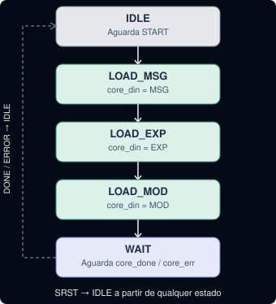
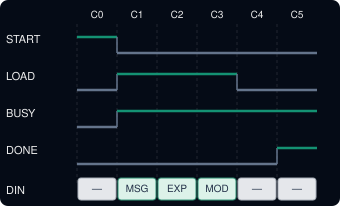
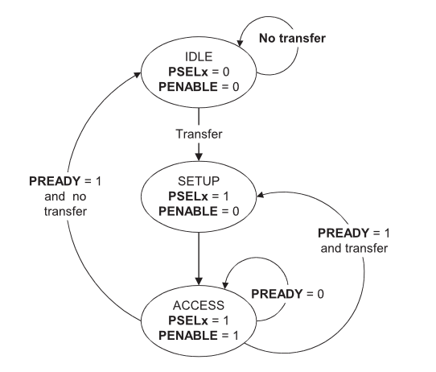
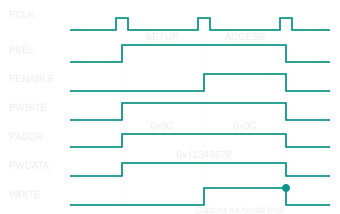
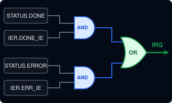
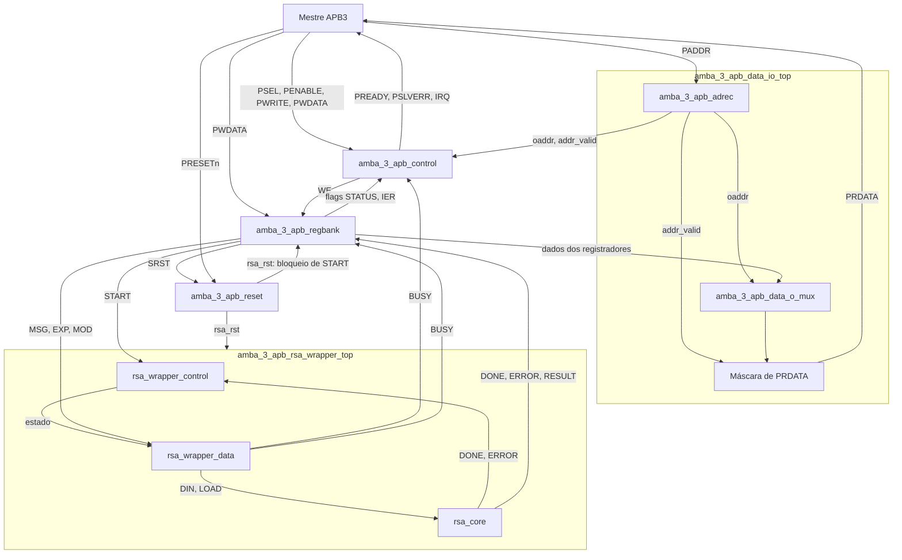

# RSA_APB

Periférico RSA com interface AMBA 3 APB (APB3), descrito em SystemVerilog.
O projeto contém RTL do periférico, um núcleo RSA, testbenches estruturais e
scripts auxiliares de síntese, LEC e simulação.

## Diagrama de topo da arquitetura

**[Abrir o diagrama interativo conectado ao Drive](https://mattgrossi12.github.io/RSA_APB_32-bit/#arquitetura)**

O visualizador da página consulta o XML original do Google Drive, com
atualização automática a cada minuto enquanto a aba está visível. As edições
salvas no diagrams.net aparecem sem exportar imagens ou reconstruir o site.

[Editar no diagrams.net](https://app.diagrams.net/#G1pJmIWxV6VePdHCURcpEqT6SSo5kHxkri#%7B%22pageId%22%3A%22MEHrRE8WjDQsoYR0GH0S%22%7D)
· [Arquivo original no Drive](https://drive.google.com/file/d/1pJmIWxV6VePdHCURcpEqT6SSo5kHxkri/view)

O README do GitHub não executa o visualizador; a versão interativa está na
página acima. O arquivo do Drive precisa continuar compartilhado para leitura
com qualquer pessoa que tenha o link.

## Estrutura do repositório

```text
.
├── constraints/                 # SDCs por módulo
├── docs/                        # Especificações e material de referência
├── images/                      # Diagramas e imagens do projeto
├── logs/<modulo>/{genus,lec,xrun}/
├── ps_files/<modulo>/{db,netlist,sdc}/
├── reports/<modulo>/
├── scripts/<modulo>/
│   ├── bash/                    # Entradas dos fluxos
│   └── tcl/
│       └── legacy/              # Tcl legado preservado
├── src/
│   ├── amba_3_apb/              # RTL APB e wrapper RSA
│   │   ├── legacy/              # RTL legado, fora do fluxo ativo
│   │   └── amba_3_apb_rsa_apb_top.sv
│   └── rsa32/
│       └── rsa_core_32.sv       # Declara rsa_core e módulos auxiliares
├── testbenchs/<modulo>/testbench.sv
└── waveforms/
```

## Imagens do projeto

### Sequência de controle do wrapper RSA

<div align="center">
  
  <p><em>Figura 1 — Estados e transições do controle do wrapper RSA, incluindo reset síncrono e conclusão ou erro do núcleo.</em></p>
</div>

### Transferência de dados para o núcleo

<div align="center">
  
  <p><em>Figura 2 — Sequência temporal de inicialização, carregamento dos operandos e sinalização de ocupado/concluído do núcleo RSA.</em></p>
</div>

### Máquina de estados do protocolo APB

<div align="center">
  
  <p><em>Figura 3 — Fases IDLE, SETUP e ACCESS de uma transferência APB, incluindo espera quando PREADY está baixo.</em></p>
</div>

### Exemplo de escrita APB

<div align="center">
  
  <p><em>Figura 4 — Exemplo de transferência de escrita APB e captura dos dados na borda final do acesso.</em></p>
</div>

### Geração da interrupção

<div align="center">
  
  <p><em>Figura 5 — Lógica de interrupção: flags DONE e ERROR habilitadas pelos bits correspondentes do registrador IER.</em></p>
</div>

## Artefatos legados

O diretório `scripts/amba_3_apb_data_i_demux/` e o RTL
`src/amba_3_apb/legacy/amba_3_apb_data_i_demux.sv` são artefatos legados;
`amba_3_apb_data_i_demux` não faz parte dos blocos ativos do projeto.

## Módulos RTL

| Módulo e fonte | Responsabilidade |
|---|---|
| `amba_3_apb_control`<br>[Fonte RTL](src/amba_3_apb/amba_3_apb_control.sv) | Controle APB e habilitações<br>de escrita e IRQ. |
| `amba_3_apb_data_io_top`<br>[Fonte RTL](src/amba_3_apb/amba_3_apb_data_io_top.sv) | Integração do endereço<br>e do caminho de leitura. |
| `amba_3_apb_adrec`<br>[Fonte RTL](src/amba_3_apb/amba_3_apb_adrec.sv) | Redução do endereço<br>e geração de `addr_valid_o`. |
| `amba_3_apb_data_o_mux`<br>[Fonte RTL](src/amba_3_apb/amba_3_apb_data_o_mux.sv) | Multiplexação combinacional<br>dos dados de leitura. |
| `amba_3_apb_regbank`<br>[Fonte RTL](src/amba_3_apb/amba_3_apb_regbank.sv) | Registradores de controle, status,<br>operandos e resultado. |
| `amba_3_apb_reset`<br>[Fonte RTL](src/amba_3_apb/amba_3_apb_reset.sv) | Sincronização de reset<br>e reset do núcleo. |
| `amba_3_apb_rsa_wrapper_control`<br>[Fonte RTL](src/amba_3_apb/amba_3_apb_rsa_wrapper_control.sv) | FSM de controle<br>do wrapper RSA. |
| `amba_3_apb_rsa_wrapper_data`<br>[Fonte RTL](src/amba_3_apb/amba_3_apb_rsa_wrapper_data.sv) | Caminho de dados e carregamento<br>dos operandos do núcleo. |
| `amba_3_apb_rsa_wrapper_top`<br>[Fonte RTL](src/amba_3_apb/amba_3_apb_rsa_wrapper_top.sv) | Integração do controle, dados<br>e núcleo RSA. |
| `amba_3_apb_rsa_apb_top`<br>[Fonte RTL](src/amba_3_apb/amba_3_apb_rsa_apb_top.sv) | Topo do periférico<br>com interface APB. |
| `rsa_core` e auxiliares<br>[Fonte RTL](src/rsa32/rsa_core_32.sv) | Núcleo RSA e módulos<br>`rsa_core_mult`, `rsa_core_mod`, `rsa_core_ctrl`. |

O topo atual está em `src/amba_3_apb/amba_3_apb_rsa_apb_top.sv` e declara
`amba_3_apb_rsa_apb_top`. O testbench correspondente fica em
[`testbenchs/rsa_apb_top/testbench.sv`](testbenchs/rsa_apb_top/testbench.sv):
aplica reset físico, envia CTRL.SRST, aguarda cinco ciclos e verifica as
escritas/leitura dos registradores RW em dez rodadas com scoreboard. Ao final,
executa dez operações RSA, conferindo STATUS, IRQ, RESULT e preservação de
MSG/EXP/MOD. A instância usa `LOAD_GAP=1`, conforme o protocolo do núcleo real.
A bancada de `amba_3_apb_adrec` percorre todos os endereços e verifica o índice
e a validade. As demais bancadas por módulo estão em
`testbenchs/<nome_do_modulo>/` e são estruturais.

### Simulação integrada com Icarus Verilog

Com `iverilog` e `vvp` no `PATH`, execute:

```bash
./scripts/amba_3_apb_rsa_apb_top/bash/iverilog.sh
# Opcional: escolher o valor genérico de 32 bits.
./scripts/amba_3_apb_rsa_apb_top/bash/iverilog.sh +DATA=DEADBEEF
```

O cenário aprovado termina com `TEST PASS: 238 checks, 0 errors`. Logs ficam em
`logs/amba_3_apb_rsa_apb_top/iverilog/` e o VCD em
`waveforms/amba_3_apb_rsa_apb_top/testbench.vcd`.
O [plano de teste](docs/plano_teste_amba_3_apb_rsa_apb_top.md) detalha a
sequência, as tasks, o mapa de registradores e os critérios de aprovação.

### Simulação e cobertura com Verilator

Com Verilator, `verilator_coverage`, Make e G++ com suporte a C++20 no `PATH`:

```bash
./scripts/amba_3_apb_rsa_apb_top/bash/verilator.sh
./scripts/amba_3_apb_rsa_apb_top/bash/verilator.sh +DATA=DEADBEEF
```

O script executa a mesma bancada e gera o resumo em
`reports/amba_3_apb_rsa_apb_top/verilator/coverage_summary.txt`, fontes anotadas
e `coverage.info` (LCOV). Com `genhtml` instalado (pacote LCOV), também gera
`reports/amba_3_apb_rsa_apb_top/verilator/html/index.html`.
Os logs ficam em `logs/amba_3_apb_rsa_apb_top/verilator/` e o VCD em
`waveforms/amba_3_apb_rsa_apb_top/verilator/testbench.vcd`.
Use `VERILATOR_JOBS=4` para alterar o paralelismo de compilação (padrão: 2).

## Diagrama de arquitetura de topo

O diagrama abaixo mostra os blocos do topo atual, incluindo o redutor de
endereço `amba_3_apb_adrec` dentro de `data_io_top`:



O bloco `adrec` gera o índice e a validade do endereço. O bloco de reset
exporta apenas `rsa_rst_o`; o sinal sincronizado permanece interno.
PCLK e as ligações diretas de PRESETn ao regbank e ao controle do wrapper
foram omitidos do desenho para facilitar a leitura.

Documentação detalhada dos blocos APB:
[`src/amba_3_apb/`](src/amba_3_apb/).
O [README do topo atual](src/amba_3_apb/README_amba_3_apb_rsa_apb_top.md) e o
[README do núcleo RSA](src/rsa32/README_rsa_core.md) descrevem a integração
usada pela bancada. A análise em `src/rsa32/README_rsa_apb_top.md` é histórica.

## Organização dos resultados

A [página GitHub Pages](site/README.md) reúne os resumos e diagramas dos onze
módulos, trechos dos logs e os resultados LCOV. Para gerar com os artefatos
locais existentes, execute `python3 scripts/pages/build.py`; a saída fica em
`_site/`. O workflow `.github/workflows/pages.yml` recria as simulações e
publica a página quando GitHub Pages está configurado para GitHub Actions.

- Os SDCs estão em `constraints/<nome_do_modulo>.sdc`.
- Os resultados de síntese são separados em
  `ps_files/<nome_do_modulo>/{netlist,sdc,db}/`.
- Os relatórios ficam em `reports/<nome_do_modulo>/`.
- Os logs são centralizados em `logs/<nome_do_modulo>/{genus,lec,xrun}/`.
- Formas de onda são armazenadas em `waveforms/`.

Os arquivos `insira_aqui.txt` mantêm pastas vazias rastreáveis pelo Git até que
sejam gerados os respectivos resultados.

## Melhorias recomendadas

1. **Completar e validar a integração de `rsa_apb_top`:** confirmar que as
   instâncias e conexões usam as interfaces RTL atuais e que todas as saídas APB
   têm drivers.
2. **Criar listas de fontes por fluxo/módulo:** os Tcl de síntese referenciam
   `filelist.f`; manter listas explícitas e versionadas evita depender de
   arquivos externos ou de diretórios de execução implícitos.
3. **Parametrizar os scripts compartilhados:** os scripts foram copiados por
   módulo e repetem lógica. Um fluxo comum com o módulo como argumento reduz
   divergências de caminhos e opções.
4. **Adicionar verificação automatizada:** elaborar os testbenches com clock,
   reset, estímulos e assertions; executar lint, compilação/elaboração e testes
   em CI antes de considerar o fluxo funcional.
5. **Alinhar os artefatos aos módulos ativos:** revisar os diretórios SDC,
   relatórios e resultados que ainda incluem o módulo legado
   `amba_3_apb_data_i_demux`.
6. **Documentar e versionar requisitos das ferramentas:** registrar versões de
   simulador, Genus/LEC, bibliotecas e variáveis de ambiente necessárias para
   reproduzir os fluxos.

As sugestões acima são propostas de trabalho; não alteram o comportamento do
RTL nem afirmam que os fluxos proprietários foram executados.
