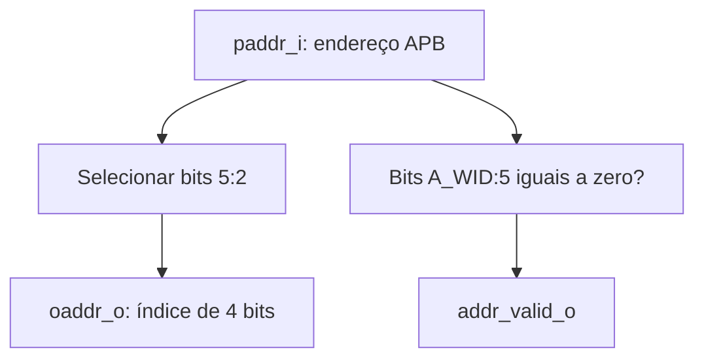

# `amba_3_apb_adrec` — Redução e validação do endereço

## 1. Objetivo

Receber o endereço APB completo, gerar o índice do registrador e indicar se o acesso está na faixa de `0x000` a `0x01F`. É um bloco combinacional, instanciado por `amba_3_apb_data_io_top`.

## 2. Interface e parâmetros

| Elemento | Direção | Largura/padrão | Função |
|---|---|---|---|
| `ADDR_WIDTH` | Parâmetro | `12` | Largura do endereço APB. |
| `A_WID` | Parâmetro | `ADDR_WIDTH - 1` | Índice superior do endereço. |
| `paddr_i` | Entrada | `A_WID + 1` bits | Endereço APB completo. |
| `oaddr_o` | Saída | 4 bits | Índice extraído de `paddr_i[5:2]`. |
| `addr_valid_o` | Saída | 1 bit | Alto quando `paddr_i[A_WID:5]` é zero. |

O barramento precisa ter pelo menos seis bits (`A_WID >= 5`). O bloco não usa clock ou reset.

## 3. Diagrama



## 4. Regras de endereço

```systemverilog
assign oaddr_o = paddr_i[5:2];
assign addr_valid_o = ~|paddr_i[A_WID:5];
```

Os bits `[1:0]` são ignorados, como no caminho de endereço anterior. Assim, os quatro endereços de byte de uma palavra selecionam o mesmo registrador; não há uma checagem de alinhamento neste bloco.

| Endereço | Índice | Válido | Seleção |
|---|---|---:|---|
| `0x000` | `0000` | 1 | CTRL |
| `0x004` | `0001` | 1 | STATUS |
| `0x008` | `0010` | 1 | IER |
| `0x00C` | `0011` | 1 | MSG |
| `0x010` | `0100` | 1 | EXP |
| `0x014` | `0101` | 1 | MOD |
| `0x018` | `0110` | 1 | RESULT |
| `0x01C` a `0x01F` | `0111` | 1 | ID |
| `0x020` | `1000` | 0 | Fora da faixa |
| `0x044` | `0001` | 0 | Fora da faixa, mesmo com índice de STATUS |

O índice é produzido mesmo para endereços inválidos. O controle APB usa `addr_valid_o` para rejeitar esses acessos, e `data_io_top` usa o mesmo sinal para retornar zero em PRDATA.

## 5. Testbench

`testbenchs/amba_3_apb_adrec/testbench.sv` percorre todos os endereços da largura configurada, verifica o índice e a faixa válida e testa a propagação de X/Z. Com 12 bits, são 4096 endereços e cinco casos adicionais.

Para simular com Icarus a partir da raiz do projeto:

```bash
iverilog -g2012 -s testbench -o /tmp/amba_3_apb_adrec.vvp \
    src/amba_3_apb/amba_3_apb_adrec.sv \
    testbenchs/amba_3_apb_adrec/testbench.sv
vvp /tmp/amba_3_apb_adrec.vvp
```
