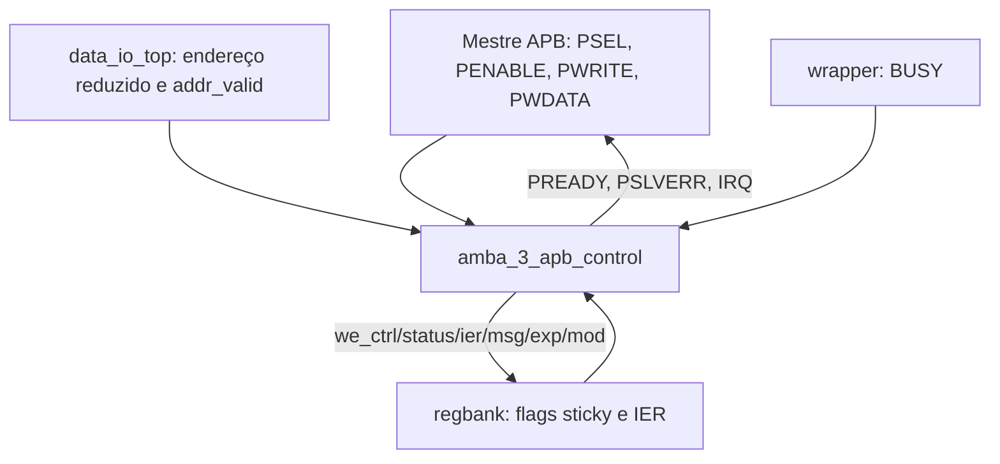

# `amba_3_apb_control` — Controle de transações APB3

**Projeto:** RSA_APB · **Linguagem:** SystemVerilog  
**Fonte analisada:** `amba_3_apb_control.sv` (215 linhas)  
**Situação:** RTL combinacional definido; integração e verificação pendentes.

## 1. Objetivo e fronteira de responsabilidade

O bloco converte sinais de transação APB em habilitações de escrita específicas dos registradores (`we_*_o`), informa erros com `pslverr_o`, mantém `pready_o = 1` para transferência sem estados de espera e calcula a interrupção `irq_o`. Não armazena `PWDATA`, não implementa os registradores e não sequencia a computação RSA. O `regbank` recebe o barramento completo `pwdata_i` e utiliza os WE para decidir se grava os bits.

**Importante:** o RTL atual não possui registrador de fase: `apb_phase` é um **valor combinacional derivado** de `PSEL` e `PENABLE`, apesar de seus códigos se assemelharem aos de uma FSM.

## 2. Conexões na hierarquia



A interpretação do endereço completo e a seleção do dado de leitura pertencem a outros blocos.

## 3. Parâmetros

| Parâmetro | Padrão | Efeito no RTL |
|---|---:|---|
| `DATA_WIDTH` | 32 | Largura nominal do caminho APB de dados. |
| `D_WID` | `DATA_WIDTH - 1` | Índice superior de `pwdata_i[D_WID:0]`. |

O endereço recebido já está reduzido a **4 bits**: `paddr_i[3:0]`.

## 4. Interface de entrada

| Sinal | Largura | Função |
|---|---:|---|
| `psel_i` | 1 | Seleção do periférico. |
| `penable_i` | 1 | Indicação da fase ACCESS. |
| `pwrite_i` | 1 | Seleciona escrita (`1`) ou leitura (`0`). |
| `paddr_i` | 4 | Índice reduzido do registrador. |
| `pwdata_i` | `DATA_WIDTH` | Contém os bits de comando de CTRL usados na validação (`[1:0]`). |
| `addr_valid_i` | 1 | Declara se o endereço completo pertence à janela implementada. |
| `status_done_i`, `status_error_i` | 1 cada | Flags persistentes provenientes do regbank. |
| `done_ie_i`, `err_ie_i` | 1 cada | Habilitações de interrupção provenientes do IER. |
| `busy_i` | 1 | Ocupação do wrapper RSA. |

## 5. Interface de saída

| Sinal | Largura | Significado |
|---|---:|---|
| `pready_o` | 1 | Fixado em `1'b1`; zero wait states. |
| `pslverr_o` | 1 | Indica transação inválida, apenas na fase ACCESS ativa. |
| `irq_o` | 1 | Interrupção ativa alta sensível a nível. |
| `we_ctrl_o` | 1 | Habilita comandos CTRL. |
| `we_status_o` | 1 | Habilita limpeza W1C de STATUS. |
| `we_ier_o` | 1 | Habilita escrita de IER. |
| `we_msg_o`, `we_exp_o`, `we_mod_o` | 1 cada | Habilitam a escrita dos operandos. |

Não há WE para RESULT nem ID, pois ambos são somente leitura.

## 6. Decodificação combinacional das fases APB

A lógica `always_comb : control_branch` atribui um dos seguintes códigos a `apb_phase`:

| `psel_i` | `penable_i` | Fase | Código |
|---:|---:|---|---|
| 0 | 0 ou 1 | `IDLE` | `4'b1000` |
| 1 | 0 | `SETUP` | `4'b1001` |
| 1 | 1 | `ACCESS` | `4'b1011` |

Somente ACCESS permite gerar WE e `PSLVERR`. Não há `always_ff` nem validação temporal de que SETUP ocorreu anteriormente; pressupõe-se um mestre APB compatível com o protocolo.

## 7. Decodificação de operações APB

O segundo `always_comb` atribui **zero a todos os WE e a `pslverr_o` no início**, evitando latches. Apenas depois da validação de fase/endereço é que uma habilitação ou um erro é gerado.

### 7.1 Validação de endereço

Em ACCESS, `!addr_valid_i` produz `pslverr_o = 1`, independentemente de leitura/escrita. Nenhum WE é habilitado nesse caso.

### 7.2 Escrita permitida e erro por registrador

| Índice reduzido | Nome | Escrita em ACCESS |
|---|---|---|
| `4'b0000` | CTRL | SRST (`pwdata_i[1]`) tem prioridade; START (`pwdata_i[0]`) com BUSY resulta em erro; nos demais casos WE de CTRL. |
| `4'b0001` | STATUS | `we_status_o = 1`; o regbank interpreta os bits W1C. |
| `4'b0010` | IER | `we_ier_o = 1`. |
| `4'b0011` | MSG | WE se `busy_i = 0`, erro se ocupado. |
| `4'b0100` | EXP | WE se `busy_i = 0`, erro se ocupado. |
| `4'b0101` | MOD | WE se `busy_i = 0`, erro se ocupado. |
| `4'b0110` | RESULT | Erro em escrita, por ser RO. |
| `4'b0111` | ID | Erro em escrita, por ser RO. |
| Outro valor | Reservado | Erro em escrita. |

Escritas em CTRL com `pwdata_i[1] = 1` são autorizadas mesmo com BUSY ativo: essa decisão implementa o aborto por SRST. Se START e SRST forem ambos 1, SRST tem precedência na lógica de CTRL.

### 7.3 Leituras

O bloco não habilita WE durante leitura (`pwrite_i = 0`). A escolha de `PRDATA` ocorre no `data_o_mux`. Leitura inválida fora da janela gera `PSLVERR` através de `addr_valid_i`.

## 8. Interrupção e latência

A interrupção é uma combinação de flags retidas e bits de habilitação:

```systemverilog
assign irq_o = (status_done_i && done_ie_i) ||
               (status_error_i && err_ie_i);
```

É **sensível a nível**, e não um pulso: permanece ativa enquanto pelo menos uma condição habilitada for verdadeira. As flags são armazenadas/limpas no regbank, não no controle APB.

`pready_o` é continuamente alto; a efetivação do acesso ocorre na borda correspondente a ACCESS, desde que a operação não seja sinalizada como inválida.

## 9. Requisitos de integração

1. Conectar `paddr_i` aos quatro bits reduzidos do `data_io_top`, não diretamente aos 12 bits externos.
2. Conectar `addr_valid_i` ao decodificador de janela do `data_io_top`.
3. Conectar cada `we_*_o` à entrada `we_*_i` homônima do regbank.
4. Conectar `busy_i` ao `rsa_wp_busy_o` do wrapper, preservando a convenção de origem.
5. Garantir que `PWDATA` seja estável durante ACCESS; o regbank o amostra ao receber WE.

## 10. Limitações e pontos pendentes

- **Sem clock/reset na interface atual:** as portas `pclk_i` e `presetn_i` estão comentadas. Durante reset ou recuperação dele, o bloco pode continuar decodificando combinações de sinais externos; o sistema precisa garantir ausência de escrita indevida.
- **`busy_i` não segue ainda o prefixo `rsa_wp_`** adotado para sinais provenientes do wrapper; ajuste nominal opcional na consolidação.
- **Sem registro de fase:** não verifica violações de sequenciamento APB pelo mestre.
- **Ambiguidade START + SRST enquanto BUSY:** a escolha de dar prioridade a SRST vem da lógica presente; deve ser reconciliada com a política global de `PSLVERR` antes de congelar a especificação.
- **Sem validação executada:** este documento descreve o código entregue; não declara resultados de lint, simulação ou síntese.

## 11. Resumo operacional

1. A interface APB indica SETUP/ACCESS.
2. O `data_io_top` informa índice reduzido e validade do endereço.
3. Em ACCESS válido de escrita, o controle habilita um WE ou assinala `PSLVERR`.
4. O regbank executa a escrita ou W1C sob o WE correspondente.
5. IRQ reflete continuamente as flags sticky habilitadas.

**Base documental funcional:** `apb_integration.pdf`, seções de protocolo APB3, mapa de registradores, erro de acesso e IRQ. A codificação combinacional de fases é uma decisão RTL do projeto.
