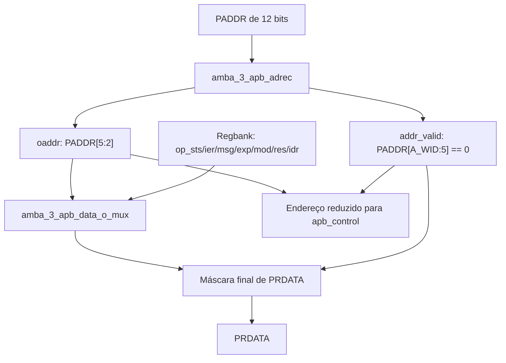

# `amba_3_apb_data_io_top` — Endereçamento e caminho de leitura

**Projeto:** RSA_APB · **Fonte analisada:** `amba_3_apb_data_io_top.sv`  
**Estado:** RTL combinacional integrado em `amba_3_apb_rsa_apb_top`.

## 1. Objetivo e escopo

Esse módulo reúne `amba_3_apb_adrec`, que reduz e valida o endereço, e `amba_3_apb_data_o_mux`, que seleciona o dado de leitura. Retorna zero em PRDATA quando o endereço está fora da faixa dos oito registradores.

O caminho de escrita foi simplificado: `PWDATA` vai diretamente ao regbank, enquanto o controle APB entrega os sinais `we_*`.

## 2. Organização funcional



## 3. Parâmetros

| Nome | Padrão | Função |
|---|---:|---|
| `DATA_WIDTH` | 32 | Largura de `PRDATA` e das entradas de registrador. |
| `ADDR_WIDTH` | 12 | Largura do endereço APB externo. |
| `D_WID` | `DATA_WIDTH - 1` | Índice superior do barramento de dados. |
| `A_WID` | `ADDR_WIDTH - 1` | Índice superior do barramento de endereço. |

A lógica usa explicitamente a fatia `paddr_i[5:2]`, portanto pressupõe ao menos seis bits de endereço; a implementação do projeto foi definida para `ADDR_WIDTH = 12`.

## 4. Interface

| Porta | Direção | Largura | Significado |
|---|---|---|---|
| `paddr_i` | Entrada | `ADDR_WIDTH` | Endereço APB completo. |
| `op_sts_i`, `op_ier_i` | Entrada | `DATA_WIDTH` | STATUS e IER preparados pelo regbank. |
| `op_msg_i`, `op_exp_i`, `op_mod_i` | Entrada | `DATA_WIDTH` | Operandos retidos no regbank. |
| `op_res_i`, `op_idr_i` | Entrada | `DATA_WIDTH` | RESULT e identificador ID. |
| `prdata_o` | Saída | `DATA_WIDTH` | Dados retornados ao mestre APB. |
| `oaddr_o` | Saída | 4 | Índice reduzido do registrador. |
| `addr_valid_o` | Saída | 1 | Indica endereço dentro da janela válida. |

A porta de CTRL não existe no caminho de leitura porque CTRL é WO e retorna zero.

## 5. Endereçamento de palavras

O mapa implementado possui oito palavras de 32 bits na janela `0x000` a `0x01F`:

| Endereço base (hex) | `paddr_i[5:2]` | Registrador |
|---|---|---|
| `0x000` | `0000` | CTRL (leitura zero) |
| `0x004` | `0001` | STATUS |
| `0x008` | `0010` | IER |
| `0x00C` | `0011` | MSG |
| `0x010` | `0100` | EXP |
| `0x014` | `0101` | MOD |
| `0x018` | `0110` | RESULT |
| `0x01C` | `0111` | ID |

O RTL ignora os bits `paddr_i[1:0]`, correspondendo à regra documental de que a seleção é por palavra de 32 bits. Assim, os endereços dentro de uma mesma palavra fazem a mesma seleção lógica.

## 6. Redução e validação do endereço

As duas funções estão em `amba_3_apb_adrec`, instanciado como `adrec_inst` com os parâmetros `ADDR_WIDTH` e `A_WID`. Sua saída `oaddr_o` alimenta `oaddr_w`, usado pelo multiplexador e encaminhado ao controle APB. A saída `addr_valid_o` também controla a máscara de PRDATA.

O operador `~|` é uma redução NOR: produz 1 somente quando **todos** os bits de `paddr_i[A_WID:5]` são zero. Para 12 bits, apenas endereços entre `0x000` e `0x01F` são aceitos.

**Distinção:** `oaddr_o` pode conter um índice válido mesmo quando o endereço completo é inválido. Por exemplo, `0x044` tem índice reduzido `0001` (STATUS), mas o endereço completo é rejeitado por `addr_valid_o = 0`.

## 7. Validação final do dado de leitura

O `data_o_mux` produz `prdata_mux_w` a partir de `oaddr_w`. A saída final é:

```systemverilog
assign prdata_o = addr_valid_o ? prdata_mux_w : '0;
```

| Endereço | `addr_valid_o` | `prdata_o` |
|---|---:|---|
| `0x000` | 1 | Zero (CTRL WO). |
| `0x004` | 1 | STATUS. |
| `0x01C` | 1 | ID. |
| `0x020` | 0 | Zero. |
| `0x044` | 0 | Zero, mesmo que o índice reduzido seja STATUS. |
| `0xFFC` | 0 | Zero. |

**`PRDATA = '0` não é um indicador de erro.** O `apb_control` deve gerar `PSLVERR` na fase ACCESS para transações inválidas.

## 8. Instanciação interna

O módulo instancia `amba_3_apb_adrec` para o endereço e `amba_3_apb_data_o_mux` para os dados. O multiplexador recebe `.DATA_WIDTH(DATA_WIDTH)`, sete entradas `op_*_i`, o índice reduzido e produz `prdata_mux_w`. Não há clock, reset ou armazenamento nesse caminho combinacional.

## 9. Integração

- `paddr_i` recebe `PADDR[11:0]` do topo.
- `oaddr_o` e `addr_valid_o` alimentam `amba_3_apb_control`.
- `op_*_i` recebem as saídas do regbank, não os dados de escrita APB.
- `prdata_o` alimenta o `PRDATA` da interface externa.
- `PWDATA` **não passa** por esse bloco na arquitetura revisada.

## 10. Questões de projeto e limitações

1. O módulo não produz `PSLVERR`; a sinalização de erro depende do controle APB.
2. O sinal `PRDATA` é combinacional e não é qualificado diretamente por `PSEL`, `PENABLE` ou `PWRITE` dentro deste módulo.
3. O topo ativo é `amba_3_apb_rsa_apb_top.sv`; sua bancada integrada fica em `testbenchs/rsa_apb_top/testbench.sv`.

## 11. Resumo

`PADDR` é reduzido a um índice, a janela é validada, o MUX seleciona um registrador e `PRDATA` é mascarado com zero se o endereço for inválido. As escritas seguem diretamente para o `regbank`, condicionadas por WE gerados em `apb_control`.
