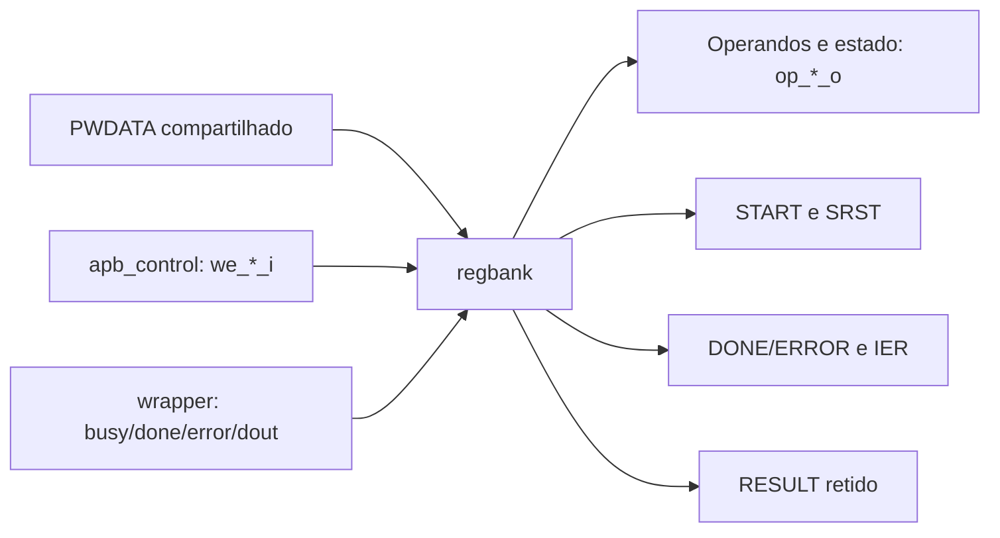

# `amba_3_apb_regbank` — Banco de registradores do coprocessador RSA

**Projeto:** RSA_APB · **Fonte analisada:** `amba_3_apb_regbank.sv`  
**Estado:** RTL sequencial/combinacional estruturado; integração e verificação pendentes.

## 1. Objetivo e escopo

O regbank mantém os operandos MSG/EXP/MOD, as habilitações de interrupção IER, o resultado RESULT e as flags persistentes DONE/ERROR. Também traduz escritas em CTRL para comandos autolimpantes START e SRST. Recebe `PWDATA` diretamente do barramento, enquanto os sinais individuais `we_*_i` do `apb_control` determinam **se** uma escrita deve ocorrer.

O módulo **não decodifica PADDR**, não implementa o multiplexador geral PRDATA, não mantém BUSY em flip-flop e não possui lógica de interrupção final; disponibiliza flags e habilitações ao `apb_control`.

## 2. Visão arquitetural



O demultiplexador antigo de entrada não faz parte da arquitetura atual.

## 3. Parâmetros e convenções

| Parâmetro | Valor | Uso |
|---|---:|---|
| `DATA_WIDTH` | 32 | Largura dos operandos, resultado e PWDATA. |
| `D_WID` | `DATA_WIDTH - 1` | Índice superior dos vetores `[D_WID:0]`. |

Os sinais externos provenientes do wrapper possuem prefixo `rsa_wp_`; write enables têm prefixo `we_` e sufixo `_i`. As declarações internas são `logic`, as constantes `localparam` estão antes dos registros e os resets utilizam `'0`.

Os códigos de endereço `CTRL_R` a `ID_R` ainda aparecem como constantes locais, mas **não são utilizados** para selecionar escritas, já que o endereço foi previamente decodificado em `apb_control`.

## 4. Interfaces

### 4.1 Entradas

| Porta(s) | Largura | Finalidade |
|---|---:|---|
| `pclk_i`, `presetn_i` | 1 | Clock e reset global ativo baixo. |
| `pwdata_i` | `DATA_WIDTH` | Dado de escrita APB compartilhado. |
| `we_ctrl_i`, `we_status_i`, `we_ier_i` | 1 cada | Comando CTRL, W1C STATUS, escrita IER. |
| `we_msg_i`, `we_exp_i`, `we_mod_i` | 1 cada | Habilitam armazenamento de operandos. |
| `rsa_wp_busy_i` | 1 | BUSY produzido pelo wrapper. |
| `rsa_wp_done_i`, `rsa_wp_error_i` | 1 cada | Pulsos terminais do núcleo, encaminhados pelo wrapper. |
| `rsa_wp_dout_i` | `DATA_WIDTH` | Resultado produzido pelo RSA. |

### 4.2 Saídas

| Porta(s) | Significado |
|---|---|
| `start_o`, `srst_o` | Comandos START e software reset. |
| `status_done_o`, `status_error_o` | Flags sticky para IRQ e lógica de controle. |
| `done_ie_o`, `err_ie_o` | Bits de habilitação da interrupção. |
| `op_sts_o`, `op_ier_o` | STATUS e IER formatados para leitura. |
| `op_msg_o`, `op_exp_o`, `op_mod_o` | Operandos registrados para wrapper e MUX de leitura. |
| `op_res_o` | Resultado registrado. |
| `op_idr_o` | Identificador e versão constantes. |

## 5. Mapa de registradores

| Offset | Nome | Acesso | Valor de reset | Implementação |
|---|---|---|---|---|
| `0x00` | CTRL | WO | `0x0000_0000` | Comandos combinacionais, sem registro persistente. |
| `0x04` | STATUS | RO/W1C | `0x0000_0000` | DONE e ERROR em 2 FFs; BUSY externo. |
| `0x08` | IER | RW | `0x0000_0000` | 2 FFs (DONE_IE e ERR_IE). |
| `0x0C` | MSG | RW | `0x0000_0000` | Um registro `DATA_WIDTH` bits. |
| `0x10` | EXP | RW | `0x0000_0000` | Um registro `DATA_WIDTH` bits. |
| `0x14` | MOD | RW | `0x0000_0000` | Um registro `DATA_WIDTH` bits. |
| `0x18` | RESULT | RO | `0x0000_0000` | Registro `DATA_WIDTH` atualizado pelo evento DONE. |
| `0x1C` | ID | RO | `0x5253_0200` | Constante `ID_VALUE`. |

Com `DATA_WIDTH = 32`, o armazenamento explícito soma **132 bits**: quatro barramentos de 32 bits (MSG, EXP, MOD, RESULT) e quatro flags (DONE, ERROR, DONE_IE, ERR_IE). CTRL, BUSY e ID não exigem FFs neste módulo.

## 6. Formatação de STATUS e IER

**STATUS:**

| Bits | Campo | Origem |
|---|---|---|
| `[31:3]` | Reservados | `'0` |
| `[2]` | ERROR | `status_error_reg` |
| `[1]` | DONE | `status_done_reg` |
| `[0]` | BUSY | `rsa_wp_busy_i` |

**IER:**

| Bits | Campo | Origem |
|---|---|---|
| `[31:2]` | Reservados | `'0` |
| `[1]` | ERR_IE | `ier_err_ie_reg` |
| `[0]` | DONE_IE | `ier_done_ie_reg` |

Os sinais individuais `status_done_o`, `status_error_o`, `done_ie_o` e `err_ie_o` são atribuídos diretamente às flags registradas. Eles permitem gerar IRQ fora do regbank, sem recodificar PRDATA.

## 7. Escrita de IER, MSG, EXP e MOD

Existe um processo `always_ff @(posedge pclk_i or negedge presetn_i)` que zera esses registradores em reset global. Fora do reset, cada campo verifica seu WE:

```systemverilog
if (we_msg_i)
    begin
        msg_reg <= pwdata_i;
    end
else
    begin
        msg_reg <= msg_reg;
    end
```

IER grava somente `pwdata_i[1:0]`. MSG, EXP e MOD gravam o vetor completo. As autoatribuições do ramo `else` implementam retenção explícita, conforme a convenção adotada; em FFs, manter o valor é comportamento implícito, e a síntese pode otimizar a autoatribuição.

**Gravar zero é válido:** não há comparação de `PWDATA` com zero; é o WE que determina a efetivação da escrita.

## 8. CTRL: comandos autolimpantes

O RTL não armazena START/SRST em FFs. Os comandos são combinações de WE e bits de PWDATA:

```systemverilog
assign srst_o  = we_ctrl_i && pwdata_i[1];
assign start_o = we_ctrl_i && pwdata_i[0] &&
                 !pwdata_i[1] && !rsa_wp_busy_i;
```

- SRST tem precedência sobre START caso os dois bits sejam escritos como 1.
- START requer que o wrapper não esteja ocupado.
- A duração real do comando depende de `we_ctrl_i` no ACCESS; o regbank **não** registra nem alonga o pulso.
- Leitura de CTRL retorna zero no `data_o_mux`, pois não existe `op_ctl_o`.

## 9. STATUS: flags sticky, W1C e prioridades

O processo sequencial de STATUS é responsável por retenção e limpeza de DONE/ERROR.

| Prioridade (maior → menor) | Condição | Efeito |
|---|---|---|
| 1 | `!presetn_i` | DONE = 0, ERROR = 0. |
| 2 | `srst_o || start_o` | Ambas flags limpas. |
| 3 | `rsa_wp_done_i` | DONE = 1. |
| 3 | `rsa_wp_error_i` | ERROR = 1. |
| 4 | `we_status_i && pwdata_i[1]` | DONE = 0, se não houve DONE simultâneo. |
| 4 | `we_status_i && pwdata_i[2]` | ERROR = 0, se não houve ERROR simultâneo. |
| 5 | Nenhuma condição | Retém valor anterior. |

As duas flags são tratadas por ramos independentes. É possível que ambas sejam 1 se ambos os eventos forem afirmados; o código não impõe exclusão mútua. Um evento terminal prevalece sobre W1C **para a mesma flag** naquele ciclo.

`STATUS.BUSY` não é sticky e não entra nesse processo: reflete diretamente `rsa_wp_busy_i`.

### 9.1 Exemplo W1C

Se `STATUS.DONE=1` e houver escrita válida de `32'h0000_0002` em STATUS (`we_status_i=1`), DONE é limpo e ERROR permanece inalterado. Uma escrita de zero não limpa nenhuma flag.

## 10. RESULT: captura do processamento RSA

```systemverilog
if (rsa_wp_done_i && !srst_o)
    begin
        result_reg <= rsa_wp_dout_i;
    end
else
    begin
        result_reg <= result_reg;
    end
```

O resultado é atualizado somente quando DONE está ativo e SRST não está sendo solicitado. Em ERROR, o valor anterior é preservado. O START de nova operação **não limpa** RESULT. Apenas `presetn_i` zera RESULT; SRST, pela especificação, deve preservá-lo.

A captura correta depende de `rsa_wp_dout_i` estar válido na borda de `PCLK` em que `rsa_wp_done_i` é reconhecido.

## 11. Reset global versus software reset

| Campo | `presetn_i = 0` | SRST |
|---|---|---|
| STATUS.DONE/ERROR | Limpa | Limpa |
| IER | Limpa | Mantém |
| MSG/EXP/MOD | Limpa | Mantém |
| RESULT | Limpa | Mantém |
| ID | Constante | Constante |
| BUSY | Derivado do wrapper | Derivado do wrapper |

O `regbank` utiliza reset assíncrono ativo baixo nos processos de armazenamento. O reset RSA propriamente dito é gerado pelo módulo `amba_3_apb_reset`, que combina o sincronizador com SRST.

## 12. Integração e pontos de atenção

1. O `apb_control` deve suprimir WE em transações inválidas, incluindo escrita de operandos quando BUSY = 1.
2. `start_o` é combinacional; sua duração depende diretamente do WE APB. Deve existir apenas um START aceito por transação.
3. DONE/ERROR são recebidos sem qualificação pelo estado `WAIT_DONE`; garantir que o núcleo não produza pulsos espúrios fora de operações válidas.
4. Caso SRST e evento terminal sejam simultâneos, STATUS é limpo; RESULT não captura se `srst_o = 1`.
5. O mapa usa operandos fixos de 32 bits e ID fixo `32'h5253_0200`; parametrizar `DATA_WIDTH` para valores distintos de 32 exige revisão funcional.
6. Os `localparam` de endereço são declarados como referência, mas não são usados pelo RTL.
7. Nenhuma verificação executada; documenta-se somente o comportamento escrito.

## 13. Resumo operacional

O controle APB autoriza a escrita e o regbank armazena IER/operandos; START dispara a operação RSA; DONE captura o resultado e torna a flag sticky; ERROR registra a falha sem alterar RESULT; W1C limpa flags individualmente; o reset global limpa armazenamento e SRST limpa STATUS e reinicializa o núcleo mantendo os demais campos.

**Base documental funcional:** `apb_integration.pdf`, mapa e descrições de CTRL/STATUS/IER/MSG/EXP/MOD/RESULT/ID, conclusão/erro e reset.
