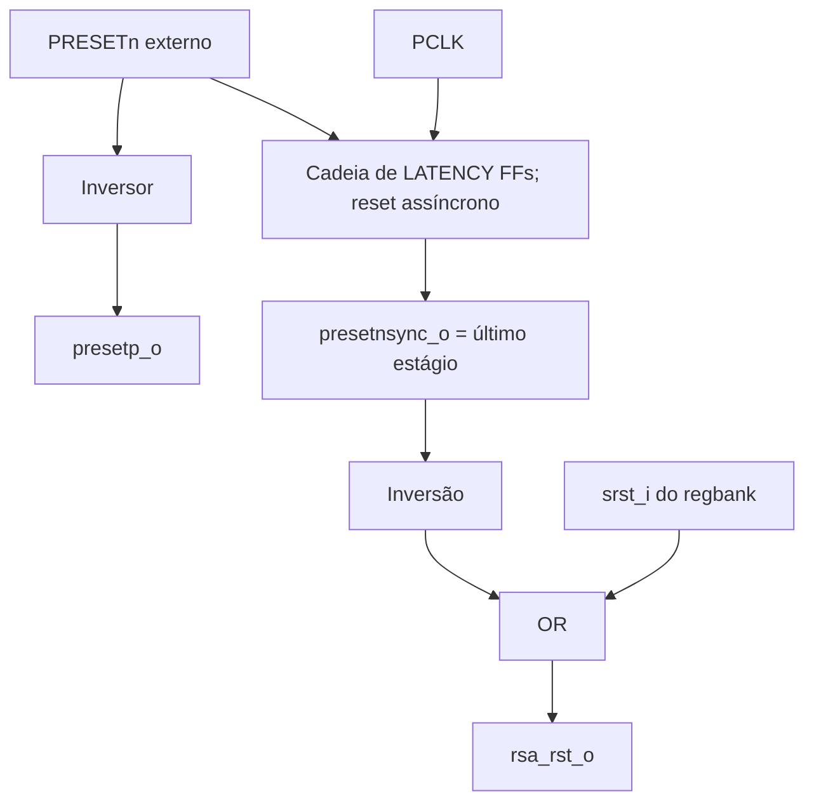

# `amba_3_apb_reset` — Sincronização de liberação e reset do RSA

**Projeto:** RSA_APB · **Fonte analisada:** `amba_3_apb_reset(1).sv`  
**Estado:** RTL de reset implementado; distribuição e restrições de implementação física pendentes.

## 1. Objetivo

Centralizar os sinais derivados do reset global `PRESETn` e do reset por software `CTRL.SRST` para os módulos do RSA_APB. A especificação prevê reset global da interface APB e reset **síncrono ativo alto** na entrada `core_rst` do `rsa_core`, com liberação do reset global sincronizada por dois estágios antes de chegar ao núcleo.

O módulo usa uma cadeia parametrizável de flip-flops: **ativação assíncrona, liberação sincronizada** (`asynchronous assertion / synchronous deassertion`).

## 2. Parâmetro e interface

| Elemento | Direção | Valor/largura | Finalidade |
|---|---|---|---|
| `LATENCY` | Parâmetro | Padrão `2` | Número de estágios de sincronização. |
| `pclk_i` | Entrada | 1 | Clock que libera o reset. |
| `presetn_i` | Entrada | 1, ativo baixo | Reset global externo. |
| `srst_i` | Entrada | 1, ativo alto | Comando de software do regbank. |
| `presetp_o` | Saída | 1, ativo alto | Inversão combinacional do reset externo. |
| `presetnsync_o` | Saída | 1, ativo baixo | Reset com ativação assíncrona e liberação sincronizada. |
| `rsa_rst_o` | Saída | 1, ativo alto | Reset destinado ao núcleo RSA. |

A documentação do projeto exige dois estágios. Recomenda-se restringir `LATENCY >= 2` na configuração efetiva; o RTL atual não contém checagem de parâmetro.

## 3. Diagrama lógico



## 4. Cadeia de flip-flops

```systemverilog
logic [LATENCY-1:0] reset_sync_reg;

always_ff @(posedge pclk_i or negedge presetn_i)
    begin
        if (!presetn_i)
            begin
                reset_sync_reg <= '0;
            end
        else
            begin
                reset_sync_reg <= (reset_sync_reg << 1) | 1'b1;
            end
    end
```

Enquanto `presetn_i = 0`, **todos os FFs são zerados** sem aguardar borda de clock. Após retornar a 1, entra `1` no bit 0 a cada borda; os bits mais altos recebem o valor do estágio anterior. O último estágio passa a 1 somente após `LATENCY` bordas.

### 4.1 Exemplo de dois estágios

| Momento | `presetn_i` | `reset_sync_reg[1:0]` | `presetnsync_o` | `presetp_o` |
|---|---:|---|---:|---:|
| Reset externo ativo | 0 | `00` | 0 | 1 |
| Externo liberado, antes do clock | 1 | `00` | 0 | 0 |
| Após primeira borda | 1 | `01` | 0 | 0 |
| Após segunda borda | 1 | `11` | 1 | 0 |
| Operação normal | 1 | `11` | 1 | 0 |

**Importante:** o sincronizador não cria um clock separado; o sistema continua em domínio único `pclk_i`.

## 5. Significado das três saídas

### 5.1 `presetp_o`

```systemverilog
assign presetp_o = !presetn_i;
```

Inverte o reset externo. Não oferece sincronização; sua ativação/desativação seguem as transições do sinal de origem.

### 5.2 `presetnsync_o`

```systemverilog
assign presetnsync_o = reset_sync_reg[LATENCY-1];
```

Possui polaridade ativa baixa. **Não é integralmente síncrono**: a ativação ocorre de modo assíncrono em `presetn_i` baixo, e a liberação ocorre somente na borda do clock após propagação pela cadeia.

### 5.3 `rsa_rst_o`

```systemverilog
assign rsa_rst_o = !presetnsync_o || srst_i;
```

A saída é ativa alta e combina a condição de reset global ainda não liberado com o comando SRST.

| `presetnsync_o` | `srst_i` | `rsa_rst_o` | Significado |
|---:|---:|---:|---|
| 0 | 0 | 1 | Núcleo ainda em reset global. |
| 0 | 1 | 1 | Reset global predominante. |
| 1 | 0 | 0 | Núcleo liberado para operação. |
| 1 | 1 | 1 | Software solicita reset. |

`rsa_rst_o` é produzido combinacionalmente; o `rsa_core` o **interpreta sincronamente** na borda de clock segundo sua interface. Não se deve confundir essas duas características.

## 6. Distinção entre reset global e SRST

O regbank realiza sua própria reinicialização global por `presetn_i`. O comando SRST não deverá zerar IER, operandos nem RESULT; deve limpar flags STATUS e reinicializar sequenciador/núcleo RSA. Essa seletividade não é aplicada pelo sincronizador: ela é responsabilidade dos blocos que consomem reset e do `regbank`.

## 7. Encaminhamento na hierarquia

- `presetn_i`: vem da entrada externa do sistema.
- `srst_i`: recebe `regbank.srst_o` (gerado por escrita em CTRL.SRST).
- `rsa_rst_o`: vai para `rsa_wrapper_top.rsa_rst_i`; o wrapper conecta ao `core_rst` do núcleo e também usa o sinal para abortar a FSM.
- `presetnsync_o`: pode ser disponibilizado aos outros blocos conforme a política de inicialização; o wrapper atual conserva uma porta `presetnsync_i` ainda **não utilizada**.
- `presetp_o`: permanece disponível para componentes que requeiram essa polaridade, mas não substitui a sincronização exigida pelo RSA.

## 8. Considerações de ASIC e reset-domain crossing

Os FFs do sincronizador devem ser identificados adequadamente para as ferramentas de análise e implementação física: preservar a estrutura, evitar otimizações indevidas e verificar recuperação/remoção e proximidade dos estágios. O código atual **não contém** o atributo `async_reg`; isso não modifica a simulação RTL, mas a identificação apropriada deverá ser discutida no fluxo de síntese/place-and-route.

O primeiro estágio recebe a liberação assíncrona; a cadeia reduz a probabilidade de propagação de metastabilidade, mas não elimina todos os riscos em qualquer cenário físico.

## 9. Questões abertas e cuidados

1. O RTL não valida `LATENCY`; valores menores que 1 tornam a declaração inadequada, e valores menores que 2 não atendem à recomendação documental.
2. O comprimento de SRST depende da duração de `regbank.srst_o`. O `reset` não prolonga nem registra o comando.
3. Durante a liberação de PRESETn, `rsa_rst_o` pode continuar alto por `LATENCY` bordas. É necessário definir como evitar START/escritas APB aceitos antes de o núcleo estar disponível.
4. Um sinal de reset derivado (`presetnsync_o`) não deve ser indiscriminadamente conectado a todos os FFs sem analisar a interface APB e a janela de liberação.
5. A integração e a verificação física/funcional não foram executadas nesta etapa.

## 10. Resumo operacional

Ao afirmar `PRESETn` baixo, a cadeia é zerada imediatamente e `rsa_rst_o` torna-se ativo. Ao liberar `PRESETn`, a cadeia recebe 1 por duas bordas de PCLK (valor padrão) e, então, libera o RSA se SRST também estiver baixo. Um SRST posterior ativa novamente `rsa_rst_o` sem rezerar necessariamente a cadeia de sincronização.

**Base documental funcional:** `apb_integration.pdf`, seções de `core_rst` e comportamento de reset global/software reset.
