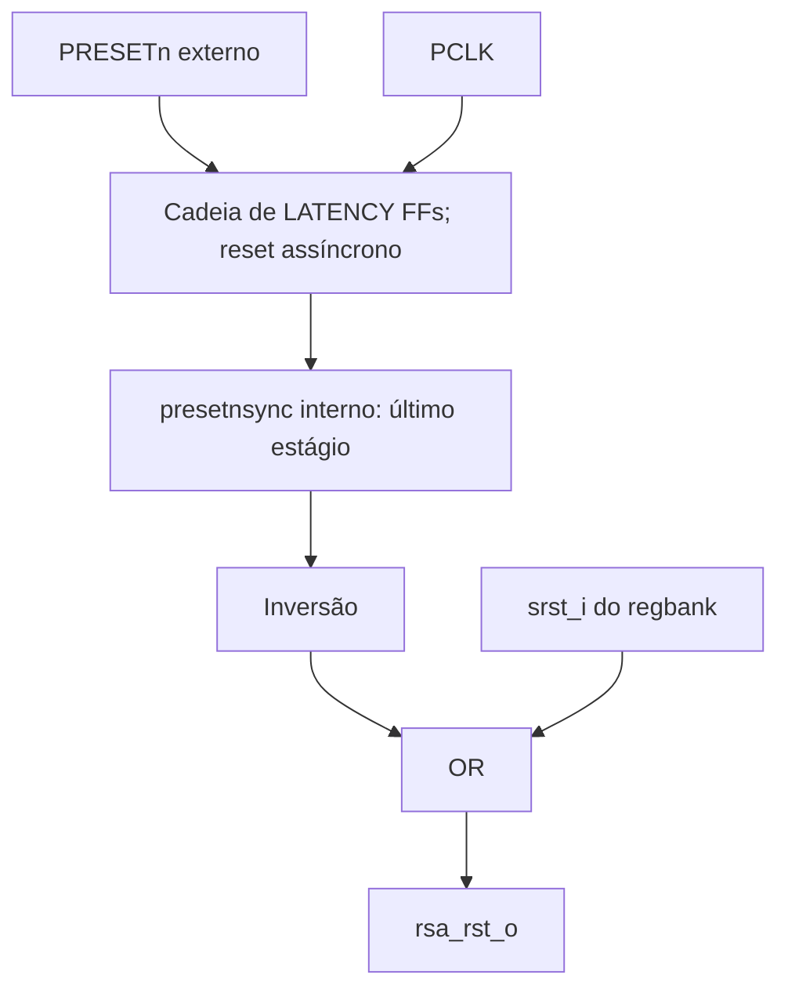

# `amba_3_apb_reset` — Reset do núcleo RSA

**Fonte:** `amba_3_apb_reset.sv`

## 1. Objetivo

Gerar `rsa_rst_o` a partir do reset externo `PRESETn` e do comando de software `CTRL.SRST`. Após a liberação de `PRESETn`, o bloco espera `LATENCY` bordas de subida de PCLK antes de liberar o RSA, desde que SRST esteja baixo.

## 2. Parâmetro e interface

| Elemento | Direção | Valor/largura | Função |
|---|---|---|---|
| `LATENCY` | Parâmetro | Padrão `2` | Número de estágios do sincronizador. |
| `pclk_i` | Entrada | 1 bit | Clock do sincronizador. |
| `presetn_i` | Entrada | 1 bit, ativo baixo | Reset global externo. |
| `srst_i` | Entrada | 1 bit, ativo alto | Comando de reset gerado pelo regbank. |
| `rsa_rst_o` | Saída | 1 bit, ativo alto | Reset do núcleo e do controle do wrapper. |

`presetnsync` é um `logic` interno ligado ao último estágio do sincronizador. A antiga saída `presetnsync_o` não tinha consumidor no topo. A saída `presetp_o`, que apenas invertia `presetn_i`, também foi removida porque estava desconectada.

## 3. Diagrama lógico



## 4. Funcionamento

Enquanto `presetn_i` está baixo, todos os estágios de `reset_sync_reg` são zerados sem esperar o clock. Quando o reset externo é liberado, entra um bit `1` na cadeia a cada borda de subida. O último estágio só chega a `1` após `LATENCY` bordas.

```systemverilog
logic [LATENCY-1:0] reset_sync_reg;
logic presetnsync;

assign presetnsync = reset_sync_reg[LATENCY-1];
assign rsa_rst_o = !presetnsync || srst_i;
```

Exemplo com `LATENCY = 2` e `srst_i = 0`:

| Momento | `presetn_i` | `reset_sync_reg` | `presetnsync` | `rsa_rst_o` |
|---|---:|---|---:|---:|
| Reset externo ativo | 0 | `00` | 0 | 1 |
| Reset externo liberado, antes do clock | 1 | `00` | 0 | 1 |
| Após primeira borda de subida | 1 | `01` | 0 | 1 |
| Após segunda borda de subida | 1 | `11` | 1 | 0 |

O sincronizador tem ativação assíncrona e liberação sincronizada. `rsa_rst_o` é uma combinação lógica; o núcleo RSA consome esse reset de forma síncrona na borda de clock.

## 5. Reset por software

SRST ativa `rsa_rst_o` sem zerar a cadeia do sincronizador. Se o reset externo já foi liberado e a cadeia está preenchida, baixar SRST libera a saída sem uma nova espera de `LATENCY` ciclos. O bloco não registra nem prolonga o comando.

| `presetnsync` | `srst_i` | `rsa_rst_o` |
|---:|---:|---:|
| 0 | 0 | 1 |
| 0 | 1 | 1 |
| 1 | 0 | 0 |
| 1 | 1 | 1 |

## 6. Ligações no topo

- `presetn_i` recebe o reset externo do sistema.
- `srst_i` recebe `srst_o` do regbank, gerado por uma escrita em `CTRL.SRST`.
- `rsa_rst_o` alimenta `rsa_rst_i` do wrapper e do regbank. O wrapper encaminha o sinal ao `core_rst` do núcleo e o usa para retornar sua FSM a IDLE. O regbank o usa para impedir START durante o reset.
- O regbank e a FSM do wrapper continuam recebendo `presetn_i` para seu reset global. `presetnsync` não sai do bloco de reset.

O regbank trata a limpeza das flags por SRST e a retenção de IER, MSG, EXP, MOD e RESULT. Essa seleção não é feita neste módulo.

## 7. Parâmetro e implementação física

O RTL exige `LATENCY >= 1` para a cadeia e não valida esse parâmetro. O valor padrão de dois estágios deve ser mantido para a sincronização prevista no projeto; simular outros valores verifica a lógica, mas não avalia metastabilidade.

O código ainda não possui atributo `async_reg`. A identificação e o posicionamento dos estágios, assim como as verificações de recuperação e remoção, precisam ser tratados no fluxo de implementação física.
