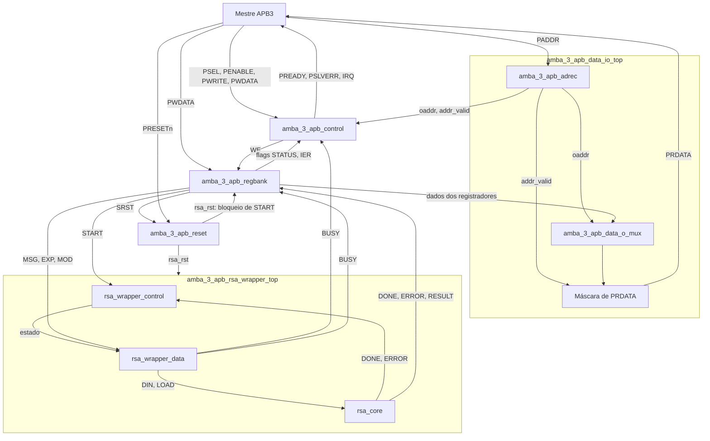

# `amba_3_apb_rsa_apb_top` — Integração do periférico APB3

## 1. Objetivo

Integrar a interface AMBA 3 APB, o banco de registradores, o sincronizador de reset e o wrapper do núcleo RSA em um periférico com dados de 32 bits e endereços de 12 bits. O topo recebe as transações de software e disponibiliza PRDATA, PREADY, PSLVERR e IRQ.

## 2. Arquitetura

## 3. Interface e parâmetros

As entradas são `pclk_i`, `presetn_i`, `psel_i`, `penable_i`, `pwrite_i`,
`paddr_i` e `pwdata_i`. As saídas são `prdata_o`, `pready_o`, `pslverr_o`
e `irq_o`. O controle responde com zero wait states (`PREADY=1`).

| Parâmetro | Padrão RTL | Configuração da bancada |
|---|---:|---:|
| DATA_WIDTH | 32 | 32 |
| ADDR_WIDTH | 12 | 12 |
| LOAD_GAP | 0 | 1 |
| RESET_LATENCY | 2 | 2 |

O núcleo atual precisa de LOAD baixo entre os operandos; a bancada configura
explicitamente `LOAD_GAP=1`. A liberação de reset do núcleo é sincronizada;
regbank e controle do wrapper recebem também `presetn_i` diretamente.

## 4. Mapa de registradores

| Endereço | Registrador | Acesso |
|---|---|---|
| 0x000 | CTRL | START/SRST; leitura zero |
| 0x004 | STATUS | BUSY; DONE/ERROR sticky e W1C |
| 0x008 | IER | RW, bits 1:0 |
| 0x00C | MSG | RW de 32 bits |
| 0x010 | EXP | RW de 32 bits |
| 0x014 | MOD | RW de 32 bits |
| 0x018 | RESULT | Somente leitura |
| 0x01C | ID | Somente leitura, 0x52530200 |

## 5. Verificação integrada

`testbenchs/rsa_apb_top/testbench.sv` executa reset físico, uma transação SRST,
cinco clocks de espera, dez rodadas de escrita/leitura e dez operações RSA.
São 238 comparações de dados, STATUS e IRQ. O resultado matemático é calculado
por uma referência independente de exponenciação modular.

Os fluxos Icarus e Verilator estão em `scripts/amba_3_apb_rsa_apb_top/bash/`.
O plano completo está em `docs/plano_teste_amba_3_apb_rsa_apb_top.md`.
A documentação `src/rsa32/README_rsa_apb_top.md` é histórica e descreve o
esqueleto anterior à integração atual.
