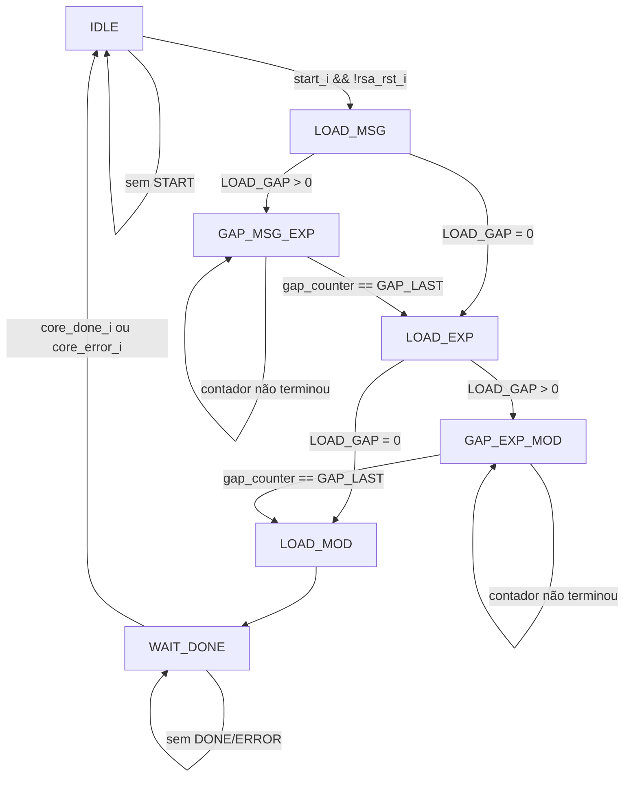

# `amba_3_apb_rsa_wrapper_control` — FSM e controle dos intervalos GAP

**Projeto:** RSA_APB · **Fonte analisada:** `amba_3_apb_rsa_wrapper_control.sv`  
**Estado:** arquitetura de sete estados definida; **o arquivo recebido contém um erro sintático a corrigir**.

## 1. Objetivo

Este módulo é o **control_path** do wrapper RSA. Reconhece START em IDLE, percorre os estados de carregamento MSG → EXP → MOD, insere `LOAD_GAP` ciclos ociosos entre operandos e aguarda os pulsos terminais `core_done_i`/`core_error_i`. Sua principal saída é o estado atual `c_state_o[6:0]`, consumido pelo módulo `rsa_wrapper_data`.

Não seleciona diretamente os operandos, não produz `core_load` nem mantém o RESULT. Essas funções pertencem, respectivamente, ao `data_path`, à interface com `rsa_core` e ao regbank.

## 2. Parâmetros e sinais

| Parâmetro | Valor padrão | Função |
|---|---:|---|
| `LOAD_GAP` | 0 | Ciclos ociosos entre MSG/EXP e EXP/MOD. |
| `GAP_WIDTH` | 1 | Largura do contador GAP (sobrescrita pelo wrapper_top). |
| `GAP_LAST` | `'0` | Última contagem no estado GAP (sobrescrita pelo wrapper_top). |
| `IDLE`, `LOAD_MSG`, `GAP_MSG_EXP`, `LOAD_EXP`, `GAP_EXP_MOD`, `LOAD_MOD`, `WAIT_DONE` | One-Hot | Parâmetros tipados `logic [6:0]`, recebidos do wrapper_top. |

| Porta | Direção | Finalidade |
|---|---|---|
| `pclk_i` | Entrada | Clock do registrador de estado e do contador. |
| `presetn_i` | Entrada | Reset global assíncrono ativo baixo. |
| `rsa_rst_i` | Entrada | Reset RSA síncrono da FSM, com prioridade. |
| `start_i` | Entrada | Comando de início, amostrado em IDLE. |
| `core_done_i` | Entrada | Pulso de sucesso proveniente do núcleo. |
| `core_error_i` | Entrada | Pulso de erro proveniente do núcleo. |
| `c_state_o` | Saída | Estado atual One-Hot enviado ao `data_path`. |

Internamente são declarados `logic [6:0] c_state, n_state` e `logic [GAP_WIDTH-1:0] gap_counter`.

## 3. Máquina de estados One-Hot

| Estado | Código | Significado |
|---|---|---|
| IDLE | `0000001` | Aguarda START. |
| LOAD_MSG | `0000010` | Carregamento da mensagem. |
| GAP_MSG_EXP | `0000100` | Espera entre MSG e EXP. |
| LOAD_EXP | `0001000` | Carregamento do expoente. |
| GAP_EXP_MOD | `0010000` | Espera entre EXP e MOD. |
| LOAD_MOD | `0100000` | Carregamento do módulo. |
| WAIT_DONE | `1000000` | Aguarda DONE ou ERROR. |

`c_state` guarda o estado atual; `n_state` é calculado em `always_comb` e registrado no próximo `posedge pclk_i`. O reset carrega `IDLE`, nunca `'0`.

## 4. Fluxo de estados

O diagrama apresenta condições de operação normal. Reset global ou `rsa_rst_i` retorna o estado registrado a IDLE com prioridade sobre o fluxo.

## 5. Tabela de transições

| Estado atual | Condição | Próximo estado |
|---|---|---|
| IDLE | START inativo | IDLE |
| IDLE | START ativo e sem reset | LOAD_MSG |
| LOAD_MSG | `LOAD_GAP == 0` | LOAD_EXP |
| LOAD_MSG | `LOAD_GAP != 0` | GAP_MSG_EXP |
| GAP_MSG_EXP | `gap_counter < GAP_LAST` | GAP_MSG_EXP |
| GAP_MSG_EXP | `gap_counter == GAP_LAST` | LOAD_EXP |
| LOAD_EXP | `LOAD_GAP == 0` | LOAD_MOD |
| LOAD_EXP | `LOAD_GAP != 0` | GAP_EXP_MOD |
| GAP_EXP_MOD | `gap_counter < GAP_LAST` | GAP_EXP_MOD |
| GAP_EXP_MOD | `gap_counter == GAP_LAST` | LOAD_MOD |
| LOAD_MOD | Incondicional | WAIT_DONE |
| WAIT_DONE | Nem DONE nem ERROR | WAIT_DONE |
| WAIT_DONE | DONE ou ERROR | IDLE |

O RTL utiliza `!= GAP_LAST` implicitamente no `else`, não usa literalmente operador `<`; a tabela presume valores não negativos de `LOAD_GAP` e o contador iniciando em zero.

## 6. Por que WAIT_DONE volta a IDLE?

DONE/ERROR significam que a **operação corrente terminou**. O `control_path` não precisa permanecer em WAIT_DONE mantendo uma flag, porque a retenção de DONE/ERROR ocorre no `regbank` como bits sticky.

Na borda em que um evento terminal é amostrado, `c_state` retorna a IDLE; o regbank pode capturar o mesmo evento e, em DONE, armazenar `rsa_wp_dout_i`. No ciclo seguinte, BUSY derivado da FSM passa a zero. Se não surgir evento terminal, WAIT_DONE pode durar um número indefinido de ciclos.

## 7. Contador GAP compartilhado

O mesmo `gap_counter` atende `GAP_MSG_EXP` e `GAP_EXP_MOD`, porque esses estados nunca se sobrepõem.

- Fora dos estados GAP: `gap_counter <= '0`.
- Dentro de GAP e antes de `GAP_LAST`: incrementa em um a cada `PCLK`.
- Dentro de GAP e ao alcançar `GAP_LAST`: volta a zero e, na mesma borda, a FSM transita para o próximo LOAD.
- Com `LOAD_GAP = 0`: ambos os GAPs são bypassados.

A largura derivada do `wrapper_top` é `max(1, $clog2(LOAD_GAP))` e `GAP_LAST = LOAD_GAP-1`, para valores positivos.

### 7.1 Exemplos

| `LOAD_GAP` | Valores observáveis do contador durante cada GAP | Duração |
|---:|---|---:|
| 0 | Não entra em GAP. | 0 ciclos |
| 1 | `0` | 1 ciclo |
| 2 | `0, 1` | 2 ciclos |
| 3 | `0, 1, 2` | 3 ciclos |

Para `LOAD_GAP = 2`, a sequência operacional contém: LOAD_MSG → GAP (2) → LOAD_EXP → GAP (2) → LOAD_MOD → WAIT_DONE.

## 8. Prioridade de reset

O processo sequencial `always_ff @(posedge pclk_i or negedge presetn_i)` aplica:

1. `!presetn_i`: carrega IDLE e zera contador assincronamente.
2. `rsa_rst_i`: carrega IDLE e zera contador na borda de subida.
3. Caso contrário: `c_state <= n_state` e atualiza o contador segundo o estado.

Em IDLE, `start_i` é também qualificado por `!rsa_rst_i`. O caminho de reset e a máscara de saídas do `data_path` protegem a operação durante o aborto por SRST.

## 9. Integração com `wrapper_top` e `data`

- O `wrapper_top` fornece códigos de estado One-Hot e parâmetros do contador.
- Os pulsos `core_done` e `core_err` do núcleo chegam às entradas `core_done_i` e `core_error_i` do `control`.
- A saída `c_state_o` fornece apenas o **estado registrado** a `rsa_wrapper_data`.
- `data` decodifica esse estado e produz `core_load`, `core_din` e BUSY; não existe um contador GAP duplicado no `data`.

## 10. Estado sintático

O arquivo `amba_3_apb_rsa_wrapper_control.sv` atualmente contém um bloco
`WAIT_DONE` com sintaxe SystemVerilog válida. Referências a
`begin (provisional implementation)` em documentação anterior descreviam uma
versão antiga e não se aplicam ao RTL atual.

## 11. Pontos de atenção e validações futuras

- A implementação de `LOAD_GAP` pressupõe parâmetro inteiro **não negativo**.
- Não há verificação programada de condição One-Hot inválida além do `default` que aponta para IDLE.
- Pulsos terminais fora de WAIT_DONE não mudam a transição, mas o `wrapper_top` ainda os encaminha diretamente ao regbank.
- START deve corresponder a um comando aceito e não permanecer alto após a operação.
- A relação temporal entre a terceira carga e DONE/ERROR precisa ser confirmada no RTL real do `rsa_core`.
- Não foram executados lint, simulação ou síntese nesta etapa.

## 12. Resumo

O módulo é um sequenciador de START, três cargas, dois intervalos opcionais e espera por conclusão. Não manipula dados diretamente: publica seu estado ao `data_path`. O código de controle está arquiteturalmente definido, mas o erro sintático em WAIT_DONE requer correção antes da elaboração.
