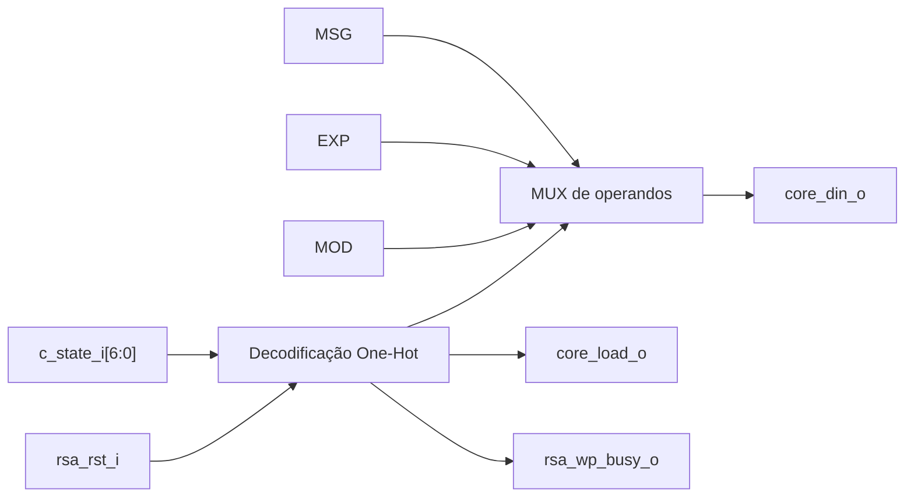

# `amba_3_apb_rsa_wrapper_data` — Caminho de dados do wrapper RSA

**Projeto:** RSA_APB · **Fonte analisada:** `amba_3_apb_rsa_wrapper_data.sv`  
**Estado:** descrição combinacional concluída em RTL; integração com o núcleo ainda não validada.

## 1. Objetivo

Decodificar os sete estados One-Hot fornecidos por `rsa_wrapper_control` e converter o estado atual em **seleção do operando** (`core_din_o`), **habilitação de carga** (`core_load_o`) e **ocupação** (`rsa_wp_busy_o`). É a realização combinacional das ações associadas à FSM; a determinação do próximo estado pertence ao `control_path`.

## 2. Interface e parâmetros

| Elemento | Tipo | Função |
|---|---|---|
| `DATA_WIDTH` | Parâmetro, 32 | Largura dos operandos. |
| `D_WID` | Parâmetro | Índice superior dos dados. |
| `IDLE` ... `WAIT_DONE` | Parâmetros One-Hot `[6:0]` | Códigos de estado recebidos do `wrapper_top`. |
| `rsa_rst_i` | Entrada, 1 | Anula imediatamente saídas do `data_path` quando alto. |
| `c_state_i` | Entrada, 7 | Estado atual vindo do `control`. |
| `op_msg_i` | Entrada, `DATA_WIDTH` | Mensagem M registrada. |
| `op_exp_i` | Entrada, `DATA_WIDTH` | Expoente e registrado. |
| `op_mod_i` | Entrada, `DATA_WIDTH` | Módulo n registrado. |
| `core_load_o` | Saída, 1 | Habilitação de captura do núcleo RSA. |
| `core_din_o` | Saída, `DATA_WIDTH` | Operando selecionado. |
| `rsa_wp_busy_o` | Saída, 1 | Ocupação da operação corrente. |

## 3. Estrutura combinacional

O módulo utiliza um `always_comb` sem registradores próprios. A estrutura tem uma condição de reset externa prioritária seguida por `case (c_state_i)`. **Todas as saídas são atribuídas em todos os ramos**, inclusive `default`, evitando inferência de latch.



## 4. Tabela completa de saídas

| Estado | `core_load_o` | `core_din_o` | `rsa_wp_busy_o` |
|---|---:|---|---:|
| IDLE | 0 | `'0` | 0 |
| LOAD_MSG | 1 | `op_msg_i` | 1 |
| GAP_MSG_EXP | 0 | `'0` | 1 |
| LOAD_EXP | 1 | `op_exp_i` | 1 |
| GAP_EXP_MOD | 0 | `'0` | 1 |
| LOAD_MOD | 1 | `op_mod_i` | 1 |
| WAIT_DONE | 0 | `'0` | 1 |
| Default/estado não reconhecido | 0 | `'0` | 0 |
| **Reset RSA ativo (`rsa_rst_i = 1`)** | **0** | **`'0`** | **0** |

A linha de reset tem prioridade sobre qualquer valor de `c_state_i`.

## 5. `core_din_o`: seleção de operandos

`core_din_o` é um multiplexador de três entradas úteis (`op_msg_i`, `op_exp_i`, `op_mod_i`). Cada uma corresponde exatamente a um estado LOAD. Nos demais estados, o barramento é zerado; esse zero **não deve ser interpretado como comando de escrita**, porque só `core_load_o` permite a captura.

Essa decisão não impede o processamento de operandos cujo valor seja efetivamente zero. Se `op_msg_i = 32'h0000_0000` durante LOAD_MSG, o núcleo captura um zero válido com `core_load = 1`.

## 6. `core_load_o`: três pulsos de carga

É alto somente em LOAD_MSG, LOAD_EXP e LOAD_MOD. Em uma execução normal, cada um desses estados dura um ciclo de `PCLK`; assim, o RSA recebe três bordas de captura com os operandos na sequência exigida.

Quando `LOAD_GAP = 0`, os pulsos de carga podem permanecer continuamente altos por três ciclos contíguos, enquanto `core_din` muda a cada transição de estado. Isso é compatível com a exigência funcional de três capturas sucessivas, mas deve ser confirmado com a implementação concreta do `rsa_core`.

Se `LOAD_GAP > 0`, os estados intermediários introduzem `core_load_o = 0` entre operandos.

## 7. `rsa_wp_busy_o`: sinalização de ocupação

BUSY é alto em **todos os estados exceto IDLE**, além de ser forçado a zero durante reset e em estados não reconhecidos.

Assim, BUSY inclui os estados GAP e WAIT_DONE, mesmo quando `core_load = 0`. Isso impede escritas concorrentes em MSG/EXP/MOD e novas solicitações START enquanto a operação ainda não terminou.

BUSY é derivado do estado **registrado** e **não** de `start_i`; evita-se dependência combinacional direta entre o comando START e a autorização de escrita por BUSY do regbank.

## 8. Máscara de reset

```systemverilog
if (rsa_rst_i)
    begin
        core_load_o   = '0;
        core_din_o    = '0;
        rsa_wp_busy_o = '0;
    end
```

Esse trecho reage combinacionalmente a `rsa_rst_i`, mesmo antes de `c_state` retornar a IDLE na próxima borda. O reset global assíncrono da FSM continua sendo implementado no `control` por `presetn_i`.

## 9. Exemplo temporal de carregamento

| Período após START | Estado | `core_din` | `core_load` | BUSY |
|---|---|---|---:|---:|
| 1 | LOAD_MSG | MSG | 1 | 1 |
| 2 | GAP_MSG_EXP (`LOAD_GAP = 1`) | 0 | 0 | 1 |
| 3 | LOAD_EXP | EXP | 1 | 1 |
| 4 | GAP_EXP_MOD (`LOAD_GAP = 1`) | 0 | 0 | 1 |
| 5 | LOAD_MOD | MOD | 1 | 1 |
| 6 em diante | WAIT_DONE | 0 | 0 | 1 |
| Após reconhecimento DONE/ERROR | IDLE | 0 | 0 | 0 |

O `data` não conta ciclos por conta própria; a duração de cada estado é definida pelo `control`.

## 10. Integração

- `wrapper_top` recebe operandos do regbank e os distribui ao `data`.
- `control.c_state_o` conecta-se a `data.c_state_i`.
- `data.core_din_o` e `data.core_load_o` conectam-se às entradas homônimas do núcleo através do `wrapper_top`.
- `data.rsa_wp_busy_o` é exposto pelo wrapper para STATUS.BUSY e o `apb_control`.
- `rsa_rst_i` é produzido pelo módulo de reset e compartilhado com `control` e o núcleo.

## 11. Limitações e pontos de atenção

1. A lógica assume estados One-Hot corretamente produzidos pelo `control`; qualquer outro vetor cai em `default` e desabilita carga/BUSY.
2. Operandos dependem da estabilidade do regbank; impedir alterações concorrentes enquanto BUSY = 1 é responsabilidade do controle de escrita APB.
3. O `data` não produz DONE nem ERROR e não registra o resultado; essas saídas vêm do `rsa_core` e passam pelo wrapper_top.
4. Os sinais são combinacionais; verificar setup/hold na interface do núcleo na futura análise de temporização.
5. Não houve verificação funcional nem síntese desta versão.

## 12. Resumo

O `rsa_wrapper_data` implementa o caminho de saída da FSM por decodificação do estado One-Hot: seleciona o operando, habilita a captura e informa BUSY. A sequência temporal é inteiramente determinada pelo `rsa_wrapper_control`.
