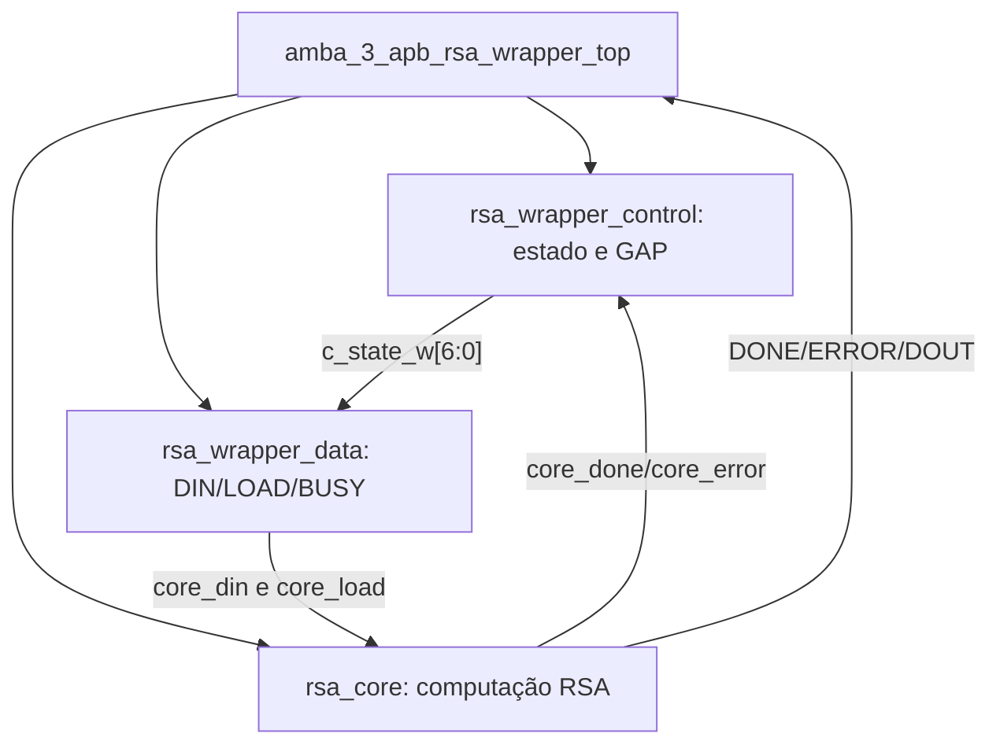

# `amba_3_apb_rsa_wrapper_top` — Integração da FSM com o núcleo RSA

**Projeto:** RSA_APB · **Fonte analisada:** `amba_3_apb_rsa_wrapper_top(1).sv`  
**Documento completo de referência:** `README_rsa_wrapper.md` fornecido junto ao projeto.  
**Estado:** conexões declaradas; a elaboração depende da correção sintática do `rsa_wrapper_control` e da presença do módulo `rsa_core`.

## 1. Objetivo

Ser a fronteira interna entre o banco de registradores do periférico APB e o núcleo `rsa_core`. Instancia três módulos: `amba_3_apb_rsa_wrapper_control`, `amba_3_apb_rsa_wrapper_data` e `rsa_core`. Não implementa diretamente a seleção de operandos nem as transições de estados: **essas responsabilidades são distribuídas aos submódulos**.

## 2. Hierarquia

## 3. Parâmetros e constantes

| Parâmetro | Valor | Finalidade |
|---|---:|---|
| `DATA_WIDTH` | 32 | Largura de operandos e resultado. |
| `D_WID` | `DATA_WIDTH - 1` | Índice superior de barramentos. |
| `LOAD_GAP` | 0 | Ciclos de espera entre carregamentos. |

Os sete estados One-Hot são definidos por `localparam logic [6:0]` e entregues a ambos `control` e `data`. `GAP_WIDTH` e `GAP_LAST` também são derivados no `top` e passados ao `control`.

## 4. Interface do top

| Sinais | Direção | Finalidade |
|---|---|---|
| `pclk_i`, `presetn_i` | Entrada | Clock e reset global da FSM. |
| `presetnsync_i` | Entrada | Declarado, mas **não utilizado** no corpo do módulo. |
| `start_i` | Entrada | Comando START do regbank. |
| `rsa_rst_i` | Entrada | Reset RSA vindo do bloco de reset. |
| `op_msg_i`, `op_exp_i`, `op_mod_i` | Entrada | Operandos de `DATA_WIDTH` bits do regbank. |
| `rsa_wp_busy_o` | Saída | Ocupação vinda do `data`. |
| `rsa_wp_done_o`, `rsa_wp_error_o` | Saída | Pulsos terminais do núcleo, repassados diretamente. |
| `rsa_wp_dout_o` | Saída | Resultado do núcleo, repassado diretamente. |

## 5. Sinais de interconexão

| Sinal interno | Origem → destino |
|---|---|
| `c_state_w[6:0]` | `control.c_state_o` → `data.c_state_i`. |
| `core_clk` | `pclk_i` → `rsa_core.core_clk`. |
| `core_rst` | `rsa_rst_i` → `rsa_core.core_rst`. |
| `core_load` | `data.core_load_o` → `rsa_core.core_load`. |
| `core_din[D_WID:0]` | `data.core_din_o` → `rsa_core.core_din`. |
| `core_done` | `rsa_core.core_done` → `control.core_done_i` e `rsa_wp_done_o`. |
| `core_error` | `rsa_core.core_err` → `control.core_error_i` e `rsa_wp_error_o`. |
| `core_dout[D_WID:0]` | `rsa_core.core_dout` → `rsa_wp_dout_o`. |

A porta `rsa_core.core_clk_o` está desconectada por `.core_clk_o()` e não tem consumidor nessa hierarquia.

## 6. Operação de alto nível

1. O regbank apresenta MSG, EXP e MOD e gera um pulso START válido.
2. O `control` reconhece START em IDLE e fornece `c_state_w` ao `data`.
3. O `data` coloca MSG/EXP/MOD em `core_din`, ativando `core_load` em seus respectivos estados LOAD; os GAPs opcionais mantêm `core_load = 0`.
4. Após a terceira captura, a FSM entra em WAIT_DONE; BUSY permanece em 1.
5. `core_done` ou `core_err` faz o `control` voltar a IDLE; o `top` encaminha o evento ao regbank, que mantém flag sticky e captura RESULT se DONE.

## 7. Reset

- `core_rst = rsa_rst_i` sem nova combinação no wrapper; o módulo dedicado de reset já incorpora PRESETn sincronizado e SRST.
- O `control` usa `presetn_i` como reset assíncrono dos FFs de estado e `rsa_rst_i` como condição prioritária de retorno síncrono a IDLE.
- O `data` força LOAD/DIN/BUSY a zero enquanto `rsa_rst_i` está ativo.

## 8. Pendências explícitas da versão fornecida

1. A porta `presetnsync_i` permanece sem uso; avaliar sua remoção para simplificar o pinout.
2. O arquivo `rsa_wrapper_control(1).sv` contém `begin (provisional implementation)` em WAIT_DONE, **erro de sintaxe a corrigir**.
3. O `top` repassa DONE/ERROR diretamente; a saída não é mascarada pelo estado da FSM. Os pulsos do `rsa_core` devem ser consistentes.
4. A implementação interna do `rsa_core` não está incluída entre os nove arquivos recebidos; sua temporização e semântica exata não podem ser verificadas a partir do top isolado.
5. A duração de START e a janela de liberação de reset serão confirmadas na integração.
6. Nenhuma simulação/síntese foi realizada nesta revisão documental.

## 9. Documentação complementar

Para as tabelas completas de transição, lógica GAP, mapas de saídas e sequências ciclo a ciclo, consultar:

- `../amba_3_apb_rsa_wrapper_control/README.md`
- `../amba_3_apb_rsa_wrapper_data/README.md`
- `../README_rsa_wrapper.md` (README original e aprofundado do wrapper completo).

**Resumo:** o `top` é um integrador hierárquico. Centraliza os parâmetros e conexões; o control sequencia e o data distribui os operandos ao núcleo RSA.
