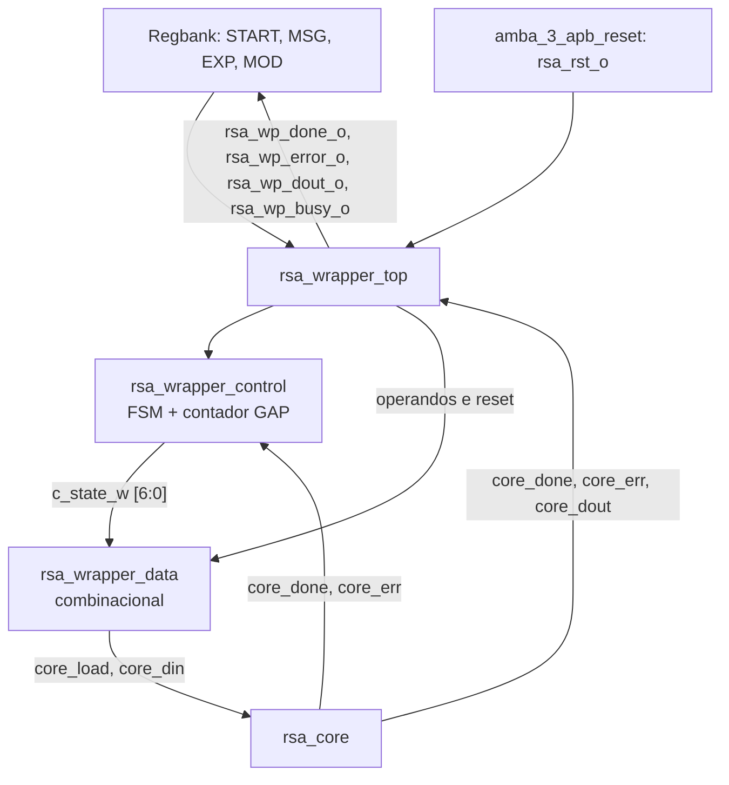

# `amba_3_apb_rsa_wrapper_top` — Arquitetura, controle e caminho de dados

**Projeto:** RSA_APB — coprocessador RSA com interface AMBA 3 APB  
**Módulo superior:** `amba_3_apb_rsa_wrapper_top`  
**Linguagem:** SystemVerilog  
**Fonte RTL:** `amba_3_apb_rsa_wrapper_top.sv`  
**Estado:** arquitetura RTL inicial; integração e verificação funcional pendentes.

## 1. Objetivo e escopo

O **`amba_3_apb_rsa_wrapper_top`** é o integrador hierárquico entre os registradores de software do periférico RSA_APB e o núcleo de processamento `rsa_core`. Ele recebe três operandos de `DATA_WIDTH` bits — mensagem **M**, expoente **e** e módulo **n** — e entrega-os ao núcleo, **nessa ordem**, através de um único barramento `core_din` e do habilitador `core_load`.

Uma operação é iniciada quando o wrapper aceita `start_i` no estado `IDLE`. Após os três carregamentos, aguarda-se a conclusão (`core_done`) ou um erro (`core_err`). O wrapper informa se está ocupado (`rsa_wp_busy_o`) e encaminha ao restante do sistema os eventos e os dados produzidos pelo núcleo.

O conjunto wrapper **não implementa o protocolo APB**, não decodifica endereços e **não armazena as flags sticky** de STATUS nem o registrador RESULT. Essas funções pertencem, respectivamente, ao controle APB e ao banco de registradores.

**Base documental:** `apb_integration.pdf`, especialmente §3.2 (interface do núcleo), §4.3 (carregamento), §4.4 (conclusão/erro), §4.5 (reset) e §6.1 (START/SRST). A sequência funcional é prescrita pelo documento; a FSM de sete estados é uma **decisão de microarquitetura deste projeto**.

## 2. Organização dos arquivos

| Arquivo | Módulo | Responsabilidade |
|---|---|---|
| `amba_3_apb_rsa_wrapper_top.sv` | `amba_3_apb_rsa_wrapper_top` | Interface externa, parâmetros e constantes compartilhadas, interconexões e instanciações de `control`, `data` e `rsa_core`. |
| `amba_3_apb_rsa_wrapper_control.sv` | `amba_3_apb_rsa_wrapper_control` | FSM sequencial/combinacional, controle das transições e contador para `LOAD_GAP`. |
| `amba_3_apb_rsa_wrapper_data.sv` | `amba_3_apb_rsa_wrapper_data` | Seleção combinacional de `core_din_o`, geração de `core_load_o` e de `rsa_wp_busy_o`. |
| `rsa_core` (externo) | `rsa_core` | Executa a exponenciação modular e fornece DONE, ERROR e resultado. |

### 2.1 Hierarquia e fluxo de sinais

O diagrama simplifica os fios internos: `core_clk = pclk_i` e `core_rst = rsa_rst_i` são atribuídos no `top`; `rsa_wp_busy_o` é produzido pelo `data`, enquanto DONE, ERROR e DOUT são repassados diretamente pelo `top` a partir do `rsa_core`.

### 2.2 Sinais de interconexão do `top`

A tabela complementa o diagrama e identifica, de forma inequívoca, quem produz e quem consome cada sinal. O `top` apenas interliga os submódulos; não implementa a FSM ou o MUX de operandos.

| Sinal no `top` | Origem | Destino |
|---|---|---|
| `c_state_w[6:0]` | `control.c_state_o` | `data.c_state_i` |
| `core_clk` | `pclk_i` | `rsa_core.core_clk` |
| `core_rst` | `rsa_rst_i` | `rsa_core.core_rst` |
| `core_load` | `data.core_load_o` | `rsa_core.core_load` |
| `core_din[D_WID:0]` | `data.core_din_o` | `rsa_core.core_din` |
| `core_done` | `rsa_core.core_done` | `control.core_done_i` e `rsa_wp_done_o` |
| `core_error` | `rsa_core.core_err` | `control.core_error_i` e `rsa_wp_error_o` |
| `core_dout[D_WID:0]` | `rsa_core.core_dout` | `rsa_wp_dout_o` |
| `rsa_wp_busy_o` | `data.rsa_wp_busy_o` | Interface externa do wrapper |

A porta `core_clk_o` do núcleo é mantida desconectada por `.core_clk_o()` no módulo superior descrito nos READMEs de origem.

## 3. Parâmetros e constantes do `top`

| Parâmetro | Valor padrão | Uso |
|---|---:|---|
| `DATA_WIDTH` | `32` | Largura dos operandos e do resultado. |
| `D_WID` | `DATA_WIDTH - 1` | Índice superior dos vetores `[D_WID:0]`. |
| `LOAD_GAP` | `0` | Número de ciclos ociosos **entre** duas cargas consecutivas. |

No corpo do `top`, os `localparam` definem as sete codificações One-Hot e os parâmetros derivados do contador:

- `GAP_WIDTH = (LOAD_GAP > 1) ? $clog2(LOAD_GAP) : 1`.
- `GAP_LAST = (LOAD_GAP > 0) ? GAP_WIDTH'(LOAD_GAP - 1) : '0`.

**Requisito de parametrização:** `LOAD_GAP` deve ser inteiro não negativo. `DATA_WIDTH` deve ser compatível com a implementação concreta de `rsa_core`. Os códigos One-Hot e parâmetros derivados são definidos no `top` e passados aos submódulos; os submódulos possuem defaults de parametrização, mas as instâncias do `top` são a referência efetiva nessa hierarquia.

## 4. Interface externa do `rsa_wrapper_top`

| Porta | Direção | Largura | Origem/destino | Função |
|---|---|---|---|---|
| `pclk_i` | Entrada | 1 | Clock do sistema | Clock da FSM e do `rsa_core`. |
| `presetn_i` | Entrada | 1 | Reset APB global | Reset assíncrono ativo baixo dos registradores da FSM. |
| `presetnsync_i` | Entrada | 1 | Bloco de reset | **Presente no cabeçalho, mas não utilizado no RTL atual do top**. |
| `start_i` | Entrada | 1 | `regbank` | Comando para iniciar operação, reconhecido em `IDLE`. |
| `rsa_rst_i` | Entrada | 1 | `amba_3_apb_reset` | Reset ativo alto do núcleo; aborta sincronamente a FSM e mascara saídas de `data`. |
| `op_msg_i` | Entrada | `DATA_WIDTH` | `regbank` | Mensagem M. |
| `op_exp_i` | Entrada | `DATA_WIDTH` | `regbank` | Expoente e. |
| `op_mod_i` | Entrada | `DATA_WIDTH` | `regbank` | Módulo n. |
| `rsa_wp_busy_o` | Saída | 1 | Controle APB e regbank | Indicador de operação em andamento. |
| `rsa_wp_done_o` | Saída | 1 | `regbank` | Encaminha diretamente `core_done`. |
| `rsa_wp_error_o` | Saída | 1 | `regbank` | Encaminha diretamente `core_err`, ligado internamente como `core_error`. |
| `rsa_wp_dout_o` | Saída | `DATA_WIDTH` | `regbank` | Encaminha diretamente `core_dout`. |

**Convenção de nomes:** `core_*` é reservado à interface interna do núcleo dentro do wrapper; `rsa_wp_*` identifica sinais disponibilizados pelo wrapper aos outros blocos.

## 5. `control_path` — FSM de sete estados One-Hot

O módulo `amba_3_apb_rsa_wrapper_control` contém:

- `logic [6:0] c_state, n_state`: estado registrado e próximo estado.
- `logic [GAP_WIDTH-1:0] gap_counter`: contador dos ciclos ociosos.
- `always_comb`: lógica de transição de estados.
- `always_ff @(posedge pclk_i or negedge presetn_i)`: atualização de estado e contador.
- `assign c_state_o = c_state`: disponibiliza o estado atual ao módulo `data`.

### 5.1 Codificação One-Hot

| Estado | Código `[6:0]` | Significado |
|---|---|---|
| `IDLE` | `7'b0000001` | Repouso; aguarda START. |
| `LOAD_MSG` | `7'b0000010` | Apresenta MSG ao núcleo e habilita captura. |
| `GAP_MSG_EXP` | `7'b0000100` | Intervalo ocioso entre MSG e EXP. |
| `LOAD_EXP` | `7'b0001000` | Apresenta EXP ao núcleo e habilita captura. |
| `GAP_EXP_MOD` | `7'b0010000` | Intervalo ocioso entre EXP e MOD. |
| `LOAD_MOD` | `7'b0100000` | Apresenta MOD ao núcleo e habilita captura. |
| `WAIT_DONE` | `7'b1000000` | Espera sinal terminal do núcleo. |

Em cada estado válido, **um único bit** de `c_state` está em nível alto. O reset carrega `IDLE`, não `'0`, porque `7'b0000000` não é um estado definido.

### 5.2 Tabela de transições

| Estado atual | Condição (sem reset) | Próximo estado |
|---|---|---|
| `IDLE` | `start_i == 0` | `IDLE` |
| `IDLE` | `start_i == 1` | `LOAD_MSG` |
| `LOAD_MSG` | `LOAD_GAP == 0` | `LOAD_EXP` |
| `LOAD_MSG` | `LOAD_GAP > 0` | `GAP_MSG_EXP` |
| `GAP_MSG_EXP` | `gap_counter != GAP_LAST` | `GAP_MSG_EXP` |
| `GAP_MSG_EXP` | `gap_counter == GAP_LAST` | `LOAD_EXP` |
| `LOAD_EXP` | `LOAD_GAP == 0` | `LOAD_MOD` |
| `LOAD_EXP` | `LOAD_GAP > 0` | `GAP_EXP_MOD` |
| `GAP_EXP_MOD` | `gap_counter != GAP_LAST` | `GAP_EXP_MOD` |
| `GAP_EXP_MOD` | `gap_counter == GAP_LAST` | `LOAD_MOD` |
| `LOAD_MOD` | Incondicional | `WAIT_DONE` |
| `WAIT_DONE` | `!core_done_i && !core_error_i` | `WAIT_DONE` |
| `WAIT_DONE` | `core_done_i || core_error_i` | `IDLE` |
| Qualquer estado | `!presetn_i` | `IDLE` (assíncrono) |
| Qualquer estado | `rsa_rst_i` | `IDLE` (na borda de clock) |
| Código não reconhecido | Ramo `default` | `IDLE` (na borda seguinte) |

### 5.3 O que acontece em cada transição

1. **`IDLE` → `LOAD_MSG`:** em uma borda de subida, com `start_i = 1` e `rsa_rst_i = 0`, a FSM aceita o comando. Na fase seguinte, `data` habilita `core_load` e seleciona MSG.
2. **Estados LOAD:** cada estado permanece por um ciclo completo de `PCLK`. A próxima borda captura o operando no `rsa_core` e desloca a FSM para o estado seguinte.
3. **Estados GAP:** `core_load` fica em zero enquanto o contador progride. Ao atingir `GAP_LAST`, a próxima borda leva ao próximo LOAD.
4. **`WAIT_DONE`:** a FSM permanece aqui enquanto DONE e ERROR estiverem inativos. Quando um deles estiver alto antes de uma borda, a FSM retorna a `IDLE` nessa borda.
5. **Retorno a IDLE:** encerra a operação atual e permite receber outro START. O registro permanente de DONE, ERROR e RESULT não é uma função do `control`.

A verificação `start_i && !rsa_rst_i` no estado IDLE impede iniciar uma operação sob reset síncrono. No processo sequencial, `rsa_rst_i` tem prioridade sobre as transições da FSM.

### 5.4 Contador GAP — duração exata

Um **único contador** serve aos dois estados GAP, porque eles nunca estão ativos simultaneamente. Fora deles, o contador recebe `'0`. Dentro deles:

- Se `gap_counter != GAP_LAST`, o contador incrementa a cada borda.
- Se `gap_counter == GAP_LAST`, o contador retorna a `'0` e a FSM passa ao próximo LOAD.

Exemplo para `LOAD_GAP = 3`: ao entrar em GAP, o contador está em `0`; o estado é mantido por três períodos de clock com contagens observáveis `0`, `1` e `2`. Na terceira borda dentro da espera ocorre a transição. Não há um quarto ciclo de espera.

Para `LOAD_GAP = 0`, os GAPs são bypassados no `control_path` e não fazem parte do fluxo normal. O RTL conserva as codificações e os ramos, mas a síntese pode eliminar a lógica inalcançável se conseguir provar o valor constante do parâmetro.

### 5.5 RESET e prioridade sequencial

O processo sequencial tem a ordem de prioridade:

1. `!presetn_i`: força imediatamente `c_state <= IDLE` e `gap_counter <= '0`.
2. `rsa_rst_i`: na borda de subida, também força IDLE e zera o contador, abortando uma operação.
3. Operação normal: atualiza `c_state <= n_state` e o contador GAP.

**Nota:** `rsa_rst_i` já é gerado no módulo de reset do sistema e combina a condição global de liberação sincronizada com SRST. O wrapper **não deve recombinar** esses resets.

## 6. `data_path` — decodificação combinacional do estado

`amba_3_apb_rsa_wrapper_data` recebe `c_state_i[6:0]`, `rsa_rst_i` e os três operandos. O bloco `always_comb` define integralmente três saídas, sem flip-flops locais e sem inferência intencional de *latches*.

### 6.1 Tabela de saídas

| `c_state_i` | `core_load_o` | `core_din_o` | `rsa_wp_busy_o` |
|---|---:|---|---:|
| `IDLE` | 0 | `'0` | 0 |
| `LOAD_MSG` | 1 | `op_msg_i` | 1 |
| `GAP_MSG_EXP` | 0 | `'0` | 1 |
| `LOAD_EXP` | 1 | `op_exp_i` | 1 |
| `GAP_EXP_MOD` | 0 | `'0` | 1 |
| `LOAD_MOD` | 1 | `op_mod_i` | 1 |
| `WAIT_DONE` | 0 | `'0` | 1 |
| Estado inválido (`default`) | 0 | `'0` | 0 |
| `rsa_rst_i = 1` (prioritário) | 0 | `'0` | 0 |

### 6.2 `core_din_o`: MUX de operandos

`core_din_o` seleciona uma das entradas `op_msg_i`, `op_exp_i` ou `op_mod_i` de acordo com o estado LOAD. Fora desses estados recebe `'0`. Esse zero não significa uma escrita: **somente `core_load_o = 1` habilita a captura**. Assim, operandos iguais a zero continuam válidos.

Não é necessário registrar novamente a seleção no wrapper: `c_state_i` já é registrado pelo `control`, e os operandos são mantidos no `regbank` enquanto a operação está ocupada.

### 6.3 `core_load_o`: habilitação de captura

`core_load_o` vale 1 exclusivamente nos estados `LOAD_MSG`, `LOAD_EXP` e `LOAD_MOD`. Cada um dura um ciclo de clock para `LOAD_GAP >= 0`. Dessa forma, o núcleo recebe três ciclos válidos de carregamento, consecutivos se `LOAD_GAP = 0` ou separados por intervalos se `LOAD_GAP > 0`.

### 6.4 `rsa_wp_busy_o`: operação em andamento

BUSY vale 1 em **todos** os estados exceto IDLE e código inválido. Isso inclui GAP e WAIT_DONE, pois a operação já foi iniciada e ainda não terminou.

No RTL atual, BUSY é uma função combinacional de `c_state_i` (e da prioridade de reset), **não** uma função combinacional de `start_i`. Essa escolha evita um caminho de realimentação imediato com a lógica de aceitação de START no `regbank`.

Na borda em que DONE/ERROR é reconhecido, `c_state` passa a IDLE; após a atualização do estado, BUSY retorna a zero. O instante exato de reconhecimento depende de quando os pulsos do núcleo se tornam visíveis.

### 6.5 Reset no `data_path`

Se `rsa_rst_i = 1`, a primeira condição do `always_comb` força imediatamente `core_load_o = 0`, `core_din_o = '0` e `rsa_wp_busy_o = 0`, independentemente do estado atual. Isso inibe carregamentos durante a solicitação de reset, mesmo antes de a FSM atualizar `c_state` na próxima borda.

## 7. Sequência temporal de uma operação

### 7.1 Exemplo: `LOAD_GAP = 0`

A tabela representa períodos **após** a borda em que START é aceito. `E0`, `E1` etc. são bordas consecutivas de subida de PCLK.

| Intervalo | Estado registrado | `core_din` | `core_load` | Ação na borda seguinte |
|---|---|---|---:|---|
| Antes de E0 | `IDLE`, `start_i = 1` | `'0` | 0 | E0: FSM entra em `LOAD_MSG` |
| E0 → E1 | `LOAD_MSG` | MSG | 1 | E1: núcleo captura MSG; FSM entra em `LOAD_EXP` |
| E1 → E2 | `LOAD_EXP` | EXP | 1 | E2: núcleo captura EXP; FSM entra em `LOAD_MOD` |
| E2 → E3 | `LOAD_MOD` | MOD | 1 | E3: núcleo captura MOD; FSM entra em `WAIT_DONE` |
| E3 → evento | `WAIT_DONE` | `'0` | 0 | Aguarda DONE/ERROR |
| Evento presente antes de Efinal | `WAIT_DONE` | `'0` | 0 | Efinal: FSM retorna a `IDLE`; `regbank` pode capturar evento/resultado na mesma borda |

A duração da espera depende da implementação real de `rsa_core` e de `T_core`; a tabela não presume uma latência fixa. A saída DONE/ERROR é repassada pelo `top`, e RESULT deve ser capturado pelo `regbank` quando DONE estiver válido.

### 7.2 Exemplo: `LOAD_GAP = 2`

Após o START: `LOAD_MSG` (1 ciclo) → `GAP_MSG_EXP` (2 ciclos) → `LOAD_EXP` (1 ciclo) → `GAP_EXP_MOD` (2 ciclos) → `LOAD_MOD` (1 ciclo) → `WAIT_DONE` (até evento). Nos intervalos GAP, `core_load = 0` e BUSY permanece em 1.

A quantidade de ciclos ociosos **entre** os carregamentos é `2 × LOAD_GAP`, porque existem exatamente duas separações entre os três operandos.

## 8. Interface física do `rsa_core`

| Conexão no top | Porta do núcleo | Observação |
|---|---|---|
| `core_clk = pclk_i` | `core_clk` | Domínio único de clock. |
| `core_rst = rsa_rst_i` | `core_rst` | Reset ativo alto, amostrado pelo núcleo de forma síncrona. |
| `core_load` do `data` | `core_load` | Pulso de um ciclo por operando. |
| `core_din` do `data` | `core_din` | Barramento compartilhado dos operandos. |
| `core_done` | `core_done` | É encaminhado ao `control` e a `rsa_wp_done_o`. |
| `core_error` | `core_err` | A porta real do núcleo chama-se `core_err`, não `core_error`. |
| `core_dout` | `core_dout` | É encaminhado a `rsa_wp_dout_o`. |
| Não conectada | `core_clk_o` | Instanciada como `.core_clk_o()`, sem consumidor nesta hierarquia. |

Os parâmetros `RESET` e `LOAD` do `rsa_core` são instanciados como `1'b1`, conforme a versão de integração fornecida. Convém conferir se o RTL interno do núcleo usa esses parâmetros exatamente como esperado.

## 9. Integração com os demais blocos do RSA_APB

### 9.1 `regbank` → wrapper

`regbank` mantém MSG, EXP e MOD em registradores dedicados e produz `start_o` a partir de uma escrita válida no bit CTRL.START. O `top` do sistema liga esses sinais a `op_msg_i`, `op_exp_i`, `op_mod_i` e `start_i` do wrapper.

O `apb_control` impede escritas de operandos enquanto BUSY estiver em 1. Como consequência, cada operando precisa permanecer estável durante seu estado de carregamento.

### 9.2 Wrapper → `regbank`

- `rsa_wp_busy_o` informa STATUS.BUSY e participa das regras de autorização de escrita.
- `rsa_wp_done_o` provoca a atualização sticky de STATUS.DONE e a captura de `rsa_wp_dout_o` em RESULT.
- `rsa_wp_error_o` provoca a atualização sticky de STATUS.ERROR; RESULT conserva o valor anterior.

O wrapper **não mantém** DONE/ERROR sticky: ele encaminha pulsos do núcleo. O `regbank` é responsável pela retenção e pela limpeza W1C/START/SRST.

### 9.3 Bloco de reset → wrapper

`amba_3_apb_reset` recebe `PRESETn` e o comando SRST, sincroniza a liberação do reset global e gera `rsa_rst_o` ativo alto. Essa saída alimenta `rsa_rst_i` do wrapper. O wrapper, por sua vez, passa esse sinal diretamente a `core_rst` e usa-o para retornar sua FSM a IDLE.

Dessa forma, a lógica de combinação entre reset sincronizado e SRST **permanece no módulo de reset**, e não é duplicada dentro do wrapper.

## 10. Decisões de projeto, limitações e itens pendentes

O bloco `WAIT_DONE` em `amba_3_apb_rsa_wrapper_control.sv` tem sintaxe válida na versão atual. Descrições de uma construção `begin (provisional implementation)` referem-se a uma versão anterior e estão obsoletas.

1. **`presetnsync_i` não utilizado:** ainda existe como porta externa do `rsa_wrapper_top`, embora `rsa_rst_i` já incorpore a liberação sincronizada. Decidir se será removido na consolidação das interfaces.
2. **START deve ser pulso válido:** o `control` reconhece `start_i` enquanto em IDLE. Se START permanecer em nível alto até o retorno a IDLE, poderá iniciar outra operação. A integração deve assegurar a duração correta do comando e a aceitação de START somente quando permitido.
3. **DONE/ERROR são encaminhados diretamente:** o `top` não mascara esses pulsos pelo estado `WAIT_DONE`. O `control` somente transita por eles em `WAIT_DONE`, mas o `regbank` poderá vê-los sempre que o núcleo os emitir. Confirmar pelo RTL do núcleo que esses sinais não aparecem indevidamente durante reset ou carregamento.
4. **Condição simultânea DONE e ERROR:** qualquer um encerra a FSM; ambos juntos serão encaminhados ao `regbank`. A especificação funcional não detalha sua ocorrência simultânea. A prioridade/validade desse caso deve ser verificada na integração.
5. **Codificação One-Hot:** existe fallback `default → IDLE`, mas não há mecanismo específico de detecção/registro de erro de estado inválido. O tratamento final de estados ilegais pode ser revisto conforme os requisitos de robustez do ASIC.
6. **`LOAD_GAP` parametrizado:** a implementação pressupõe `LOAD_GAP >= 0`; valores negativos não fazem parte do contrato do módulo.
7. **Temporização do núcleo:** confirmar no RTL real de `rsa_core` quando `core_done`, `core_err` e `core_dout` se tornam válidos em relação à terceira carga e às bordas de clock. A captura de RESULT e a desativação de BUSY dependem dessa relação temporal.
8. **Sem validação executada:** este documento consolida o RTL e as decisões de arquitetura relatadas nos dois READMEs originais. Não foram executados testbenches, lint, síntese, STA ou verificação formal nesta etapa. As observações não equivalem a uma certificação funcional.

## 11. Resumo operacional

1. O sistema grava M, e e n no `regbank`, em qualquer ordem, enquanto não estiver ocupado.
2. Uma escrita válida em CTRL.START produz `start_i`.
3. O `control` sai de IDLE, avançando por `LOAD_MSG`, `LOAD_EXP` e `LOAD_MOD`, com GAPs opcionais.
4. O `data` multiplexa os operandos sobre `core_din`, ativa `core_load` apenas nas três cargas e mantém BUSY durante toda a operação.
5. O `rsa_core` processa os três operandos após a última carga.
6. `core_done` ou `core_err` faz a FSM sair de `WAIT_DONE` e retornar a `IDLE`.
7. O `regbank` captura o resultado/erro, mantém as flags sticky e permite novas solicitações quando BUSY voltar a zero.

**Situação:** divisão `top`/`control`/`data` descrita em um único README. O RTL inicial exige as correções e verificações da seção 10 antes de ser considerado integrado e validado.
