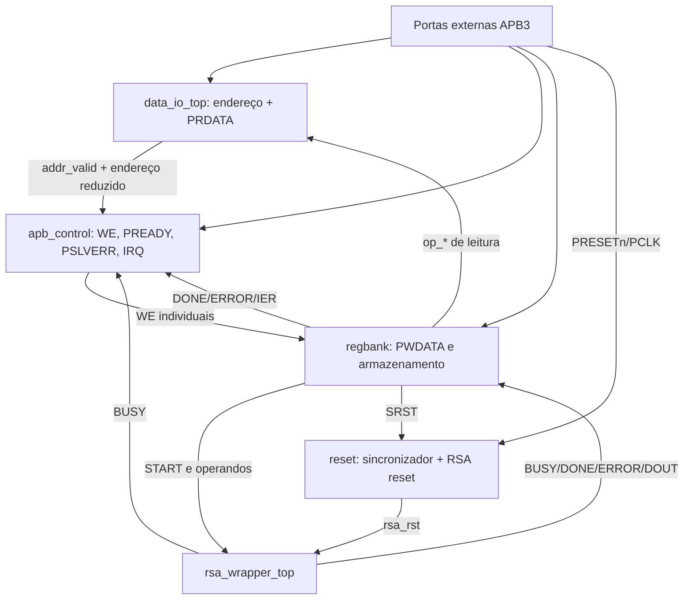

# `rsa_apb_top` — Topo geral da interface APB para o núcleo RSA

**Projeto:** RSA_APB · **Fonte analisada:** `amba_3_apb_top.sv`  
**Nome do módulo declarado no arquivo:** `rsa_apb_top` (não `amba_3_apb_top`).  
**Estado real:** **esqueleto de integração desatualizado e incompleto**; não representa ainda o sistema final.

## 1. Objetivo arquitetural pretendido

Reunir o escravo APB3, o caminho de leitura, o banco de registradores, a geração de reset e o wrapper que contém o núcleo RSA. É a fronteira externa do periférico para o mestre APB.

No entanto, **o RTL anexado ainda instancia apenas uma versão antiga de `amba_3_apb_data_io_top`** e não conecta os demais módulos já desenvolvidos. Os comportamentos descritos como *planejados* abaixo não devem ser confundidos com funções efetivamente implementadas nesse arquivo.

## 2. Interface externa declarada

| Porta | Direção | Largura atual | Papel |
|---|---|---|---|
| `pclk_i` | Entrada | 1 | Clock APB e RSA. |
| `presetn_i` | Entrada | 1 | Reset global ativo baixo. |
| `pwdata_i` | Entrada | `DATA_WIDTH` | Dados de escrita APB. |
| `paddr_i` | Entrada | `ADDR_WIDTH` | Endereço APB. |
| `psel_i` | Entrada | 1 | Seleção do escravo. |
| `penable_i` | Entrada | 1 | Fase ACCESS. |
| `pwrite_i` | Entrada | 1 | Direção da transação. |
| `prdata_o` | Saída | `DATA_WIDTH` | Dado de leitura APB. |
| `pready_o` | Saída | 1 | Transferência concluída / zero wait states. |
| `pslverr_o` | Saída | 1 | Indicação de transação inválida. |
| `irq_o` | Saída | 1 | Interrupção ativa alta. |

Parâmetros atuais: `DATA_WIDTH = 32`, `D_WID = DATA_WIDTH - 1`, `ADDR_WIDTH = 11` e `A_WID = ADDR_WIDTH - 1`.

**Incompatibilidade documental:** `apb_integration.pdf` define `PADDR` com 12 bits. O `data_io_top` atualizado também utiliza `ADDR_WIDTH = 12`. O topo ainda usa 11.

## 3. O que o arquivo efetivamente implementa

O RTL atualmente contém:

1. Declarações de vários fios internos `op_*_i_w` e `op_*_o_w` herdados da organização anterior com demux.
2. Uma conexão direta `assign prdata_o = prdata_o_w`.
3. Uma instância `u_data_io_top` **usando a lista antiga de portas**, incluindo `pwdata_i`, `op_ctl_i` e `op_*_o`.
4. Um trecho comentado com atribuições padrão para `pready_o`, `pslverr_o`, `irq_o` e outros fios.

Não há instanciação de `apb_control`, `regbank`, `reset` ou `rsa_wrapper_top` nesta versão.

## 4. Erros e pendências concretos do código atual

| Item | Evidência | Consequência |
|---|---|---|
| Endereço com 11 bits | `ADDR_WIDTH = 11` | Não corresponde à janela APB3 de 12 bits definida pelo projeto. |
| Instanciação antiga de dados | `.pwdata_i(pwdata_i)` | A porta foi removida do `data_io_top` atual. |
| Referência a CTRL no MUX | `.op_ctl_i(op_ctl_i_w)` | A porta foi removida; CTRL WO é lido como zero diretamente no MUX. |
| Saídas antigas de demux | `.op_ctl_o`, `.op_sts_o`, ... `.op_idr_o` | Não existem no cabeçalho do `data_io_top` atualizado. |
| Controle APB ausente | `pready_o`, `pslverr_o`, `irq_o` não conectados no RTL ativo | Essas saídas não possuem fonte funcional no topo. |
| Banco de registradores ausente | `op_*_i_w` não vêm de instância regbank | PRDATA para vários endereços pode ser indefinido. |
| `addr_valid_w` não declarado explicitamente | Usado na conexão `.addr_valid_o(addr_valid_w)` | Pode provocar erro ou net implícita indesejada conforme o compilador/opções de nettype. |
| Sinais legados | Pares `op_*_i_w` e `op_*_o_w` sem uso completo | Tornam a integração confusa e podem gerar warnings. |
| Nome do arquivo ≠ nome do módulo | `amba_3_apb_top.sv` contém `module rsa_apb_top` | Não é erro SV por si só; deve ser padronizado para facilitar busca/build. |

O trecho `/* ... */` com assigns não faz parte do circuito. Assim, **não é correto considerar `PREADY` ou IRQ implementados no topo** com base nesses comentários.

## 5. Arquitetura desejada para a integração definitiva

O diagrama a seguir expressa **uma proposta de interligação**, não o RTL do arquivo recebido:

Este modelo mantém o **demux de escrita fora da hierarquia ativa** e utiliza PWDATA compartilhado + WE.

## 6. Interligações a concluir por grupo

### 6.1 Endereço e leitura

- `PADDR[11:0]` → `data_io_top.paddr_i`.
- `data_io_top.oaddr_o[3:0]` → `apb_control.paddr_i`.
- `data_io_top.addr_valid_o` → `apb_control.addr_valid_i`.
- `regbank.op_sts_o`, `op_ier_o`, `op_msg_o`, `op_exp_o`, `op_mod_o`, `op_res_o`, `op_idr_o` → entradas do `data_io_top`.
- `data_io_top.prdata_o` → `PRDATA` externo.

### 6.2 Escrita e resposta APB

- `PWDATA` externo → `regbank.pwdata_i` e `apb_control.pwdata_i`.
- `PSEL`, `PENABLE`, `PWRITE` → `apb_control`.
- `apb_control.we_*_o` → `regbank.we_*_i`.
- `apb_control.pready_o`, `pslverr_o`, `irq_o` → portas externas correspondentes.

### 6.3 Cálculo RSA e flags

- `regbank.start_o`, `op_msg_o`, `op_exp_o`, `op_mod_o` → wrapper.
- `rsa_wrapper_top.rsa_wp_busy_o` → regbank e `apb_control.busy_i`.
- `rsa_wrapper_top.rsa_wp_done_o`, `rsa_wp_error_o`, `rsa_wp_dout_o` → regbank.
- `regbank.status_done_o`, `status_error_o`, `done_ie_o`, `err_ie_o` → `apb_control` para IRQ.

### 6.4 Resets

- `PRESETn` externo → `amba_3_apb_reset.presetn_i` e rede de reset global dos blocos correspondentes.
- `regbank.srst_o` → `amba_3_apb_reset.srst_i`.
- `amba_3_apb_reset.rsa_rst_o` → `rsa_wrapper_top.rsa_rst_i`.
- A distribuição de `presetnsync_o` e a política de aceitação de operações durante liberação de reset devem ser decididas na integração.

## 7. Regras funcionais do APB3 que o topo deverá satisfazer

| Requisito | Implementação prevista |
|---|---|
| Dados de 32 bits | `PWDATA`/`PRDATA` e registradores. |
| Endereço de 12 bits | `PADDR[11:0]`. |
| Zero wait states | `PREADY = 1` via `apb_control`. |
| PSLVERR para endereço inválido | Sinal de validade do `data_io_top` + `apb_control`. |
| Escrever em RESULT/ID | Rejeitar e afirmar PSLVERR. |
| Impedir escrita de operandos sob BUSY | WE bloqueados em `apb_control`. |
| Ler CTRL | Retornar zero. |
| IRQ por DONE/ERROR com IER | Flags sticky no regbank + expressão no controle. |
| START, SRST e resposta de reset | Integração de regbank, reset e wrapper. |

Esses itens são requisitos do sistema e/ou funcionalidades disponíveis em submódulos; **não significa que o topo atual já os interligue**.

## 8. Ordem recomendada para concluir a concepção

1. Padronizar nome do módulo/arquivo e `ADDR_WIDTH = 12`.
2. Atualizar a instância `data_io_top` de acordo com a interface sem demux.
3. Instanciar `regbank` e ligar as saídas `op_*` à leitura.
4. Instanciar `apb_control` e conectar endereço reduzido, validade, WE e respostas APB.
5. Instanciar reset e wrapper, unindo START/SRST, operandos, eventos e BUSY.
6. Resolver a política de inicialização e liberação de reset e a temporização de START/DONE.
7. Só depois iniciar a fase de teste, lint, síntese e correção funcional planejada pelo projeto.

## 9. Estado de validação

O arquivo entregue é um **rascunho hierárquico**. Dadas as portas incompatíveis e ausência de blocos essenciais, não está pronto para compilação integrada. Nenhuma verificação foi executada ou é presumida por este documento.

## 10. Resumo

`rsa_apb_top` deverá reunir caminhos APB, armazenamento, reset e execução RSA. A versão atual ainda reflete a arquitetura com demux e **precisa ser atualizada** para a interface de `data_io_top` revisada antes de completar as instanciações.
