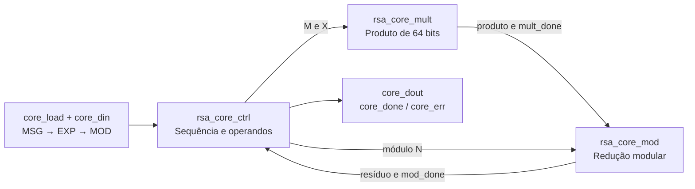

# `rsa_core` — Exponenciação modular de 32 bits

## 1. Objetivo

Calcular a exponenciação modular da mensagem, usando o expoente e o módulo recebidos sequencialmente em core_din. O núcleo reúne controle, multiplicação e redução modular e entrega core_dout com sinalização de conclusão ou erro.

## 2. Organização interna

## 3. Interface

`core_clk` é o clock; `core_rst` tem nível ativo definido por RESET (padrão 1).
`core_load` tem nível ativo definido por LOAD (padrão 1). O controle espera a
desativação de LOAD entre a captura da mensagem, do expoente e do módulo.
O wrapper deve usar `LOAD_GAP >= 1` com este núcleo.

| Bloco no arquivo rsa_core_32.sv | Responsabilidade |
|---|---|
| rsa_core_ctrl | Capturar M/e/N, iniciar operações e emitir DONE/ERROR |
| rsa_core_mult | Multiplicação por deslocamentos e somas |
| rsa_core_mod | Redução por comparação, subtração e deslocamentos |
| rsa_core | Interligar os três blocos e expor a interface do núcleo |

## 4. Algoritmo e resultados

O controle usa multiplicações modulares sucessivas; a latência depende do
expoente e dos caminhos percorridos pelo multiplicador e redutor. Expoente
zero e expoente um possuem caminhos próprios. Módulo zero é tratado como
erro pelo controle. O sinal mod_err do redutor não é conectado à saída
core_err no integrador atual.

## 5. Verificação no periférico

A bancada integrada aplica dez vetores com módulo não nulo, incluindo mensagem
zero/um, expoente zero/um, mensagem maior que módulo e operandos com bit 31
ativo. RESULT é comparado com exponenciação binária modular na bancada e os
vetores também foram conferidos com pow(M, e, N) em Python. A aprovação desses
vetores não representa cobertura exaustiva do espaço de 32 bits.
